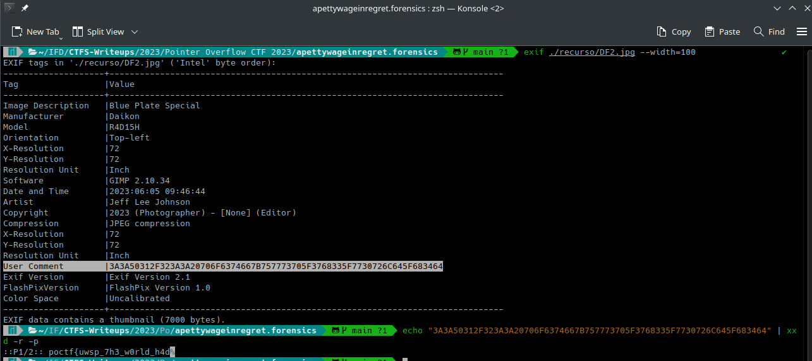
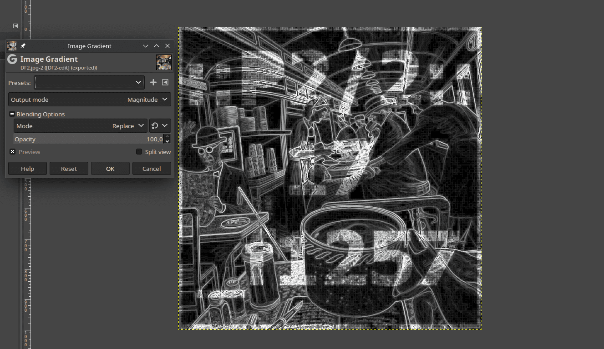
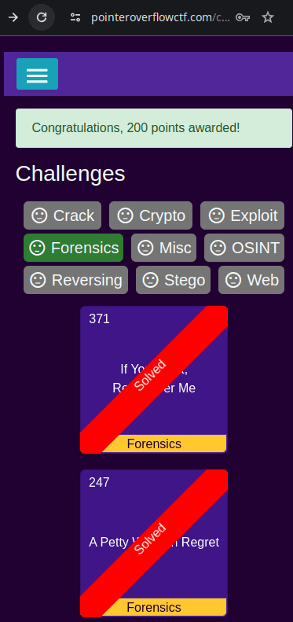

# A Petty Wage in Regret

**Category:** Forensics
**Challenge:** A Petty Wage in Regret
**CTF:** Pointer Overflow CTF 2023
**Result:** Solved (reference)

**Flag:**

~~~text
poctf{uwsp_7h3_w0rld_h4d_17_f1257}
~~~

---

## 1. Reconnaissance

The challenge provides a JPEG image (`DF2.jpg`). The flag is broken into several parts and embedded within it, requiring a variety of techniques to reassemble.

---

## 2. Part 1: EXIF Metadata

Using `exif` or `exiftool` to inspect the image metadata:

~~~bash
exiftool DF2.jpg
~~~

The `User Comment` field contains hex-encoded data:

~~~text
3A3A50312F323A3A20706F6374667B757773705F3768335F7730726C645F683464
~~~

Decoding with `xxd`:

~~~bash
echo -n "3A3A50312F323A3A20706F6374667B757773705F3768335F7730726C645F683464" | xxd -r -p
# Output: ::P1/2:: poctf{uwsp_7h3_w0rld_h4d
~~~

The `::P1/2::` prefix indicates this is part 1 of 2.

---

## 3. Part 2: Visual Steganography

The image itself contains barely visible characters. Applying an image gradient filter (e.g., in GIMP: Filters > Edge Detect > Image Gradient) reveals:

~~~text
::P2/2::
17
_f1257
~~~

So the second fragment is `_17_f1257`.

---

## 4. Flag Assembly

Concatenating part 1 and part 2:

~~~text
poctf{uwsp_7h3_w0rld_h4d + _17_f1257}
= poctf{uwsp_7h3_w0rld_h4d_17_f1257}
~~~

The leetspeak reads: "the world had it first."

---

## 5. Attack Path Summary

~~~text
DF2.jpg
    |
EXIF User Comment -> hex decode -> Part 1: poctf{uwsp_7h3_w0rld_h4d
    |
Image gradient filter -> Part 2: _17_f1257
    |
Concatenate -> FLAG
~~~

---

## 6. Lessons Learned

| # | Finding | Real-World Relevance | Key Takeaway |
|---|---------|---------------------|--------------|
| 1 | EXIF metadata can carry hex-encoded flag fragments | Threat actors use EXIF fields for C2 communication and data exfiltration in real campaigns (APT29 has embedded payloads in image metadata) | Always inspect all metadata fields beyond the obvious ones |
| 2 | Barely visible text in images requires edge detection filters | Visual steganography is used to hide messages in corporate documents and social media images | GIMP Image Gradient or similar filters reveal hidden content invisible to the naked eye |
| 3 | Multi-part flags use `::P1/N::` notation | Fragmented data exfiltration across multiple channels is a common technique to evade DLP | Look for part indicators to know when you have all pieces |

---

## MITRE ATT&CK Mapping

| Phase | Tactic | Technique | TTP-ID |
|-------|--------|-----------|--------|
| Defense Evasion | TA0005 | Obfuscated Files or Information: Steganography | T1027.003 |
| Collection | TA0009 | Data from Local System | T1005 |
| Exfiltration | TA0010 | Data Obfuscation: Steganography | T1001.002 |
| Command and Control | TA0011 | Data Encoding: Standard Encoding | T1132.001 |

> MITRE ATT&CK: https://attack.mitre.org/

---

## Remediation and Containment

### Technical Fixes

1. Strip EXIF metadata from images before sharing externally using tools like `exiftool -all=` or automated pipelines
2. Implement content inspection on outbound traffic to detect steganographic patterns in image files
3. Deploy DLP solutions that scan image metadata fields for encoded data
4. Use allowlisting for image processing tools to prevent unauthorized steganography software

### MITRE D3FEND Countermeasures

- **D3-DA Data Analysis** for detecting steganographic content in image files (counters T1027.003)
- **D3-OAM Outbound Traffic Analysis** to identify data exfiltration via steganography (counters T1001.002)
- **D3-FCR File Content Rules** to inspect metadata fields for encoded payloads (counters T1132.001)

### NIST CSF 2.0

- **Protect (PR.DS-5):** Protections against data leaks are implemented, including metadata stripping on outbound images
- **Detect (DE.CM-1):** The network is monitored to detect potential steganographic exfiltration
- **Respond (RS.MI-1):** Incidents are mitigated by stripping metadata and blocking steganographic channels

### NIST SP 800-53 Rev. 5

- **SC-7: Boundary Protection** (inspect outbound image traffic for hidden data)
- **SI-3: Malicious Code Protection** (detect steganographic tools and encoded payloads)
- **AU-13: Monitoring for Information Disclosure** (monitor for data hidden in image metadata)

---

Thanks guys!! (❍ᴥ❍ʋ)

---

EXIF metadata hides way more than most people expect, and combining it with visual steganography makes for a sneaky multi-layered challenge. If this forensics breakdown helped you see what is really inside your images, pass it along and connect with me.

- Instagram: https://www.instagram.com/uniaogeek
- LinkedIn: http://linkedin.com/in/mrhenrike
- X: https://x.com/mrhenrike
