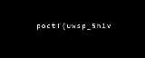
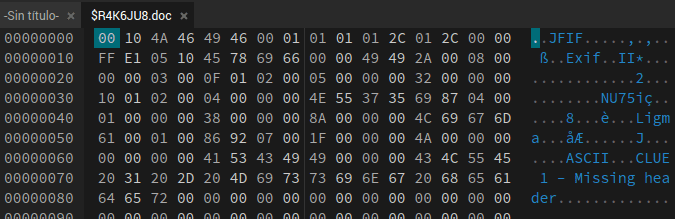
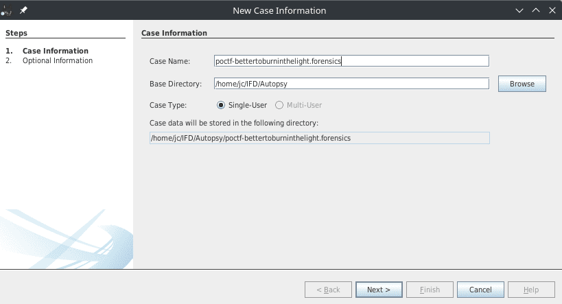
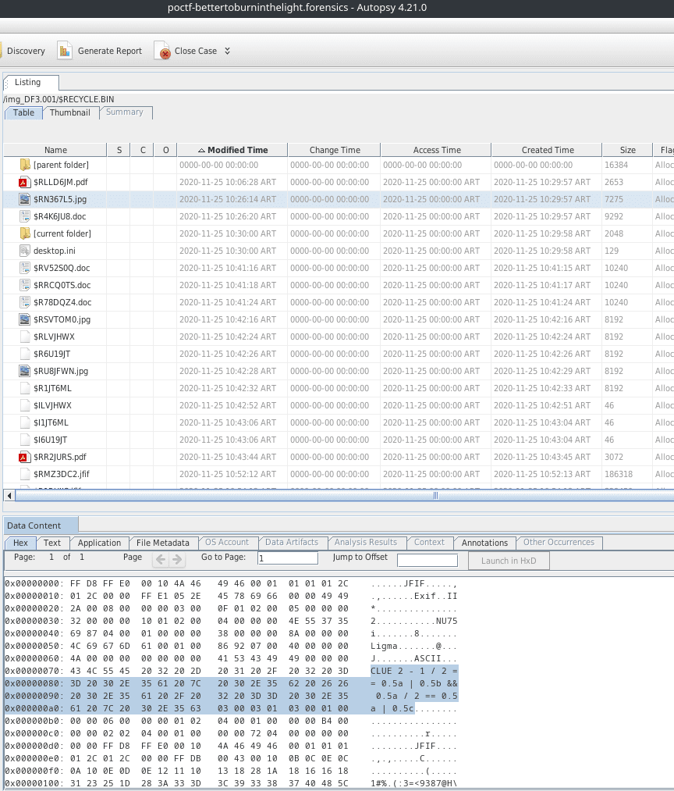
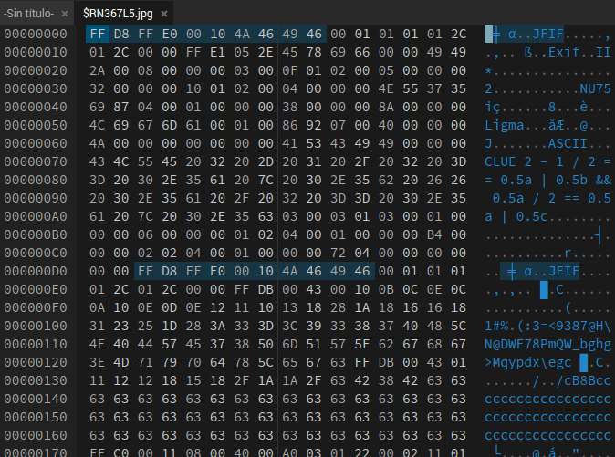
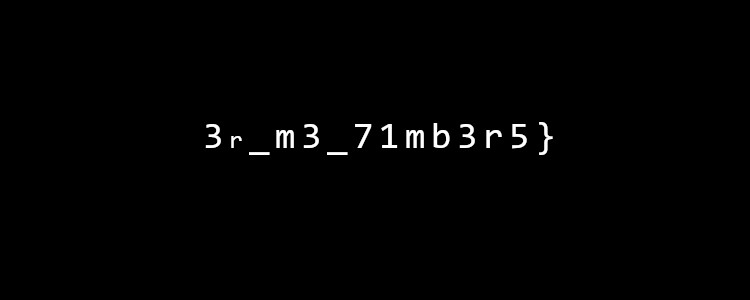
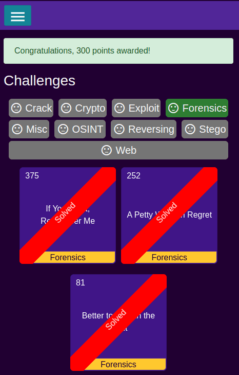

# Better to Burn in the Light

| Detail | Value |
|--------|-------|
| **CTF** | Pointer Overflow CTF 2023 |
| **Category** | Digital Forensics |
| **Difficulty** | Hard |
| **Points** | 300 |
| **Flag** | `poctf{dynamic}` |
~~~

### File 2: Missing Header JPEG

A second file also contains `CLUE` in its metadata. The hint is "missing header". Adding the 4-byte JPEG magic header `FF D8 FF E0` at the beginning restores the image, which shows:

~~~text
3r_m3_71mb3r5}` |
| **Status** | Solved (reference) |

---

## 1. Reconnaissance

The challenge provides a disk image file (`DF3.001`). The description states that several files were deleted before imaging, and the flag is split between two of them. We need to carve and restore the files.

~~~bash
file DF3.001
# DF3.001: DOS/MBR boot sector
~~~

---

## 2. Disk Analysis with Autopsy

Loading the disk image into Autopsy and browsing the file system reveals a `$RECYCLE.BIN` directory. The deleted files are still recoverable from the recycle bin.

After creating the case and adding the data source, we can navigate the file tree to find the deleted artifacts.

### File 1: Broken JPEG

Inspecting the hex dump of one recovered file reveals the word `CLUE` in the EXIF metadata. The file contains two Start of Image (SOI) markers (`FF D8 FF E0`). After removing the first SOI marker with a hex editor, the image reveals:

~~~text
poctf{uwsp_5h1v
~~~

### File 2: Missing Header JPEG

A second file also contains `CLUE` in its metadata. The hint is "missing header". Adding the 4-byte JPEG magic header `FF D8 FF E0` at the beginning restores the image, which shows:

~~~text
3r_m3_71mb3r5}
~~~

---

## 3. Flag Assembly

Concatenating both parts:

~~~text
poctf{uwsp_5h1v3r_m3_71mb3r5}
~~~

Leetspeak for "shiver me timbers."

---

## 4. Attack Path Summary

~~~text
Load DF3.001 disk image in Autopsy
    |
Browse $RECYCLE.BIN for deleted files
    |
File 1: Remove duplicate SOI marker -> Part 1 of flag
    |
File 2: Add missing JPEG header -> Part 2 of flag
    |
Concatenate both parts -> FLAG
~~~

---

## 5. Lessons Learned

| # | Finding | Real-World Relevance | Key Takeaway |
|---|---------|---------------------|--------------|
| 1 | Deleted files persist in disk images | File carving from $RECYCLE.BIN is a standard forensic technique used in incident response and legal discovery | Always image the full disk, including unallocated space, before analysis |
| 2 | Corrupted JPEG headers hide data | Attackers manipulate file headers to evade detection by file-type scanners and antivirus | Always check hex dumps for duplicate or missing magic bytes |
| 3 | EXIF metadata can contain clues | EXIF fields are commonly used for data exfiltration and steganographic channels in real attacks | Inspect all metadata fields beyond the obvious ones during forensic analysis |

---

## MITRE ATT&CK Mapping

| Phase | Tactic | Technique | TTP-ID |
|-------|--------|-----------|--------|
| Defense Evasion | TA0005 | Indicator Removal: File Deletion | T1070.004 |
| Defense Evasion | TA0005 | Obfuscated Files or Information | T1027 |
| Collection | TA0009 | Data from Local System | T1005 |
| Exfiltration | TA0010 | Data Obfuscation: Steganography | T1001.002 |

> MITRE ATT&CK: https://attack.mitre.org/

---

## Remediation and Containment

### Technical Fixes

1. Enable secure file deletion policies that overwrite data on disk rather than just removing directory entries
2. Implement File Integrity Monitoring (FIM) to detect unauthorized file modifications or deletions
3. Deploy endpoint detection that monitors $RECYCLE.BIN and temporary directories for suspicious file operations
4. Use disk encryption (BitLocker, LUKS) to protect data at rest from offline disk image analysis

### MITRE D3FEND Countermeasures

- **D3-FE File Encryption** to protect data at rest from offline analysis (counters T1005)
- **D3-FRAA File Removal Auditing and Analysis** to detect indicator removal via file deletion (counters T1070.004)
- **D3-DA Data Analysis** for detecting obfuscated file content (counters T1027)

### NIST CSF 2.0

- **Protect (PR.DS-1):** Data-at-rest is protected with encryption to prevent unauthorized access from disk images
- **Detect (DE.CM-4):** Malicious code and file manipulation are detected through file integrity monitoring
- **Respond (RS.AN-1):** Notifications from detection systems are investigated using forensic tools like Autopsy

### NIST SP 800-53 Rev. 5

- **SC-28: Protection of Information at Rest** (disk encryption prevents offline extraction)
- **AU-6: Audit Record Review, Analysis, and Reporting** (detect file deletion and manipulation)
- **SI-4: System Monitoring** (monitor recycle bin and temp directories for anomalous activity)
- **MP-6: Media Sanitization** (secure deletion prevents data recovery from decommissioned media)

---

Thanks guys!! (❍ᴥ❍ʋ)

---

File carving from disk images is bread and butter for any forensics analyst, and this challenge nails the fundamentals: deleted does not mean gone, and corrupted headers are just a puzzle waiting for a hex editor. If this walkthrough helped sharpen your forensic skills, share it with your study group.

- Instagram: https://www.instagram.com/uniaogeek
- LinkedIn: http://linkedin.com/in/mrhenrike
- X: https://x.com/mrhenrike
