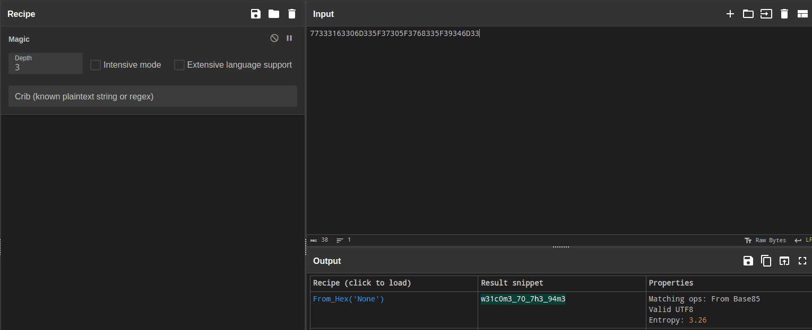
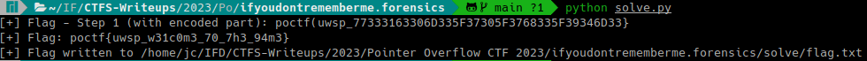

# If You Don't, Remember Me

**Category:** Forensics
**Challenge:** If You Don't, Remember Me
**CTF:** Pointer Overflow CTF 2023
**Result:** Solved (reference)

**Flag:**

~~~text
poctf{uwsp_w31c0m3_70_7h3_94m3}
~~~

---

## 1. Reconnaissance

The challenge provides a PDF file (`DF1.pdf`) described as having "some problems." The flag is inside it but partially encoded, requiring a two-step extraction.

---

## 2. Step 1: String Extraction

Using `strings` with a grep for the known flag format:

~~~bash
strings DF1.pdf | grep poctf
~~~

Output:

~~~text
poctf(uwsp_77333163306D335F37305F3768335F39346D33}
~~~

Note the opening parenthesis `(` instead of `{`, which is a red herring from the PDF structure. The actual flag starts with `poctf{`.

The second portion `77333163306D335F37305F3768335F39346D33` appears to be hex-encoded ASCII.

---

## 3. Step 2: Hex Decoding

~~~bash
echo -n "77333163306D335F37305F3768335F39346D33" | xxd -r -p
# Output: w31c0m3_70_7h3_94m3
~~~

---

## 4. Flag Assembly

Combining the prefix with the decoded portion:

~~~text
poctf{uwsp_w31c0m3_70_7h3_94m3}
~~~

The leetspeak translates to "welcome to the game."

---

## 5. Attack Path Summary

~~~text
DF1.pdf
    |
strings | grep poctf -> raw flag with hex payload
    |
xxd -r -p -> decode hex portion
    |
Assemble -> FLAG
~~~

---

## 6. Lessons Learned

| # | Finding | Key Takeaway |
|---|---|---|
| 1 | `strings` is the first tool for flag hunting in binary/PDF files | Always grep for the flag format first |
| 2 | Hex-encoded ASCII is a common CTF encoding layer | Recognize 40-char hex as potential ASCII when character pairs are in 0x20-0x7E range |
| 3 | PDF structure can mangle flag delimiters | Don't trust parentheses in PDF; verify the actual format |

---

## 7. MITRE ATT&CK Mapping

| Tactic | Technique | TTP-ID |
|--------|-----------|--------|
| Collection | Data from Local System | T1005 |
| Defense Evasion | Obfuscated Files or Information | T1027 |
| Defense Evasion | Deobfuscate/Decode Files or Information | T1140 |

> MITRE ATT&CK: https://attack.mitre.org/

---

## 8. Remediation and Containment

### Technical Fixes

1. Apply PDF sanitization on all incoming documents: strip embedded scripts, metadata and encoded payloads before allowing user access
2. Deploy content disarm and reconstruction (CDR) solutions to neutralize potentially malicious document structures
3. Enforce DLP rules that flag documents containing encoded or obfuscated content patterns (hex strings, Base64 blocks)

### MITRE D3FEND Countermeasures

- **D3-FE (File Encryption):** encrypt sensitive files at rest so extracted strings yield no useful data
- **D3-DA (Dynamic Analysis):** sandbox incoming PDFs and inspect runtime behavior before delivery
- **D3-FCR (File Content Rules):** apply YARA or similar rules to detect encoded payloads in document metadata

### NIST CSF 2.0

- **Protect (PR.DS):** protect data at rest with encryption, preventing trivial extraction via `strings`
- **Detect (DE.CM):** monitor for anomalous document structures that may carry hidden data

### NIST SP 800-53 Rev. 5

- **SI-3 (Malicious Code Protection):** scan documents for embedded encoded payloads
- **SC-28 (Protection of Information at Rest):** encrypt sensitive data so string extraction is ineffective
- **SI-4 (System Monitoring):** detect anomalous file structures that could indicate data exfiltration via steganographic channels

---

Thanks guys!! (❍ᴥ❍ʋ)

---

PDF forensics is one of those skills that transfers directly to real-world incident response. If this hex decoding walkthrough helped you level up your extraction game, share it with your study group!

- Instagram: https://www.instagram.com/uniaogeek
- LinkedIn: http://linkedin.com/in/mrhenrike
- X: https://x.com/mrhenrike
