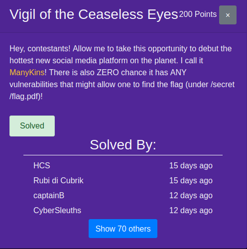
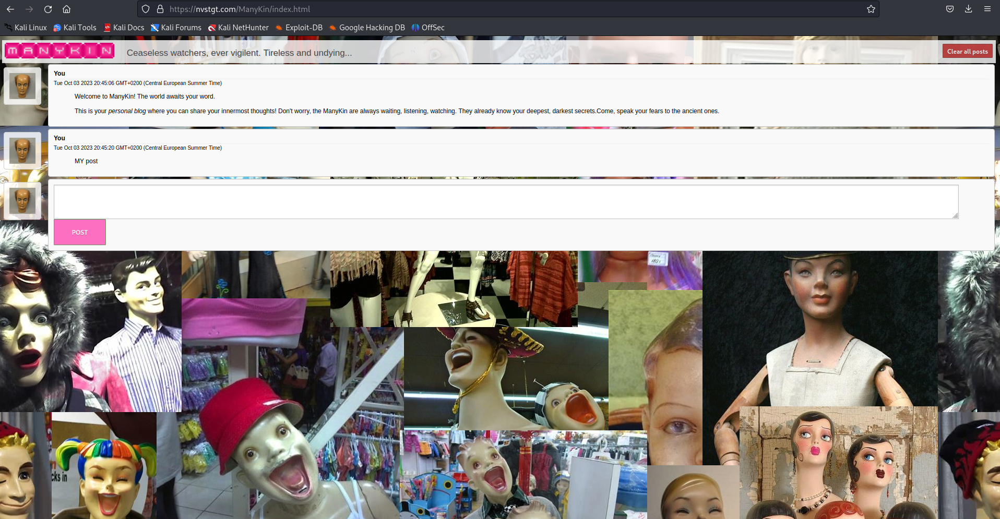
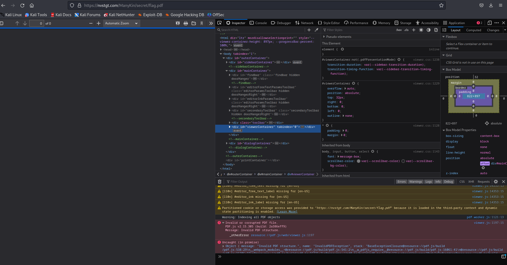
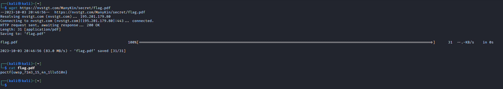

# Vigil of the Ceaseless Eyes

| Detail | Value |
|--------|-------|
| **CTF** | Pointer Overflow CTF 2023 |
| **Category** | Web Exploitation |
| **Difficulty** | Medium |
| **Points** | 200 |
| **Flag** | `poctf{dynamic}` |
| **Status** | Solved |

---

## 1. Challenge Overview

The challenge presents a web application with a hidden flag located at `secret/flag.pdf`. The goal is to access this file directly through the browser by circumventing the expected content type.

---

## 2. Initial Reconnaissance

Upon accessing the web application, we explore the interface and note the available functionality:

The challenge description mentions that the flag is stored at `secret/flag.pdf`. This is a direct hint to try accessing the file path through the URL.

---

## 3. Accessing the Hidden File

### Attempt 1: Direct PDF Access

Navigating to `secret/flag.pdf` in the browser returns an error indicating the content is not in PDF format:

### Attempt 2: Accessing as Plain Text

Since the file exists but is not actually a PDF, we use `wget` or simply access it as plain text. Fetching the resource and reading its raw content reveals the flag:

~~~bash
wget https://<target>/secret/flag.pdf
cat flag.pdf
~~~

Alternatively, using the browser to view the source or download the file reveals the flag embedded as plaintext:

---

## 4. Attack Path Summary

~~~text
Web application with hidden file
    |
Challenge hint: "secret/flag.pdf"
    |
Direct URL access -> content type error
    |
Access as plaintext (wget/view-source) -> FLAG
~~~

---

## 5. Lessons Learned

| # | Finding | Real-World Relevance | Key Takeaway |
|---|---------|---------------------|--------------|
| 1 | Sensitive file paths disclosed in challenge descriptions | Real applications leak internal paths through error messages, comments, and documentation | Never disclose internal file paths in user-facing content |
| 2 | File extension does not guarantee content type | A `.pdf` file may contain plaintext, a `.jpg` may contain PHP code | Validate file content by magic bytes, not just extension |
| 3 | Direct object reference allows file access | Without authentication or authorization checks, any known path is accessible | Implement proper access controls on all sensitive resources |

---

## MITRE ATT&CK Mapping

| Phase | Tactic | Technique | TTP-ID |
|-------|--------|-----------|--------|
| Reconnaissance | TA0043 | Gather Victim Host Information | T1592 |
| Initial Access | TA0001 | Exploit Public-Facing Application | T1190 |
| Collection | TA0009 | Data from Information Repositories | T1213 |

> MITRE ATT&CK: https://attack.mitre.org/

---

## Remediation and Containment

### Technical Fixes

1. Never store sensitive files in web-accessible directories; place them outside the document root
2. Implement proper authentication and authorization before serving any sensitive content
3. Configure the web server to deny direct access to sensitive directories (`Deny from all` or equivalent)
4. Use Content-Type headers correctly and validate file content matches its declared type

### OWASP Top 10 2021

- **A01:2021 Broken Access Control:** The sensitive file is accessible without any authentication or authorization checks
- **A05:2021 Security Misconfiguration:** Web server allows direct browsing to sensitive file paths

### MITRE D3FEND Countermeasures

- **D3-ACL Access Control List** to restrict access to sensitive files and directories (counters T1190)
- **D3-UAM URL Analysis** to detect direct access attempts to known sensitive paths (counters T1213)

### NIST CSF 2.0

- **Protect (PR.AC-4):** Access permissions and authorizations are managed for all resources
- **Protect (PR.PT-3):** The principle of least functionality is applied to web server configuration

### NIST SP 800-53 Rev. 5

- **AC-3: Access Enforcement** (enforce authorization before serving sensitive files)
- **CM-7: Least Functionality** (disable directory browsing and restrict accessible paths)

### CWE

- **CWE-552: Files or Directories Accessible to External Parties** (sensitive file reachable via URL)
- **CWE-200: Exposure of Sensitive Information** (flag content accessible without authentication)

---

## References

- Based on solve approach from [chris-devel0per](https://github.com/chris-devel0per/UWSP-Pointer-Overflow-CTF)

---

Thanks guys!! (❍ᴥ❍ʋ)

---

Sometimes the ceaseless eyes are watching, but they forgot to lock the door. Direct object access remains one of the most common web vulnerabilities, so never assume a path is safe just because it is not linked. Stay curious and share this walkthrough if it helped.

- Instagram: https://www.instagram.com/uniaogeek
- LinkedIn: http://linkedin.com/in/mrhenrike
- X: https://x.com/mrhenrike
