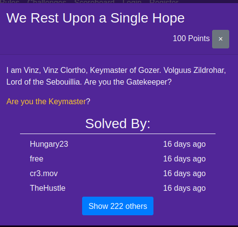
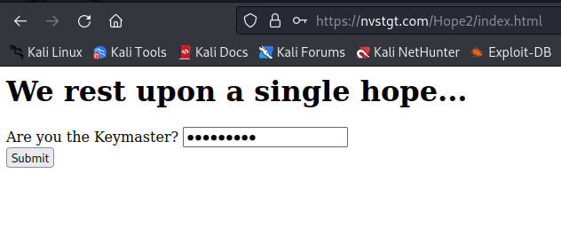
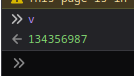

# We Rest Upon a Single Hope

| Detail | Value |
|--------|-------|
| **CTF** | Pointer Overflow CTF 2023 |
| **Category** | Web Exploitation |
| **Difficulty** | Easy |
| **Points** | 100 |
| **Flag** | `poctf{uwsp_1_4m_all_7h47_r3m41n5_0f_7h3_d0s7_r3m0v3}` |
| **Status** | Solved |

---

## 1. Challenge Overview

The challenge presents a web application that requires a secret key to reveal the flag. The key validation is implemented entirely in client-side JavaScript, making it trivially bypassable by inspecting the source code.

---

## 2. Initial Reconnaissance

Upon accessing the application, we see a form that accepts a key via a GET parameter:

The key is submitted through the URL:

~~~text
https://nvstgt.com/Hope2/index.html?key=testkey
~~~

Since the application consists of only HTML and JavaScript (no server-side processing), the entire validation logic is exposed in the browser.

---

## 3. Analyzing the JavaScript

Inspecting the source code reveals several functions:

- `Gozer(key)`: A hash function that computes a numeric hash from the input string
- `conv(s)`: Converts a string to its hex representation
- `Zuul(key)`: The main validation function that checks if the submitted key equals `v`

The variable `v` is computed from browser fingerprint values:

~~~javascript
var p = navigator.mimeTypes + navigator.doNotTrack;
var o = navigator.deviceMemory;
var c = navigator.vendor + navigator.userAgent;
var t = navigator.product + p;
var f = o + c + p;
var v = Gozer(p / ((o + c) * t) + f);
~~~

If the key matches `v`, the `Zuul` function constructs the flag from hex-encoded and array-computed fragments.

---

## 4. Finding the Key

Instead of reverse-engineering the hash computation, we simply query the value of `v` in the browser's developer console:

~~~javascript
console.log(v);
// Output: 134356987
~~~

---

## 5. Submitting the Key

Entering `134356987` as the key triggers the `Zuul` function, which computes and logs the flag to the console:

~~~text
https://nvstgt.com/Hope2/index.html?key=134356987
~~~

The flag is printed in the browser console by `console.log(z.join("_"))`.

---

## 6. Flag Reconstruction

The `Zuul` function builds the flag from:

- `Gatekeeper[0]` = hex-encoded `poctf{uwsp`
- Various array manipulations using characters from `Gatekeeper[1]` ("formal") and `Gatekeeper[2]` ("88410")
- Arithmetic operations to produce leetspeak characters

The final output after joining with underscores produces the flag.

---

## 7. Attack Path Summary

~~~text
Web application with client-side key validation
    |
View page source -> JavaScript logic exposed
    |
Browser console: console.log(v) -> key = 134356987
    |
Submit key -> Zuul() constructs flag
    |
Console output -> FLAG
~~~

The flag reads as a Ghostbusters reference combined with leetspeak.

---

## 8. Lessons Learned

| # | Finding | Real-World Relevance | Key Takeaway |
|---|---------|---------------------|--------------|
| 1 | Client-side validation provides zero security | Web apps that validate secrets in JavaScript expose the entire logic to any user with DevTools | Always perform authentication and authorization on the server side |
| 2 | Browser fingerprint-based keys are deterministic | Computing `v` from browser properties makes the key reproducible and queryable | Never use client-side computed values as security tokens |
| 3 | Obfuscated JavaScript is still readable | The Ghostbusters-themed function names add confusion but not security | JavaScript obfuscation is a speed bump, not a barrier; assume all client code is public |

---

## MITRE ATT&CK Mapping

| Phase | Tactic | Technique | TTP-ID |
|-------|--------|-----------|--------|
| Reconnaissance | TA0043 | Search Victim-Owned Websites | T1594 |
| Initial Access | TA0001 | Exploit Public-Facing Application | T1190 |
| Credential Access | TA0006 | Steal Application Access Token | T1528 |
| Defense Evasion | TA0005 | Obfuscated Files or Information | T1027 |

> MITRE ATT&CK: https://attack.mitre.org/

---

## Remediation and Containment

### Technical Fixes

1. Move all authentication and secret validation logic to the server side
2. Never embed secrets, flags, or sensitive tokens in client-side JavaScript
3. If client-side validation is needed for UX, always re-validate on the server before granting access
4. Use proper obfuscation and code splitting if JavaScript must contain sensitive logic (while understanding this is not true security)

### OWASP Top 10 2021

- **A01:2021 Broken Access Control:** Authentication logic implemented client-side, trivially bypassable
- **A07:2021 Identification and Authentication Failures:** Key validation in JavaScript provides no real authentication

### MITRE D3FEND Countermeasures

- **D3-SPP Server-Side Input Validation** to enforce validation on the server, not the client (counters T1190)
- **D3-OAM Obfuscation Analysis** for understanding that obfuscation does not equal security (counters T1027)

### NIST CSF 2.0

- **Protect (PR.AC-7):** Authentication mechanisms are commensurate with the sensitivity of the data
- **Protect (PR.PT-3):** Least functionality: do not expose validation logic in client-side code

### NIST SP 800-53 Rev. 5

- **IA-2: Identification and Authentication** (implement server-side authentication)
- **SC-12: Cryptographic Key Establishment** (do not derive keys from predictable browser properties)

### CWE

- **CWE-602: Client-Side Enforcement of Server-Side Security** (all validation in JavaScript)
- **CWE-798: Use of Hard-coded Credentials** (flag construction logic embedded in client code)

---

## References

- Based on solve approach from [chris-devel0per](https://github.com/chris-devel0per/UWSP-Pointer-Overflow-CTF)

---

Thanks guys!! (❍ᴥ❍ʋ)

---

Client-side JavaScript secrets are about as secure as writing your password on a sticky note and taping it to the monitor. If this Ghostbusters-themed walkthrough made you smile while you learned, share it with fellow challengers.

- Instagram: https://www.instagram.com/uniaogeek
- LinkedIn: http://linkedin.com/in/mrhenrike
- X: https://x.com/mrhenrike
