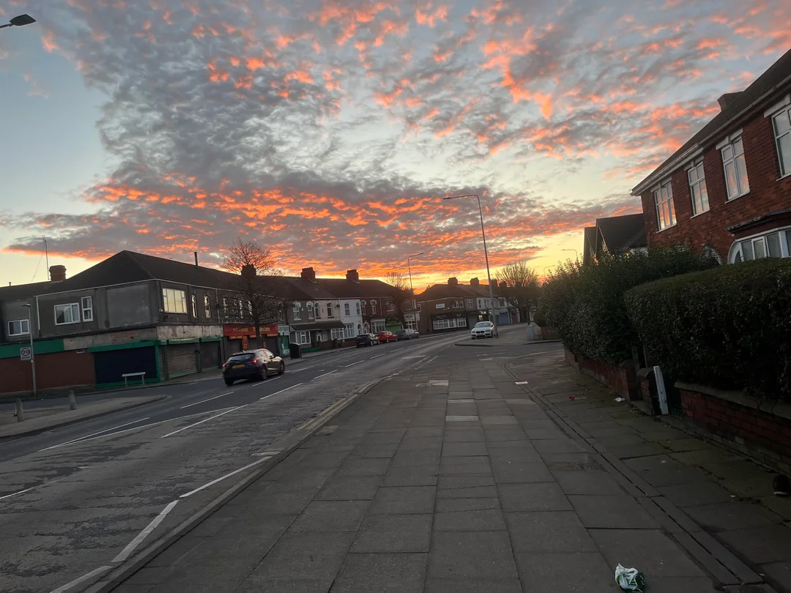
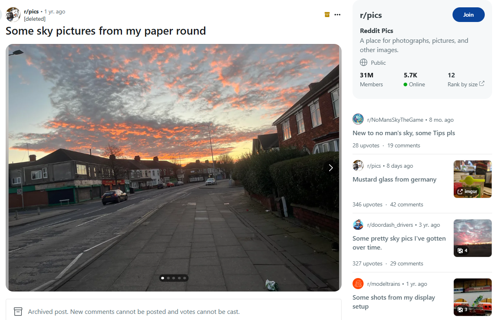
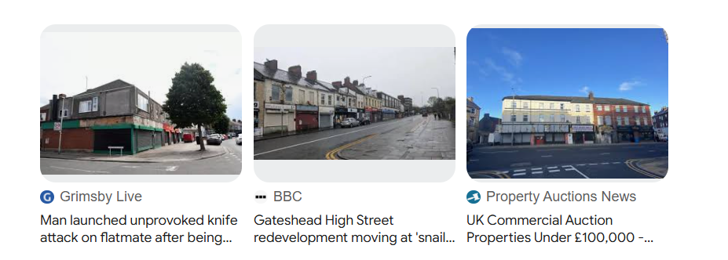
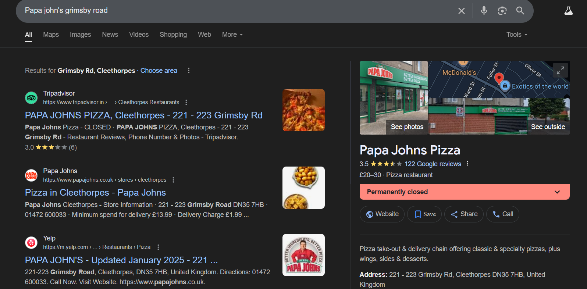
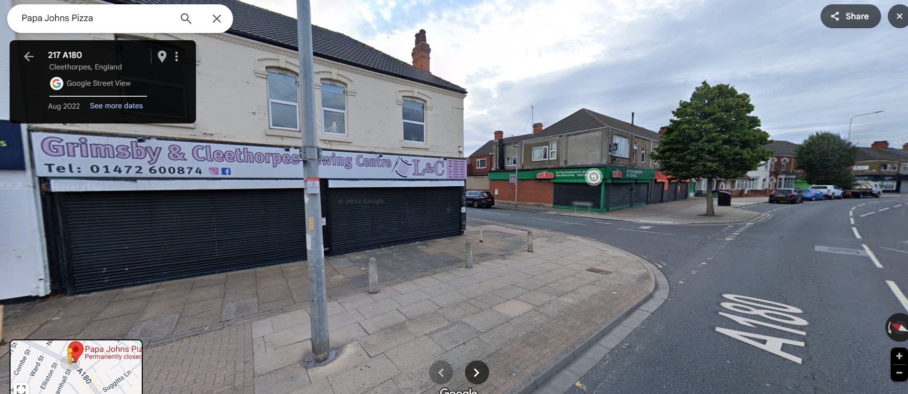

# A Tangle a Jingle

| Detail | Value |
|--------|-------|
| **CTF** | Pointer Overflow CTF 2024 |
| **Category** | Relevance |
| **Difficulty** | Unknown |
| **Points** | N/A |
| **Flag** | `poctf{uwsp_1_h4v3_4_dr34m}` |
| **Status** | Solved |

---

## Challenge Overview

A geolocation challenge involving two different image sets. The first involves tracking down a location from a social media post using architectural features and reverse image search. The phone number on a nearby business sign serves as the archive password.

## Objective

Geolocate the photographed location using reverse image search and Google Street View, find a business phone number near the identified spot, and use it to unlock the flag archive.

## Methodology

### Step 1: Reverse Image Search

The provided image shows a distinctive street scene with bollards and a building on the corner.



Reverse image lookup led to a Reddit post with related images showing different angles of the same location.



### Step 2: Narrow the Location

By isolating architectural features in the background, found an article mentioning a former **Papa John's takeaway** on **Grimsby Road** in the UK.



### Step 3: Pinpoint with Street View

Searched for the Papa John's location on Grimsby Road in Google Maps. Using Street View, confirmed the exact spot matching the original image.



### Step 4: Find the Phone Number

Following the challenge instructions ("a business just out of frame, across the street from the building on the corner, to the left of the bollards"), located the business sign with a visible phone number.



### Step 5: Unlock the Archive

Entered the phone number (without spaces or special characters) as the password for the ZIP archive.

```
Flag: poctf{uwsp_1_h4v3_4_dr34m}
```

## Lessons Learned

| # | Lesson | Details |
|---|--------|---------|
| 1 | Partial image search | Isolating specific parts of an image can yield better reverse search results |
| 2 | Street View time travel | Google Street View's historical imagery can show businesses that no longer exist |
| 3 | Directional clues | Challenge descriptions often give precise spatial directions ("across the street", "to the left of") |
| 4 | UK geolocation cues | Road markings, signage style, and bollard types help narrow to UK locations |

## MITRE ATT&CK Mapping

| Tactic | Technique | ID | Details |
|--------|-----------|-----|---------|
| Reconnaissance | Search Open Websites/Domains | T1593 | Reverse image search on Reddit and Google |
| Reconnaissance | Gather Victim Org Information: Physical Locations | T1591.001 | Geolocating the exact street and business |

## Remediation

### Technical Fixes

- Social media posts with identifiable locations enable geolocation
- Strip EXIF data and consider blurring distinctive landmarks before posting
- Phone numbers visible on business signage are public but should not be used as secrets

### MITRE D3FEND

| Technique | ID | How it applies |
|-----------|-----|----------------|
| Credential Hardening | D3-CH | Never derive passwords from publicly visible information |

### NIST CSF 2.0

| Function | Category | Relevance |
|----------|----------|-----------|
| Identify (ID) | Asset Management (ID.AM) | Understand what location data social media posts reveal |

### NIST SP 800-53 Rev. 5

| Control | Description |
|---------|-------------|
| IA-5 | Authenticator Management: do not use publicly visible data as passwords |

### CWE

| CWE ID | Name | Relevance |
|--------|------|-----------|
| CWE-521 | Weak Password Requirements | Public phone number used as archive password |

## References

- [UWSP Pointer Overflow CTF 2024](https://pointeroverflowctf.com)
- Based on solve approach from [shivang1209-dot](https://github.com/shivang1209-dot/CTF-Writeup)

---

Thanks guys!! (❍ᴥ❍ʋ)

OSINT is a jigsaw puzzle. Each piece of information constrains the solution space until only one answer remains.

[](https://www.instagram.com/uniaogeek)
[](http://linkedin.com/in/mrhenrike)
[](https://x.com/mrhenrike)
