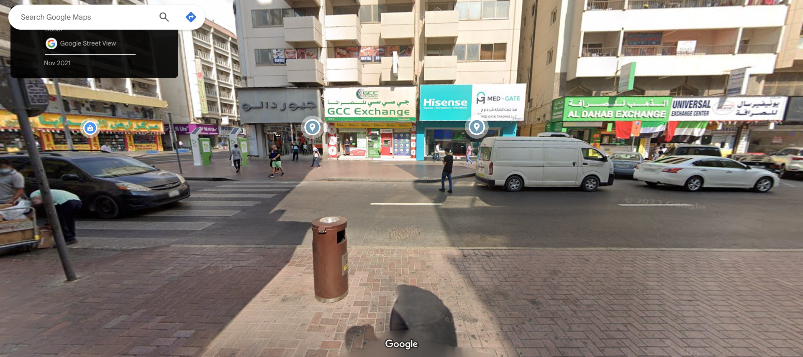
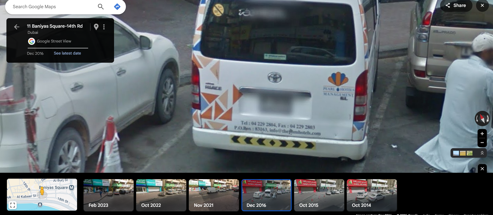

# Down Like This

| Property | Value |
|----------|-------|
| **CTF** | Pointer Overflow CTF 2024 (UWSP) |
| **Category** | OSINT |
| **Difficulty** | Hard |
| **Points** | 300 |
| **Status** | Solved |

## Challenge Overview

A geolocation challenge centered on a street photograph with distinctive foreign-language signage. The goal is to identify the location, then use Google Street View's historical imagery to find a white van with a fax number, which serves as the archive password.

## Objective

Geolocate the street scene, navigate to the historical Street View imagery, find the fax number on a parked white van, and use it to unlock the flag archive.

## Methodology

### Step 1: Analyze the Image

The provided photograph shows a street with distinctive characteristics:


Key observations:
- Non-Latin script on signage
- Bikes left unsecured near an ATM
- Specific telephone number format
- Privacy screen on one ATM but not another

### Step 2: Reverse Image Search

A reverse image lookup on Google found the exact Street View location.



### Step 3: Navigate Historical Street View

The description mentions "we can sometimes go back in time" with Street View. Cycling through historical imagery of the location, the **December 2016** capture shows a white van parked on the street.

### Step 4: Read the Fax Number

The van's rear displays a fax number: `042292803`



### Step 5: Unlock the Archive

Using `042292803` as the password (numbers only, no spaces or special characters):

```
Flag: poctf{uwsp_7h3_4n5w3r_70_3v3ry7h1n6}
```

## Lessons Learned

| # | Lesson | Details |
|---|--------|---------|
| 1 | Street View time machine | Google Street View stores multiple captures over time; this is critical for OSINT investigations |
| 2 | Temporal OSINT | Information that no longer exists in the present may be preserved in historical imagery |
| 3 | Cultural indicators | Script type, phone number format, ATM design, and bicycle culture help identify countries |
| 4 | Vehicle as intelligence source | Parked vehicles may display phone numbers, company names, and other identifiable information |

## MITRE ATT&CK Mapping

| Tactic | Technique | ID | Details |
|--------|-----------|-----|---------|
| Reconnaissance | Search Open Websites/Domains | T1593 | Reverse image search and Street View exploration |
| Reconnaissance | Gather Victim Org Information: Physical Locations | T1591.001 | Geolocation and temporal navigation |
| Collection | Data from Information Repositories | T1213 | Historical Street View imagery as data source |

## Remediation

### Technical Fixes

- Historical satellite and street-level imagery creates a persistent record of locations
- Vehicles with visible contact information are indexed by mapping services
- Consider that archived imagery may reveal information no longer physically present

### MITRE D3FEND

| Technique | ID | How it applies |
|-----------|-----|----------------|
| Credential Hardening | D3-CH | Do not use publicly visible information (fax numbers, phone numbers) as passwords |

### NIST CSF 2.0

| Function | Category | Relevance |
|----------|----------|-----------|
| Identify (ID) | Asset Management (ID.AM) | Understand what information is preserved in public mapping services |

### NIST SP 800-53 Rev. 5

| Control | Description |
|---------|-------------|
| IA-5 | Authenticator Management: avoid publicly derivable secrets |

### CWE

| CWE ID | Name | Relevance |
|--------|------|-----------|
| CWE-521 | Weak Password Requirements | Publicly visible fax number used as password |

## References

- [UWSP Pointer Overflow CTF 2024](https://pointeroverflowctf.com)
- [Google Street View Historical Imagery](https://support.google.com/maps/answer/3093484)
- Based on solve approach from [shivang1209-dot](https://github.com/shivang1209-dot/CTF-Writeup)

---

Thanks guys!! (❍ᴥ❍ʋ)

Time travel is real, and Google Maps is the DeLorean. Historical Street View captures moments that have long since passed.

[](https://www.instagram.com/uniaogeek)
[](http://linkedin.com/in/mrhenrike)
[](https://x.com/mrhenrike)
