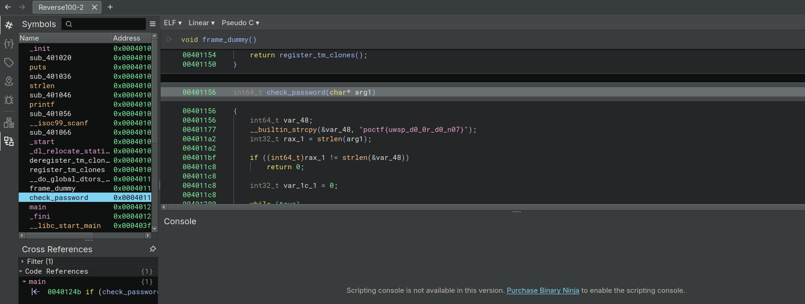

# End of the Line

| Detail | Value |
|--------|-------|
| **CTF** | Pointer Overflow CTF 2024 |
| **Category** | Reverse Engineering |
| **Difficulty** | Easy |
| **Points** | 100 |
| **Flag** | `poctf{uwsp_d0_0r_d0_n07}` |
| **Status** | Solved |

---

## 1. Challenge Overview

A beginner reverse engineering challenge recreating the author's very first CTF solve. The binary prompts for a password and checks it against a hardcoded value. The flag is the correct password.

**Files:** `Reverse100-2` (ELF binary)

---

## 2. Static Analysis

Loaded the ELF binary in Binary Ninja. The `main` function decompiles to:

~~~c
printf(format: "Enter the password: ")
__isoc99_scanf(format: "%99s", &var_78)

if (check_password(&var_78) == 0)
    puts(str: "Access denied!")
else
    puts(str: "Access granted!")
~~~

The `check_password` function performs a direct string comparison between the user input and the hardcoded flag.

---

## 3. Flag Extraction

The `check_password` function directly compares against the plaintext string `poctf{uwsp_d0_0r_d0_n07}`, visible in the decompiled output.

---

## Lessons Learned

| # | Lesson | Detail |
|---|--------|--------|
| 1 | Direct string comparisons expose secrets | Hardcoded passwords are visible in decompilers |
| 2 | Binary Ninja streamlines static analysis | Pseudocode view reveals logic immediately |
| 3 | Password-checking binaries are common CTF patterns | Always check `strcmp`/comparison functions first |

---

## MITRE ATT&CK Mapping

| Tactic | Technique | TTP-ID | Context |
|---|---|---|---|
| Credential Access | Unsecured Credentials: Credentials in Files | T1552.001 | Password hardcoded as plaintext in binary |
| Defense Evasion | Obfuscated Files or Information | T1027 | No obfuscation applied to the password comparison |
| Collection | Data from Local System | T1005 | Extracted credentials through static binary analysis |

> **CWE-798:** Use of Hard-coded Credentials. Password stored as plaintext string in the executable.
> **CWE-259:** Use of Hard-coded Password. Authentication relies on a static, extractable value.

---

## Remediation and Containment

### Technical Fixes

1. Hash passwords using bcrypt/scrypt/Argon2 and compare hashes instead of plaintext
2. Never embed authentication credentials directly in client-side binaries
3. Implement server-side authentication where the secret never leaves the server
4. If local validation is required, use challenge-response protocols

### MITRE D3FEND Countermeasures

- **D3-CH (Credential Hardening):** store only salted hashes, never plaintext passwords
- **D3-OBF (Obfuscation):** apply code and string obfuscation to raise analysis difficulty
- **D3-FCOA (File Content Analysis):** scan binaries for embedded credentials before distribution

### NIST CSF 2.0

- **Protect (PR.AC):** use proper cryptographic authentication, not plaintext comparison
- **Protect (PR.DS):** protect credentials at rest through hashing
- **Detect (DE.CM):** detect extraction attempts through anti-debug and integrity checks

### NIST SP 800-53 Rev. 5

- **IA-5 (Authenticator Management):** protect authenticators with cryptographic hashing
- **SC-28 (Protection of Information at Rest):** encrypt or hash all sensitive stored data
- **SA-15 (Development Process, Standards, and Tools):** scan for hardcoded secrets in build pipeline

### C2M2

- **ACCESS-3:** audit authentication implementations for hardcoded credentials
- **THREAT-2:** include binary analysis in security assessment methodology

---

Thanks guys!! (❍ᴥ❍ʋ)

---

Do or do not, there is no try. And with plaintext passwords in binaries, there is no security either. Every reverse engineer's origin story starts somewhere, and a simple `check_password` function is the perfect first target.

- Instagram: https://www.instagram.com/uniaogeek
- LinkedIn: http://linkedin.com/in/mrhenrike
- X: https://x.com/mrhenrike

---

> **Reference:** Adapted from [shivang1209-dot/CTF-Writeups](https://github.com/shivang1209-dot/CTF-Writeups). Original scripts credited to the author.
