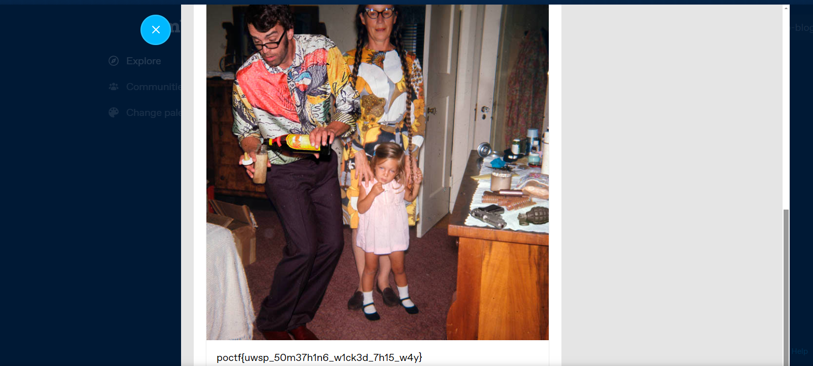

# Grifting Lonesome Widowers

| Detail | Value |
|--------|-------|
| **CTF** | Pointer Overflow CTF 2024 |
| **Category** | Relevance |
| **Difficulty** | Unknown |
| **Points** | N/A |
| **Flag** | `poctf{uwsp_50m37h1n6_w1ck3d_7h15_w4y}` |
| **Status** | Solved |

---

## Challenge Overview

A social engineering and platform identification challenge. The description creates a fictional persona (poker champion from Austin, Texas) and a blackmail scenario. Linguistic analysis of the threat message reveals the platform (Tumblr), and a username lookup finds the flag.

## Objective

Identify the social media platform from linguistic clues in the threat message, locate the adversary's profile, and retrieve the flag.

## Methodology

### Step 1: Decode the Pop Culture References

The description contains multiple layered references:
- **"$2,500 No-Limit Deuce to Seven Draw Tournament"** at the WSOP: this matches Kevin Malone from "The Office"
- **"Know when to hold'em and when to fold'em"**: Kenny Rogers, "The Gambler"
- **Tito's** vodka: made in Austin, Texas (location clue)

### Step 2: Analyze the Threat Message Language

The blackmail message contains platform-specific vocabulary:
- **"dash babe"** = dashboard (Tumblr terminology)
- **"notes"** = interactions on Tumblr
- **"Reblog"** = Tumblr's share feature
- **"main character"** = Tumblr culture language
- **"blorbos"** = Tumblr fandom slang

This clearly identifies the platform as **Tumblr**.

### Step 3: Find the Username

The message is signed by a user. Searching for the username `unlikelycreatortaco-blog` on Tumblr reveals a profile page.



### Step 4: Retrieve the Flag

The flag was found on the Tumblr blog.

```
Flag: poctf{uwsp_50m37h1n6_w1ck3d_7h15_w4y}
```

## Lessons Learned

| # | Lesson | Details |
|---|--------|---------|
| 1 | Platform fingerprinting | Each social media platform has unique terminology that can identify it from text alone |
| 2 | Cultural literacy in OSINT | Recognizing pop culture references (The Office, Kenny Rogers) provides context clues |
| 3 | Tumblr-specific vocabulary | "dashboard", "notes", "reblog", "blorbos" are distinctive Tumblr terms |
| 4 | Username pivoting | Once a platform is identified, username search tools (Sherlock, Namechk) locate profiles quickly |

## MITRE ATT&CK Mapping

| Tactic | Technique | ID | Details |
|--------|-----------|-----|---------|
| Reconnaissance | Search Open Websites/Domains | T1593 | Identifying and searching Tumblr platform |
| Reconnaissance | Gather Victim Identity Information | T1589 | Profiling the fictional persona from description clues |
| Reconnaissance | Search Victim-Owned Websites | T1594 | Locating the specific Tumblr blog |

## Remediation

### Technical Fixes

- Platform-specific jargon in messages can reveal the author's primary social media
- Username reuse across platforms enables cross-platform tracking
- Use unique usernames per platform to reduce OSINT surface

### MITRE D3FEND

| Technique | ID | How it applies |
|-----------|-----|----------------|
| User Account Monitoring | D3-UAM | Monitor for account impersonation or social engineering attempts |

### NIST CSF 2.0

| Function | Category | Relevance |
|----------|----------|-----------|
| Identify (ID) | Asset Management (ID.AM) | Track social media presence and exposure |
| Protect (PR) | Awareness and Training (PR.AT) | Train users to recognize social engineering language |

### NIST SP 800-53 Rev. 5

| Control | Description |
|---------|-------------|
| AT-2 | Security Awareness Training: social engineering recognition |
| IA-4 | Identifier Management: unique identifiers per platform |

### CWE

| CWE ID | Name | Relevance |
|--------|------|-----------|
| CWE-200 | Exposure of Sensitive Information to an Unauthorized Actor | Platform vocabulary revealing identity |

## References

- [UWSP Pointer Overflow CTF 2024](https://pointeroverflowctf.com)
- [Sherlock: Username Search](https://github.com/sherlock-project/sherlock)
- Based on solve approach from [shivang1209-dot](https://github.com/shivang1209-dot/CTF-Writeup)

---

Thanks guys!! (❍ᴥ❍ʋ)

The words people choose betray the platforms they inhabit. Learn the slang of every major social network; it is the fingerprint of digital culture.

[](https://www.instagram.com/uniaogeek)
[](http://linkedin.com/in/mrhenrike)
[](https://x.com/mrhenrike)
