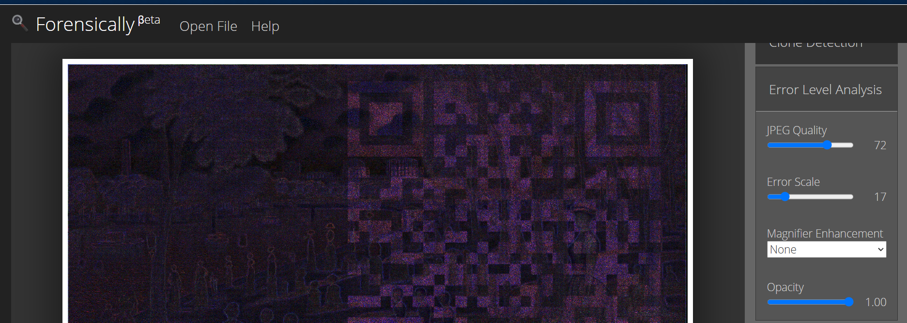
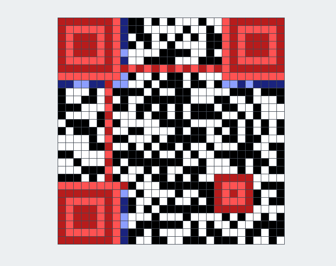
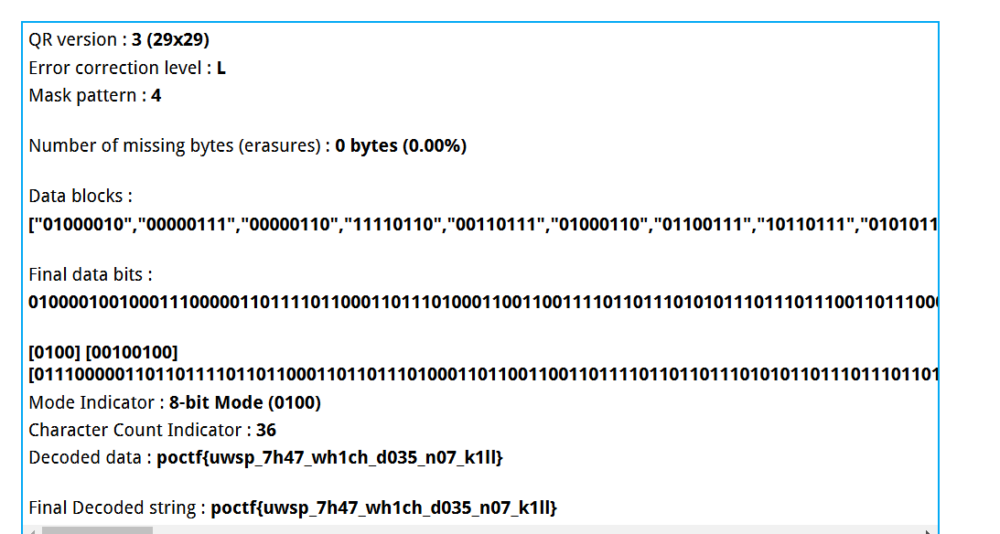

# Little Things Matter the Most

| Detail | Value |
|--------|-------|
| **CTF** | Pointer Overflow CTF 2024 |
| **Category** | Unknown |
| **Difficulty** | Unknown |
| **Points** | N/A |
| **Flag** | `poctf{uwsp_7h47_wh1ch_d035_n07_k1ll}` |
| **Status** | Solved |

---

## Challenge Overview

A PNG image styled after Seurat's pointillist painting *A Sunday Afternoon on the Island of La Grande Jatte* contains embedded PNG fragments that form a QR code. The challenge description hints at "little dots" and "backing up to see the big picture."

**File provided:** `Stego200-2.png`

---

## Objective

Discover and reconstruct the hidden QR code from embedded PNG data within the image, then scan it to reveal the flag.

---

## Methodology

### Step 1: Initial Analysis

Standard steganography tools (zsteg, stegsolve) did not reveal the flag directly. The image was then examined in Forensically for pixel-level anomalies.



### Step 2: Search for Embedded PNGs

A hex-level search for additional PNG headers within the file:

```bash
grep -abo "PNG" Stego200-2.png
```

```
1:PNG
25667216:PNG
31787609:PNG
48168936:PNG
66542125:PNG
```

Five PNG headers were found, indicating four additional images embedded within the main file.

### Step 3: Extract Embedded Images

Each embedded PNG was carved out using the offset markers. The extracted images contained fragments of a QR code, but none were individually scannable.

### Step 4: Reconstruct the QR Code

The QR code fragments were assembled manually using the noise patterns visible at each offset. The reconstructed QR code was assembled using online QR reconstruction tools.



### Step 5: Scan the QR Code

Scanning the reconstructed QR code revealed the flag.



---

## Flag

```
poctf{uwsp_7h47_wh1ch_d035_n07_k1ll}
```

---

## Lessons Learned

| # | Insight |
|---|---------|
| 1 | When standard stego tools fail, search for embedded file signatures at the hex level |
| 2 | Multiple embedded fragments may need manual reconstruction |
| 3 | Pointillism references hint at pixel-level and fragment-based hiding |
| 4 | QR codes are resilient and can be reconstructed from partial fragments |

---

## MITRE ATT&CK Mapping

| Tactic | Technique | Description |
|--------|-----------|-------------|
| Defense Evasion | T1027.003 - Obfuscated Files: Steganography | QR code fragments hidden within image data |
| Defense Evasion | T1027.005 - Obfuscated Files: Indicator Removal from Tools | Data split across multiple embedded images |

---

## Remediation

### Technical Fixes

- Implement deep file inspection that detects multiple file headers within a single file.
- Use file carving tools (foremost, scalpel) in automated analysis pipelines.
- Validate that image files contain only one image stream, rejecting files with embedded additional content.

### MITRE D3FEND

| ID | Technique |
|----|-----------|
| D3-FCR | File Content Rules: detect multi-header anomalies |
| D3-SFA | Static File Analysis |

### NIST CSF 2.0

| Function | Category | Action |
|----------|----------|--------|
| Detect | DE.CM | Deploy deep file inspection for embedded content |
| Protect | PR.DS | Validate file structure integrity at upload points |

### NIST SP 800-53 Rev. 5

| Control | Description |
|---------|-------------|
| SI-3 | Malicious Code Protection |
| SI-4 | Information System Monitoring |

### C2M2

| Practice | Description |
|----------|-------------|
| DETECT | Integrate file carving into forensic and DLP workflows |

### CWE

| ID | Description |
|----|-------------|
| CWE-506 | Embedded Malicious Code |
| CWE-434 | Unrestricted Upload of File with Dangerous Type |

---

## References

- [shivang1209-dot POCTF 2024 Writeups](https://github.com/shivang1209-dot/shivang1209-dot) (original reference)
- [Forensically](https://29a.ch/photo-forensics/)
- [Pointer Overflow CTF](https://pointeroverflowctf.com/)

---

Thanks guys!! (❍ᴥ❍ʋ)

Pontilhismo digital: fragmentos de QR code escondidos entre pixels, exatamente como Seurat faria se fosse hacker. A arte de ver o todo nas partes!

[](https://www.instagram.com/uniaogeek)
[](http://linkedin.com/in/mrhenrike)
[](https://x.com/mrhenrike)
