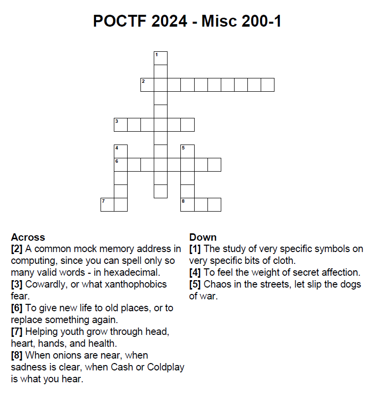

# My Name is Human

| Detail | Value |
|--------|-------|
| **CTF** | Pointer Overflow CTF 2024 |
| **Category** | Unknown |
| **Difficulty** | Unknown |
| **Points** | N/A |
| **Flag** | `poctf{uwsp_cry_h4v0c}` |
| **Status** | Solved |

---

## Challenge Overview

A miscellaneous challenge presented as a crossword puzzle. Solving the crossword provides a set of numbered answers, and a position mapping `poctf{uwsp_[8][6][3]_[5][7][1][2][4]}` determines which first letters compose the flag.

---

## Objective

Solve the crossword, extract the first letter of each answer, and apply the position mapping to assemble the flag.

---

## Methodology

### Step 1: Examine the crossword

The challenge provides a crossword grid image:



And the flag format: `poctf{uwsp_[8][6][3]_[5][7][1][2][4]}`

### Step 2: Solve the crossword

| Clue Direction | Number | Answer       | First Letter |
|---------------|--------|-------------|-------------|
| Across        | 2      | 0xDEADBEFF  | 0           |
| Across        | 3      | Yellow      | Y           |
| Across        | 6      | Renovate    | R           |
| Across        | 7      | 4H          | 4           |
| Across        | 8      | Cry         | C           |
| Down          | 1      | Vexillology | V           |
| Down          | 4      | Crush       | C           |
| Down          | 5      | Havoc       | H           |

### Step 3: Apply the position mapping

The flag format `[8][6][3]_[5][7][1][2][4]` maps to:

| Position | Number | Answer      | First Letter |
|----------|--------|-------------|-------------|
| [8]      | 8      | Cry         | C           |
| [6]      | 6      | Renovate    | R           |
| [3]      | 3      | Yellow      | Y           |
| [5]      | 5      | Havoc       | H           |
| [7]      | 7      | 4H          | 4           |
| [1]      | 1      | Vexillology | V           |
| [2]      | 2      | 0xDEADBEFF  | 0           |
| [4]      | 4      | Crush       | C           |

Result: `CRY_H4V0C` -> `cry_h4v0c`

---

## Flag

```
poctf{uwsp_cry_h4v0c}
```

---

## Lessons Learned

| # | Lesson | Detail |
|---|--------|--------|
| 1 | Position mappings reorder data | The numbered positions do not follow sequential order |
| 2 | First letters encode the message | Only the initial character of each answer matters |
| 3 | Crosswords combine knowledge domains | Answers span computing (0xDEADBEFF), organizations (4H), and vocabulary |
| 4 | The flag phrase has meaning | "Cry havoc" references Shakespeare's Julius Caesar |

---

## MITRE ATT&CK Mapping

| Tactic          | Technique                      | ID        |
|-----------------|--------------------------------|-----------|
| Defense Evasion | Obfuscated Files or Information| T1027     |
| Collection      | Data Obfuscation               | T1001     |

---

## Remediation

### Technical Fixes
- Steganographic and puzzle-based encoding provides no real security
- Use established encryption standards for protecting sensitive data
- Transposition and substitution ciphers are trivially reversible

### D3FEND Countermeasures
| Technique             | ID        |
|-----------------------|-----------|
| File Content Rules    | D3-FCR    |

### NIST CSF 2.0
| Function | Category                | Subcategory |
|----------|------------------------|-------------|
| Protect  | Data Security          | PR.DS-01    |

### NIST SP 800-53 Rev. 5
| Control     | Description                          |
|-------------|--------------------------------------|
| SC-28       | Protection of Information at Rest    |

### C2M2
| Practice Area               | MIL |
|-----------------------------|-----|
| Asset, Change and Configuration Management | MIL1 |

### CWE
| ID      | Name                                     |
|---------|------------------------------------------|
| CWE-261 | Weak Encoding for Password               |

---

## References

- Based on solve approach from [Jdwalli](https://github.com/Jdwalli/ctf-writeups)
- William Shakespeare, Julius Caesar, Act 3, Scene 1: "Cry 'Havoc!' and let slip the dogs of war"

---

## Closing

Thanks guys!! (❍ᴥ❍ʋ)

Cry havoc and let slip the flags of CTF! When letters become weapons and crosswords become battlefields, only the well-read solver survives. Shakespeare knew about steganography before it was cool.

[](https://www.instagram.com/uniaogeek)
[](http://linkedin.com/in/mrhenrike)
[](https://x.com/mrhenrike)
