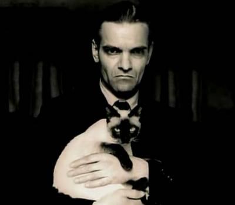
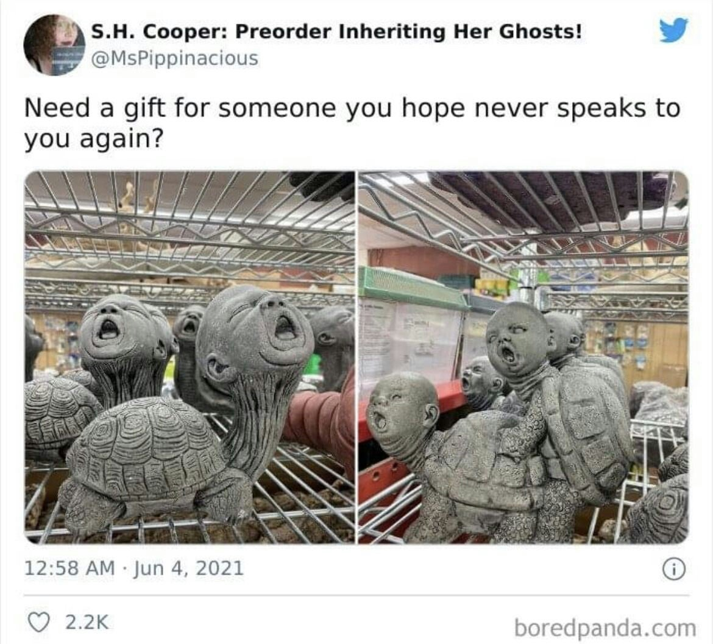
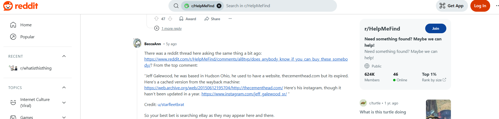
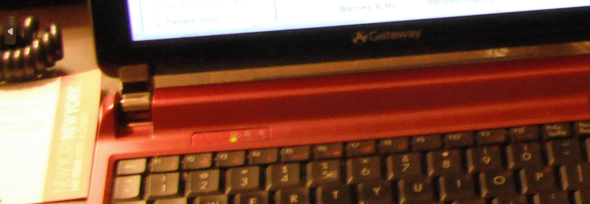

# Not All Secrets Are Exciting

| Property | Value |
|----------|-------|
| **CTF** | Pointer Overflow CTF 2024 (UWSP) |
| **Category** | OSINT |
| **Difficulty** | Hard |
| **Points** | 300 |
| **Status** | Solved |

## Challenge Overview

A three-part OSINT challenge requiring identification of a cat's name, an artist's last name, and a building's address. Each answer forms a segment of a VeraCrypt container password. Reverse image search, cultural research, and geolocation combine to unlock the encrypted container.

## Objective

Solve three independent OSINT sub-challenges, combine the answers into a composite password, and decrypt the VeraCrypt container to retrieve the flag.

## Methodology

### Part 1: Identify the Cat's Name

The first image shows a person holding a cat.



Reverse image search identified the person as **Yuri Knorozov**, the famous Soviet epigrapher who deciphered the Maya script. His cat's full name is **Aspid** (commonly nicknamed "Asya").

Password Part 1: `ASPID`

### Part 2: Identify the Artist

The second image shows a distinctive sculpture.



Reverse image search led to a Reddit thread identifying the artist as **Jeff Galewood**.



Password Part 2: `GALEWOOD`

### Part 3: Locate the Building

The third image shows an interior scene with clues pointing to a specific building.


Analysis revealed:
- A placard mentioning **New York**
- A notebook referencing **Las Vegas**
- The location was identified as **3790 S Las Vegas Blvd, Las Vegas, NV 89109**




From the address, the password part is the street number + five-digit zip code: `379089109`

Password Part 3: `379089109`

### Final Step: Decrypt the Container

Combined password: `ASPID-GALEWOOD-379089109`

```bash
veracrypt --text --password="ASPID-GALEWOOD-379089109" OSINT300-3 /mnt/veracrypt
```

```
Flag: poctf{uwsp_411_7h3_b357_p30p13}
```

## Lessons Learned

| # | Lesson | Details |
|---|--------|---------|
| 1 | Composite passwords | Multi-part challenges require solving each component independently before combining |
| 2 | Historical figure research | Academic and cultural figures have well-documented personal details, including pets |
| 3 | Art attribution via OSINT | Reddit, art databases, and reverse image search can identify artists from their work |
| 4 | Address format parsing | Reading challenge instructions carefully ("street number and five-digit zip code") is critical |

## MITRE ATT&CK Mapping

| Tactic | Technique | ID | Details |
|--------|-----------|-----|---------|
| Reconnaissance | Search Open Websites/Domains | T1593 | Reverse image search across Google, Reddit, Wikipedia |
| Reconnaissance | Gather Victim Org Information: Physical Locations | T1591.001 | Geolocating the building from interior clues |
| Credential Access | Brute Force: Password Guessing | T1110.001 | Assembling the composite password from OSINT data |

## Remediation

### Technical Fixes

- VeraCrypt provides strong encryption, but the password is only as strong as its derivation method
- Passwords composed of publicly researchable information (famous cats, artists, addresses) are OSINT-vulnerable
- Use randomly generated passwords and store them in a password manager

### MITRE D3FEND

| Technique | ID | How it applies |
|-----------|-----|----------------|
| Credential Hardening | D3-CH | Avoid passwords derived from publicly available OSINT data |
| File Encryption | D3-FE | VeraCrypt encryption is strong, but password strength is the weakest link |

### NIST CSF 2.0

| Function | Category | Relevance |
|----------|----------|-----------|
| Protect (PR) | Data Security (PR.DS) | Use strong, random passwords for encrypted volumes |
| Protect (PR) | Identity Management, Authentication and Access Control (PR.AA) | Passwords should not be derivable from public information |

### NIST SP 800-53 Rev. 5

| Control | Description |
|---------|-------------|
| IA-5 | Authenticator Management: require unpredictable passwords |
| SC-28 | Protection of Information at Rest: encryption password strength |

### C2M2

| Practice | Domain | Relevance |
|----------|--------|-----------|
| Access Management | ACCESS | Enforce strong authentication for encrypted storage |

### CWE

| CWE ID | Name | Relevance |
|--------|------|-----------|
| CWE-521 | Weak Password Requirements | Composite password from publicly researchable facts |
| CWE-330 | Use of Insufficiently Random Values | Password components are deterministic and researachable |

## References

- [UWSP Pointer Overflow CTF 2024](https://pointeroverflowctf.com)
- [Yuri Knorozov (Wikipedia)](https://en.wikipedia.org/wiki/Yuri_Knorozov)
- [VeraCrypt](https://www.veracrypt.fr/)
- Based on solve approach from [shivang1209-dot](https://github.com/shivang1209-dot/CTF-Writeup)

---

Thanks guys!! (❍ᴥ❍ʋ)

Not all secrets are exciting, but all secrets are researchable. When OSINT meets cryptography, the password is never truly random if a human chose it.

[](https://www.instagram.com/uniaogeek)
[](http://linkedin.com/in/mrhenrike)
[](https://x.com/mrhenrike)
