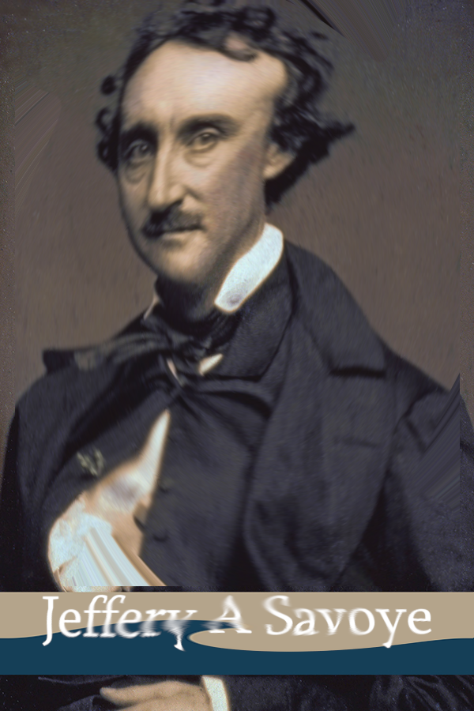

# Novel Means of Lying

| Detail | Value |
|--------|-------|
| **CTF** | Pointer Overflow CTF 2024 |
| **Category** | Relevance |
| **Difficulty** | Unknown |
| **Points** | N/A |
| **Flag** | `poctf{uwsp_7h3_r4v3n_n3v3rm0r3}` |
| **Status** | Solved |

---

## Challenge Overview

A multi-step OSINT challenge themed around Halloween and horror. A swirled image must be reversed to identify a historical figure, then research a commemorative event to find a keynote speaker whose work phone number unlocks the flag archive.

## Objective

Reverse the image distortion, identify the subject, research a special anniversary event in October 2024, and find the keynote speaker's work phone number to unlock the archive.

## Methodology

### Step 1: Reverse the Image Distortion

The provided image (`OSINT100-2.png`) has a swirl distortion applied. Using GIMP's Whirl and Pinch filter with reversed parameters:

- Central area: Whirl = -563.2, Radius = 0.977
- Bottom text area: Whirl = -200.2, Radius = 0.98

The reversed image reveals a portrait of **Edgar Allan Poe** and associated text mentioning **Jeffrey A. Savoye**.




### Step 2: Research the Connection

- **Edgar Allan Poe**: famous American writer, known for horror and mystery
- **Jeffrey A. Savoye**: associated with the **Edgar Allan Poe Society of Baltimore**
- October 2024 marks a special anniversary: the 175th anniversary of Poe's death (October 7, 1849)

### Step 3: Find the Keynote Speaker

The Edgar Allan Poe Society of Baltimore held a commemorative event on **October 6, 2024**. The keynote speaker was **Ashley Kniss**.

### Step 4: Find the Work Phone Number

Searching for Ashley Kniss's professional contact information (likely through her academic institution profile) reveals her work phone: `443-352-4039`.

### Step 5: Unlock the Archive

Using `443-352-4039` as the password for `OSINT100-2.zip`:

```
Flag: poctf{uwsp_7h3_r4v3n_n3v3rm0r3}
```

## Lessons Learned

| # | Lesson | Details |
|---|--------|---------|
| 1 | Image manipulation reversal | Swirl distortions can be reversed with the same tool using negative parameters |
| 2 | Event research | Cultural and literary societies hold commemorative events that are publicly documented |
| 3 | OSINT chaining | Each step depends on the previous: image reversal, person identification, event research, contact lookup |
| 4 | Public contact info | Academic and professional phone numbers are often publicly listed |

## MITRE ATT&CK Mapping

| Tactic | Technique | ID | Details |
|--------|-----------|-----|---------|
| Reconnaissance | Search Open Technical Databases | T1596 | Researching Edgar Allan Poe Society events |
| Reconnaissance | Gather Victim Identity Information: Email Addresses | T1589.002 | Finding keynote speaker's contact information |
| Reconnaissance | Search Open Websites/Domains | T1593 | Locating academic profiles and phone numbers |

## Remediation

### Technical Fixes

- Image obfuscation (swirl, blur) is reversible and should not be trusted for redaction
- Use proper redaction tools that permanently remove data from images
- Avoid using publicly discoverable phone numbers as passwords

### MITRE D3FEND

| Technique | ID | How it applies |
|-----------|-----|----------------|
| Credential Hardening | D3-CH | Never use publicly available information as authentication secrets |

### NIST CSF 2.0

| Function | Category | Relevance |
|----------|----------|-----------|
| Protect (PR) | Data Security (PR.DS) | Properly redact sensitive information in shared images |
| Identify (ID) | Asset Management (ID.AM) | Understand what information is publicly accessible |

### NIST SP 800-53 Rev. 5

| Control | Description |
|---------|-------------|
| IA-5 | Authenticator Management: do not use publicly available data as passwords |
| SC-28 | Protection of Information at Rest: proper redaction before sharing |

### CWE

| CWE ID | Name | Relevance |
|--------|------|-----------|
| CWE-521 | Weak Password Requirements | Publicly available phone number used as password |
| CWE-200 | Exposure of Sensitive Information to an Unauthorized Actor | Reversible image obfuscation |

## References

- [UWSP Pointer Overflow CTF 2024](https://pointeroverflowctf.com)
- [Edgar Allan Poe Society of Baltimore](https://www.eapoe.org/)
- Based on solve approach from [shivang1209-dot](https://github.com/shivang1209-dot/CTF-Writeup)

---

Thanks guys!! (❍ᴥ❍ʋ)

Quoth the Raven, "Nevermore." But in OSINT, everything that was once public lives on forever.

[](https://www.instagram.com/uniaogeek)
[](http://linkedin.com/in/mrhenrike)
[](https://x.com/mrhenrike)
