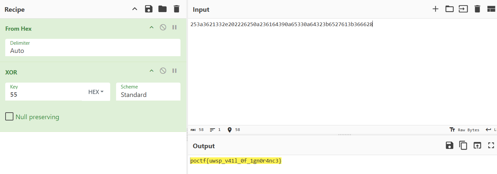

# Overall a Flop

| Detail | Value |
|--------|-------|
| **CTF** | Pointer Overflow CTF 2024 |
| **Challenge** | Overall a Flop |
| **Category** | Cryptography |
| **Difficulty** | Hard |
| **Points** | 300 |
| **Status** | Solved |

---

## Challenge Overview

The challenge presents an ECC (secp256r1) public key and a ciphertext that appears to be hex-encoded. Despite the ECC framing, the actual encryption is a simple XOR cipher disguised behind cryptographic terminology.

**Ciphertext:**

```
8a258a3a8a368a218a338a2e8a208a228a268a258a0a8a238a618a648a398a0a8a658a338a0a8a648a328a3b8a658a278a618a3b8a368a668a28
```

---

## Objective

Look past the ECC misdirection, identify the true encoding scheme, and recover the flag.

---

## Methodology

### Step 1: Analyze the Ciphertext Structure

The ciphertext has a repetitive `8a` pattern appearing every two bytes. This is a strong indicator that the "encryption" is much simpler than ECC.

Splitting by the `8a` marker:

```
25, 3a, 36, 21, 33, 2e, 20, 22, 26, 25, 0a, 23, 61, 64, 39, 0a, 65, 33, 0a, 64, 32, 3b, 65, 27, 61, 3b, 36, 66, 28
```

### Step 2: Known Plaintext XOR

Knowing the flag starts with `poctf{uwsp_`, XOR the first bytes of the extracted data with the known plaintext:

```
0x25 XOR ord('p') = 0x25 XOR 0x70 = 0x55
0x3a XOR ord('o') = 0x3a XOR 0x6f = 0x55
0x36 XOR ord('c') = 0x36 XOR 0x63 = 0x55
```

The XOR key is consistently `0x55` (decimal 85).

### Step 3: Decrypt with Key 0x55

XOR every extracted byte with `0x55` to recover the full plaintext. This can be done quickly in CyberChef or with a one-liner:

```python
data = [0x25,0x3a,0x36,0x21,0x33,0x2e,0x20,0x22,0x26,0x25,0x0a,0x23,0x61,0x64,0x39,0x0a,0x65,0x33,0x0a,0x64,0x32,0x3b,0x65,0x27,0x61,0x3b,0x36,0x66,0x28]
print(''.join(chr(b ^ 0x55) for b in data))
```



---

## Flag

```
poctf{uwsp_v41l_0f_1gn0r4nc3}
```

---

## Lessons Learned

| # | Insight |
|---|---------|
| 1 | Repetitive byte patterns in ciphertext are a strong indicator of simple XOR |
| 2 | Don't be misled by complex-sounding descriptions (ECC); analyze the data first |
| 3 | Known plaintext attacks are devastating against XOR ciphers |
| 4 | The challenge title "Overall a Flop" hints that the ECC approach was a red herring |

---

## MITRE ATT&CK Mapping

| Tactic | Technique | Description |
|--------|-----------|-------------|
| Defense Evasion | T1027 - Obfuscated Files or Information | XOR encoding masquerading as ECC encryption |
| Defense Evasion | T1140 - Deobfuscate/Decode Files or Information | Single-byte XOR decryption |

---

## Remediation

### Technical Fixes

- Single-byte XOR is not encryption. It provides zero confidentiality against known-plaintext attacks.
- If using ECC, implement proper ECIES (Elliptic Curve Integrated Encryption Scheme) rather than XOR.
- Always validate that cryptographic implementations match their claimed algorithm.

### MITRE D3FEND

| ID | Technique |
|----|-----------|
| D3-FCOA | File Content Analysis: detect XOR-encoded payloads |

### NIST CSF 2.0

| Function | Category | Action |
|----------|----------|--------|
| Protect | PR.DS | Use authenticated encryption, not XOR obfuscation |

### NIST SP 800-53 Rev. 5

| Control | Description |
|---------|-------------|
| SC-13 | Cryptographic Protection: FIPS-validated algorithms only |

### C2M2

| Practice | Description |
|----------|-------------|
| PROTECT | Audit cryptographic implementations for correctness |

### CWE

| ID | Description |
|----|-------------|
| CWE-327 | Use of a Broken or Risky Cryptographic Algorithm |
| CWE-261 | Weak Encoding for Password |

---

## References

- [shivang1209-dot POCTF 2024 Writeups](https://github.com/shivang1209-dot/shivang1209-dot) (original reference)
- [CyberChef](https://gchq.github.io/CyberChef/)
- [Pointer Overflow CTF](https://pointeroverflowctf.com/)

---

Thanks guys!! (❍ᴥ❍ʋ)

Quando o challenge fala em ECC mas entrega XOR: as aparencias enganam, mas os bytes nunca mentem!

[](https://www.instagram.com/uniaogeek)
[](http://linkedin.com/in/mrhenrike)
[](https://x.com/mrhenrike)
