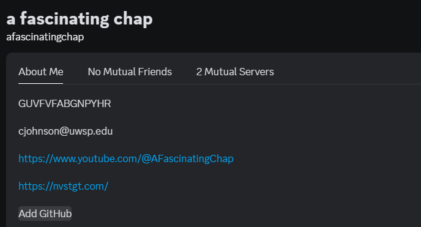
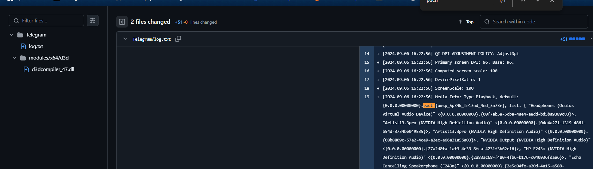

# Seen and Then Forgotten

| Property | Value |
|----------|-------|
| **CTF** | Pointer Overflow CTF 2024 (UWSP) |
| **Category** | OSINT |
| **Difficulty** | Easy |
| **Points** | 100 |
| **Status** | Solved |

## Challenge Overview

An OSINT challenge where the target is the CTF organizer, Prof. Johnson. The trail starts on Discord, leads to a GitHub profile, and the flag is hidden in the commit history of a public repository.

## Objective

Follow the breadcrumb trail from Discord to GitHub and locate the flag within the commit history.

## Methodology

### Step 1: Investigate the Discord Profile

Starting from Prof. Johnson's Discord profile on the POCTF server, found a linked GitHub account.



### Step 2: Explore the GitHub Profile

Navigated to the linked GitHub profile and explored the public repositories and their commit histories.

### Step 3: Search Commit History

Searched the commit history for the flag format `poctf{`:

```bash
# Conceptually, searching through commit messages and diffs:
git log --all --oneline | grep -i poctf
git log --all -p | grep -i poctf
```

### Step 4: Locate the Flag

Found a commit that included the flag text in the diff or commit message.



```
Flag: poctf{uwsp_5p34k_fr13nd_4nd_3n73r}
```

## Lessons Learned

| # | Lesson | Details |
|---|--------|---------|
| 1 | Git history is permanent | Commits are never truly deleted from public repos; even reverted changes persist in history |
| 2 | Cross-platform OSINT | Social platforms often link to other profiles, creating traceable chains |
| 3 | Commit message searching | `git log -p` and GitHub's search can reveal secrets accidentally committed |
| 4 | Digital footprint awareness | Every linked account expands the attack surface for OSINT |

## MITRE ATT&CK Mapping

| Tactic | Technique | ID | Details |
|--------|-----------|-----|---------|
| Reconnaissance | Search Open Websites/Domains | T1593 | Following Discord profile links to GitHub |
| Reconnaissance | Search Victim-Owned Websites | T1594 | Exploring public GitHub repositories |
| Credential Access | Unsecured Credentials: Credentials In Files | T1552.001 | Flag found in git commit history |

## Remediation

### Technical Fixes

- Use `git-secrets` or `gitleaks` to prevent committing sensitive data
- If secrets are committed, use `git filter-branch` or BFG Repo-Cleaner to rewrite history
- Minimize cross-platform profile linking when operational security matters
- Audit linked accounts on social platforms

### MITRE D3FEND

| Technique | ID | How it applies |
|-----------|-----|----------------|
| File Content Rules | D3-FCR | Scan commits for sensitive patterns before pushing |

### NIST CSF 2.0

| Function | Category | Relevance |
|----------|----------|-----------|
| Protect (PR) | Data Security (PR.DS) | Prevent accidental exposure of secrets in version control |
| Identify (ID) | Asset Management (ID.AM) | Track what information is publicly visible across platforms |

### NIST SP 800-53 Rev. 5

| Control | Description |
|---------|-------------|
| CM-7 | Least Functionality: remove sensitive data from public repositories |
| SC-28 | Protection of Information at Rest: do not store secrets in VCS |

### CWE

| CWE ID | Name | Relevance |
|--------|------|-----------|
| CWE-540 | Inclusion of Sensitive Information in Source Code | Flag committed to public repository |
| CWE-200 | Exposure of Sensitive Information to an Unauthorized Actor | Public git history containing secrets |

## References

- [UWSP Pointer Overflow CTF 2024](https://pointeroverflowctf.com)
- Based on solve approach from [shivang1209-dot](https://github.com/shivang1209-dot/CTF-Writeup)

---

Thanks guys!! (❍ᴥ❍ʋ)

Git never forgets. If it was committed once, it exists somewhere in the history. Always audit your repos with tools like gitleaks before going public.

[](https://www.instagram.com/uniaogeek)
[](http://linkedin.com/in/mrhenrike)
[](https://x.com/mrhenrike)
