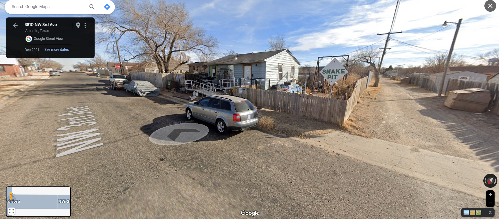
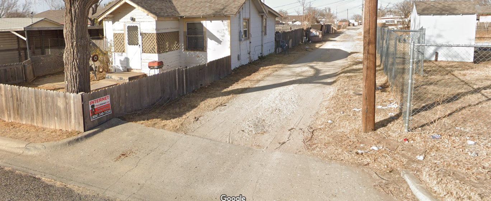

# Something to Say About It

| Property | Value |
|----------|-------|
| **CTF** | Pointer Overflow CTF 2024 (UWSP) |
| **Category** | OSINT |
| **Difficulty** | Medium |
| **Points** | 200 |
| **Status** | Solved |

## Challenge Overview

A geolocation challenge involving a "snake pit" sign. EXIF metadata in the challenge images contains GPS coordinates and textual hints. The objective is to find a phone number on a sign near the snake pit location and use it to unlock the flag archive.

## Objective

Extract EXIF data from the provided images, geolocate the snake pit sign, find a phone number on a nearby sign, and use it to unlock the archive.

## Methodology

### Step 1: Analyze Image Metadata

Extracted EXIF data from the first image, revealing critical information:

- Hints in metadata:
  1. "There are no snakes in Ireland, so the sign isn't there."
  2. "The sign is written in English, but is not in England."
- GPS coordinates: `43°46'10.6"N 88°26'29.4"W`
- Converted to decimal: `43.76961111°, -88.44150000°`

```bash
exiftool OSINT200-1_first.jpg
```

### Step 2: Locate the Scene

The coordinates point to the area near **San Jacinto, Amarillo, Texas**. Using Google Maps, explored the area to match the images.

The "snake dumping pit" sign and the yellow surroundings in the zoomed-out image confirmed the location near **3810 NW 3rd Ave**.



### Step 3: Find the Phone Number

Using Google Street View, examined the area around the snake pit sign. Found a **phone number** on a nearby sign: `806-340-7320`.



### Step 4: Unlock the Archive

Entered the phone number without formatting as the password: `8063407320`.

```
Flag: poctf{uwsp_f07r7un3_f4v0r5_7h3_b01d}
```

## Lessons Learned

| # | Lesson | Details |
|---|--------|---------|
| 1 | EXIF metadata is gold | GPS coordinates and custom comments in image metadata can pinpoint exact locations |
| 2 | Negative clues matter | "Not Ireland", "not England" narrows the search significantly |
| 3 | Street View exploration | Once at the right coordinates, virtual exploration reveals details not in the original images |
| 4 | Coordinate conversion | GPS coordinates in DMS format must be converted to decimal for map tools |

## MITRE ATT&CK Mapping

| Tactic | Technique | ID | Details |
|--------|-----------|-----|---------|
| Reconnaissance | Search Open Websites/Domains | T1593 | Using Google Maps and Street View for geolocation |
| Reconnaissance | Gather Victim Org Information: Physical Locations | T1591.001 | GPS coordinate analysis from EXIF data |
| Collection | Data from Information Repositories | T1213 | Extracting metadata from provided images |

## Remediation

### Technical Fixes

- Always strip EXIF data before sharing images publicly (use `exiftool -all= image.jpg`)
- GPS coordinates in metadata directly reveal where a photo was taken
- Even custom EXIF comments can leak information

### MITRE D3FEND

| Technique | ID | How it applies |
|-----------|-----|----------------|
| File Content Rules | D3-FCR | Strip metadata from images before distribution |

### NIST CSF 2.0

| Function | Category | Relevance |
|----------|----------|-----------|
| Protect (PR) | Data Security (PR.DS) | Remove metadata from images before sharing |
| Identify (ID) | Asset Management (ID.AM) | Audit what metadata is embedded in shared files |

### NIST SP 800-53 Rev. 5

| Control | Description |
|---------|-------------|
| SC-28 | Protection of Information at Rest: strip metadata from published files |
| RA-5 | Vulnerability Monitoring and Scanning: check for metadata leaks |

### CWE

| CWE ID | Name | Relevance |
|--------|------|-----------|
| CWE-200 | Exposure of Sensitive Information to an Unauthorized Actor | GPS coordinates leaked via EXIF metadata |

## References

- [UWSP Pointer Overflow CTF 2024](https://pointeroverflowctf.com)
- [ExifTool by Phil Harvey](https://exiftool.org/)
- Based on solve approach from [shivang1209-dot](https://github.com/shivang1209-dot/CTF-Writeup)

---

Thanks guys!! (❍ᴥ❍ʋ)

Always check the metadata first. EXIF data is the low-hanging fruit of OSINT, and it is surprising how often it goes unstripped.

[](https://www.instagram.com/uniaogeek)
[](http://linkedin.com/in/mrhenrike)
[](https://x.com/mrhenrike)
