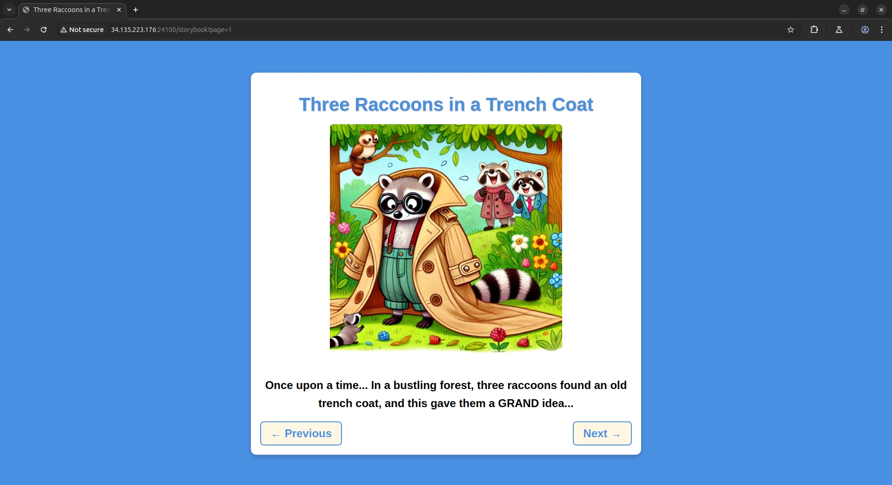
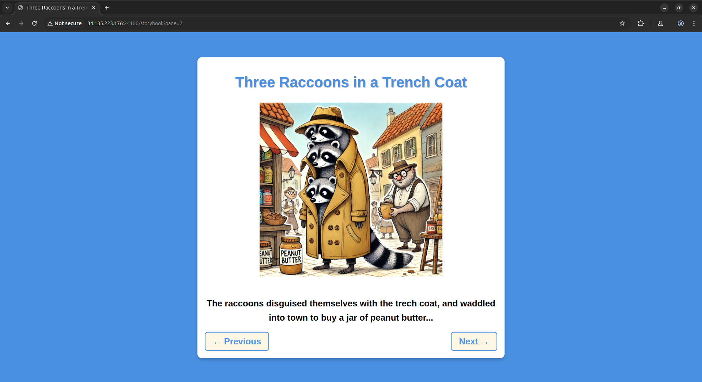
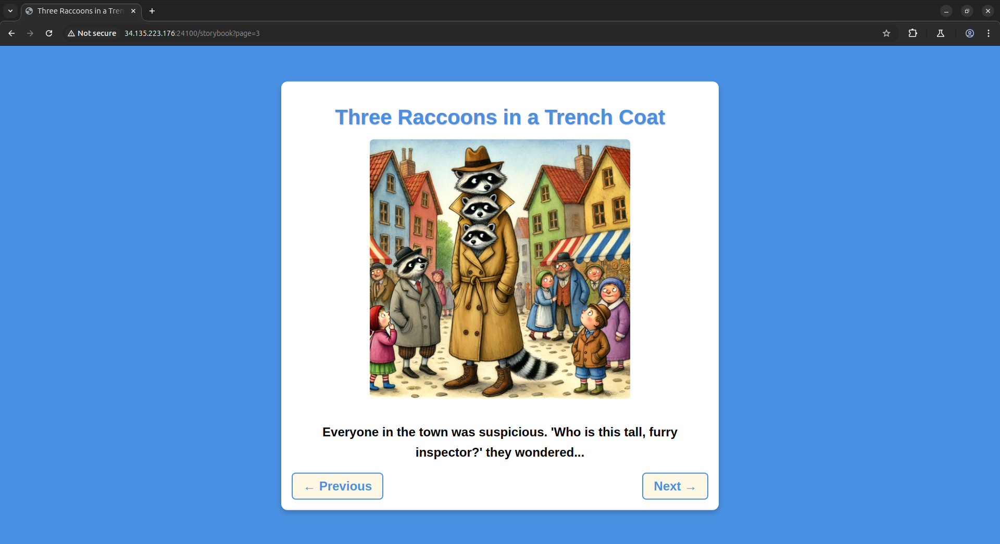
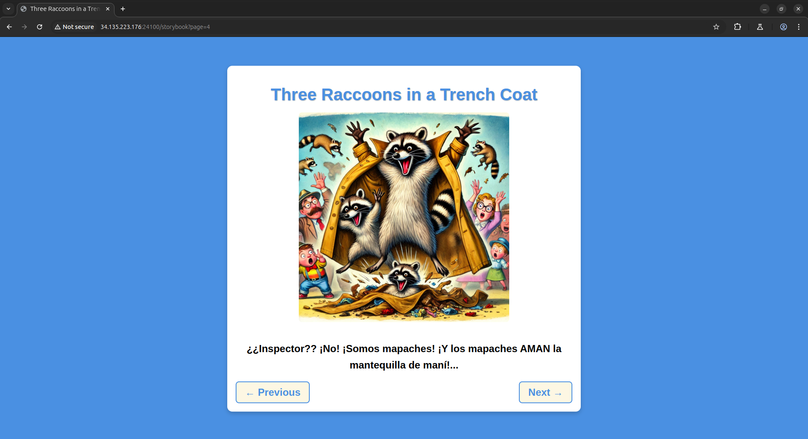
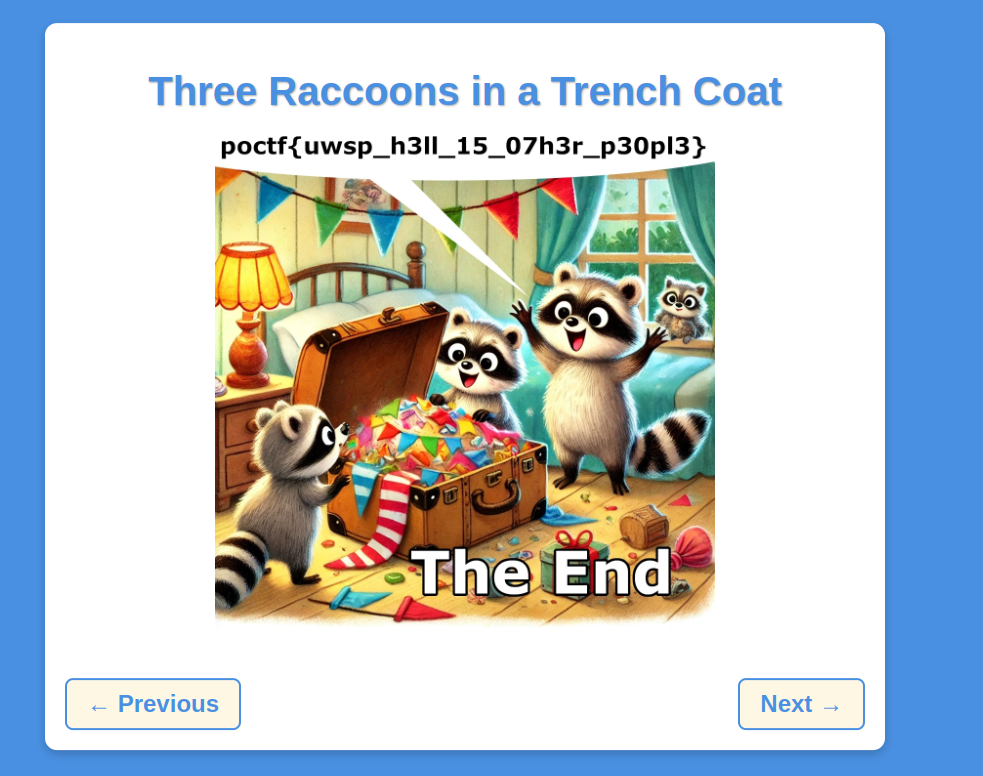

# Three Raccoons in a Trench Coat

| Detail | Value |
|--------|-------|
| **CTF** | Pointer Overflow CTF 2024 |
| **Category** | ID |
| **Difficulty** | Unknown |
| **Points** | N/A |
| **Flag** | `poctf{uwsp_h3ll_15_07h3r_p30pl3}` |
| **Status** | Solved |

---

## Challenge Overview

A web challenge featuring an interactive storybook with a `page` URL parameter. The first three pages are accessible via the navigation buttons, but a fourth hidden page exists at `page=4`. Using `ffuf` to fuzz the parameter reveals an `archive` page containing the flag embedded in an image.

---

## Objective

Discover hidden pages by fuzzing the `page` URL parameter and extract the flag from the archive page.

---

## Methodology

### Step 1: Explore the storybook

The challenge URL follows the pattern:

```
http://<host>/storybook?page=1
```

Clicking "Next" navigates through pages 1, 2, and 3. On page 3, the "Next" button loops back to the same page.

  

### Step 2: Test the parameter manually

Manually setting `page=4` reveals a hidden fourth page:



Setting `page=5` returns a 404 with the message: `The raccoons don't recognize this path!`

### Step 3: Fuzz the parameter with ffuf

To discover all valid values, use `ffuf` to brute-force the `page` parameter:

```bash
ffuf -u "http://<host>/storybook?page=FUZZ" \
     -w /usr/share/dirbuster/wordlists/directory-list-2.3-small.txt \
     -o results.json -mc 200 -rate 3
```

The rate limit is set to 3 requests/second because the server returns 429 (Too Many Requests) above 200 requests/minute.

Results:

```
1       [Status: 200, Size: 3144]
2       [Status: 200, Size: 3136]
3       [Status: 200, Size: 3117]
4       [Status: 200, Size: 3116]
14      [Status: 200, Size: 3215]
archive [Status: 200, Size: 3036]
```

### Step 4: Access the archive page

Navigating to `?page=archive` reveals a special page with the raccoons and the flag:



---

## Flag

```
poctf{uwsp_h3ll_15_07h3r_p30pl3}
```

---

## Lessons Learned

| # | Lesson | Detail |
|---|--------|--------|
| 1 | Parameters accept non-numeric values | URL parameters can take string values, not just integers |
| 2 | Rate limiting requires patience | Aggressive fuzzing triggers 429 errors |
| 3 | Hidden pages exist beyond navigation | UI navigation does not expose all valid routes |
| 4 | ffuf is effective for parameter fuzzing | Word lists can uncover unexpected parameter values |

---

## MITRE ATT&CK Mapping

| Tactic          | Technique                          | ID        |
|-----------------|------------------------------------|-----------|
| Discovery       | Application Layer Protocol         | T1071     |
| Reconnaissance  | Active Scanning: Vulnerability Scanning | T1595.002 |
| Initial Access  | Exploit Public-Facing Application  | T1190     |

---

## OWASP Top 10 2021 Mapping

| Category | ID    | Relevance |
|----------|-------|-----------|
| Broken Access Control     | A01:2021 | Hidden page accessible without authentication |
| Security Misconfiguration | A05:2021 | Sensitive page exposed via predictable parameter |

---

## Remediation

### Technical Fixes
- Implement proper authentication for sensitive pages
- Validate and whitelist acceptable parameter values
- Use rate limiting with progressive backoff
- Do not expose hidden content through guessable parameters

### OWASP Top 10 2021
- **A01 Broken Access Control**: require authentication for archive/admin pages
- **A05 Security Misconfiguration**: restrict parameter values to an explicit allowlist

### D3FEND Countermeasures
| Technique                  | ID        |
|----------------------------|-----------|
| Network Traffic Filtering  | D3-NTF    |
| Application Hardening      | D3-AH     |

### NIST CSF 2.0
| Function | Category                | Subcategory |
|----------|------------------------|-------------|
| Protect  | Identity Management and Access Control | PR.AA-01 |
| Detect   | Security Continuous Monitoring | DE.CM-01 |

### NIST SP 800-53 Rev. 5
| Control     | Description                          |
|-------------|--------------------------------------|
| AC-3        | Access Enforcement                   |
| SI-10       | Information Input Validation         |

### C2M2
| Practice Area               | MIL |
|-----------------------------|-----|
| Access Management           | MIL2 |

### CWE
| ID      | Name                                     |
|---------|------------------------------------------|
| CWE-284 | Improper Access Control                  |
| CWE-425 | Direct Request (Forced Browsing)         |

---

## References

- Based on solve approach from [Jdwalli](https://github.com/Jdwalli/ctf-writeups)
- [ffuf](https://github.com/ffuf/ffuf)
- [OWASP Top 10 2021](https://owasp.org/Top10/)

---

## Closing

Thanks guys!! (❍ᴥ❍ʋ)

Hell is other people, and also rate-limited endpoints when you're trying to fuzz them. Three raccoons taught us that blending in is overrated: sometimes you just need to ask for the archive page directly.

[](https://www.instagram.com/uniaogeek)
[](http://linkedin.com/in/mrhenrike)
[](https://x.com/mrhenrike)
