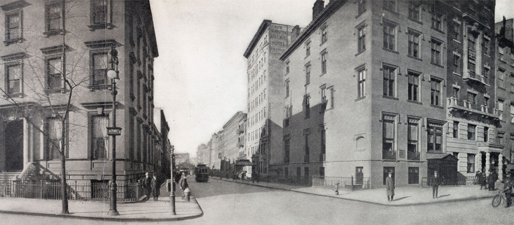
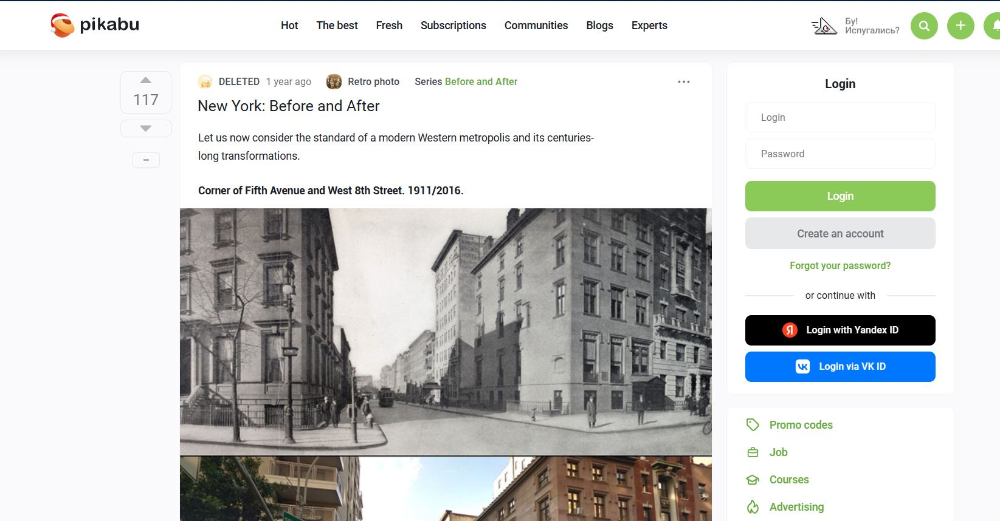
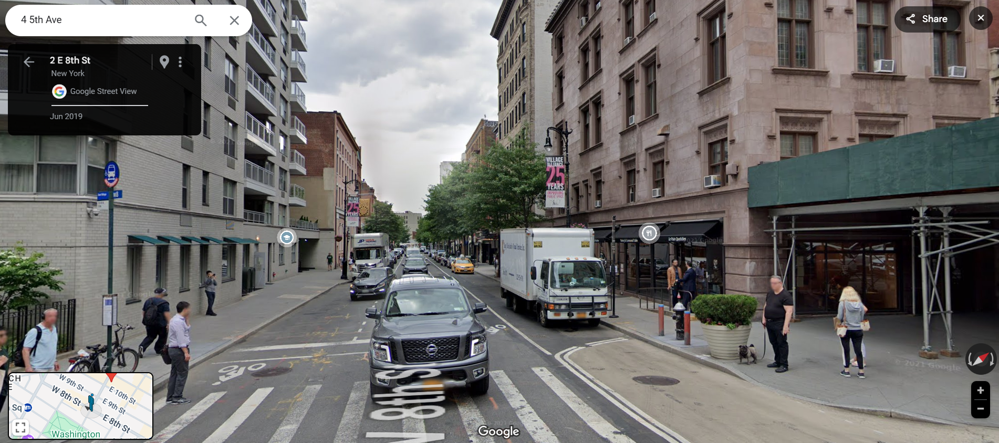
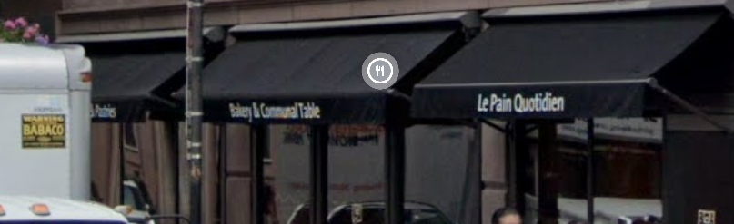

# Who Can It Be Now

| Detail | Value |
|--------|-------|
| **CTF** | Pointer Overflow CTF 2024 |
| **Category** | Relevance |
| **Difficulty** | Unknown |
| **Points** | N/A |
| **Flag** | `poctf{uwsp_l3_p41n_qu071d13n}` |
| **Status** | Solved |

---

## Challenge Overview

A historical photo geolocation challenge. An old photograph must be identified and matched to its modern location using reverse image search and Google Street View. The flag is derived from the text on a bakery's awning at the intersection.

## Objective

Identify the location in a historical photograph, find the modern equivalent, and read the awning text on a specific business at the intersection.

## Methodology

### Step 1: Reverse Image Search

Performed a reverse image lookup on the provided historical photograph.



Found an exact match on a website that compares historical and modern views of the same locations.



### Step 2: Identify the Street

Used Google Images to confirm the location and find its current-day appearance.



### Step 3: Locate the Awning

Inspected the Google Street View of the intersection for a business with a "rustic chic style" and identified the bakery's awning closest to the intersection.

### Step 4: Read the Awning Text

The awning reads: **"Le Pain Quotidien"** (a Belgian bakery chain meaning "The Daily Bread").



### Step 5: Format the Flag

Applied the CTF's leetspeak alphabet rules to convert the text:

```
Le Pain Quotidien → l3_p41n_qu071d13n
```

```
Flag: poctf{uwsp_l3_p41n_qu071d13n}
```

## Lessons Learned

| # | Lesson | Details |
|---|--------|---------|
| 1 | Historical OSINT | Comparing old photographs with modern Street View is a core OSINT geolocation technique |
| 2 | Reverse image search variants | Different cropping and search engines yield different results |
| 3 | Street View exploration | Virtually walking around an identified location reveals details not visible in the initial image |
| 4 | Encoding schemes | CTFs often use consistent encoding (leetspeak) that must be applied correctly |

## MITRE ATT&CK Mapping

| Tactic | Technique | ID | Details |
|--------|-----------|-----|---------|
| Reconnaissance | Search Open Websites/Domains | T1593 | Reverse image search for location identification |
| Reconnaissance | Gather Victim Org Information: Physical Locations | T1591.001 | Geolocating the photographed intersection |

## Remediation

### Technical Fixes

- Geolocation from photographs is a well-known OSINT technique
- Remove EXIF data and identifiable landmarks before sharing sensitive location photos
- Be aware that historical photo archives can be cross-referenced with modern imagery

### MITRE D3FEND

| Technique | ID | How it applies |
|-----------|-----|----------------|
| File Content Rules | D3-FCR | Strip metadata from images before publication |

### NIST CSF 2.0

| Function | Category | Relevance |
|----------|----------|-----------|
| Identify (ID) | Asset Management (ID.AM) | Understand what location data is embedded in shared photos |

### NIST SP 800-53 Rev. 5

| Control | Description |
|---------|-------------|
| SC-28 | Protection of Information at Rest: strip location metadata from published images |

### CWE

| CWE ID | Name | Relevance |
|--------|------|-----------|
| CWE-200 | Exposure of Sensitive Information to an Unauthorized Actor | Geolocation data derivable from shared photos |

## References

- [UWSP Pointer Overflow CTF 2024](https://pointeroverflowctf.com)
- [Le Pain Quotidien](https://www.lepainquotidien.com/)
- Based on solve approach from [shivang1209-dot](https://github.com/shivang1209-dot/CTF-Writeup)

---

Thanks guys!! (❍ᴥ❍ʋ)

A single photograph can reveal more than you think. From architectural details to storefront text, every pixel tells a story.

[](https://www.instagram.com/uniaogeek)
[](http://linkedin.com/in/mrhenrike)
[](https://x.com/mrhenrike)
